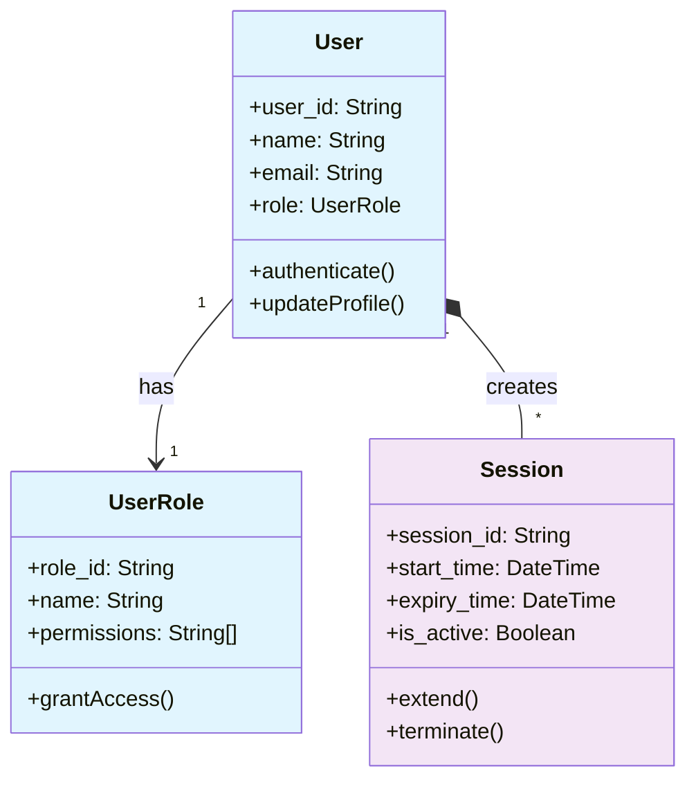
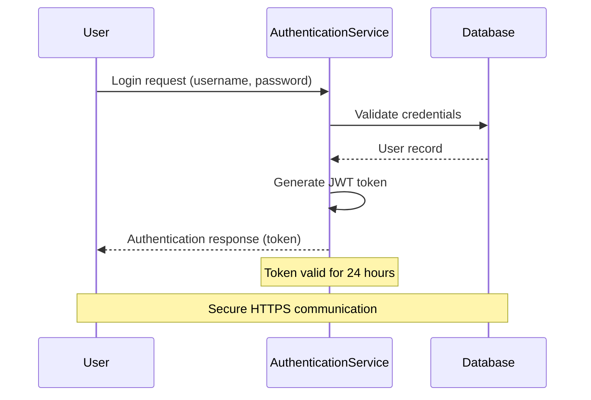
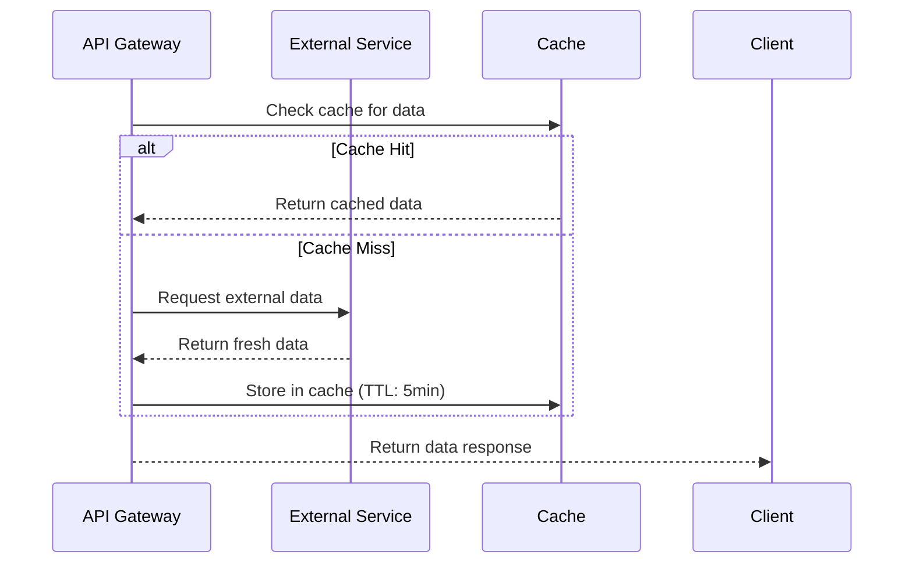
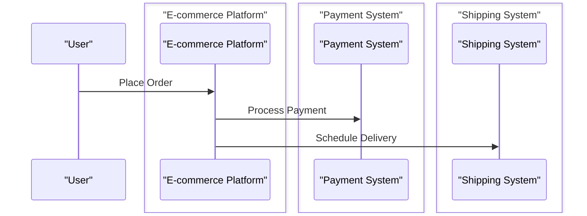

# Collaboration Diagrams — Output Format

The complete templates for `collaboration-diagrams.md` and `collaboration-diagrams.json`. Values shown are illustrative.

### Markdown Structure (`collaboration-diagrams.md`)
```markdown
# Collaboration Diagrams

**Project**: [project_id]  
**Generated**: [timestamp]  
**Source**: domain-concepts.json, requirements.json

## Domain Class Model

### Entity Relationship Overview *(Diagram D-001)*
**Source Requirements**: [R-001], [R-003]  
**Domain Source**: orgModel/01-skill-dev/domain-model.md



## User-System Interactions

### Authentication Flow *(Diagram D-002)*
**Source Requirements**: [R-001], [R-003]  
**Entities Involved**: User, AuthenticationService, Database




### [Additional User-System Diagrams...]

## System-System Interactions

### API Integration Flow *(Diagram D-002)*
**Source Requirements**: [R-005], [R-007]  
**Entities Involved**: APIGateway, ExternalService, Cache



### [Additional System-System Diagrams...]

## Hierarchical Collaboration Diagrams

### System Boundary View *(Diagram D-005)*
**Source Requirements**: [R-010]
**Decomposition**: `01-ECommerce-Platform/collaboration.md`



## Process Workflows

### [Business Process Diagrams...]
```

### JSON Structure (`collaboration-diagrams.json`)
```json
{
  "project_id": "string",
  "generation_metadata": {
    "generated_at": "ISO8601",
    "source_files": ["domain-concepts.json", "requirements.json"],
    "total_diagrams": "number",
    "diagram_types": ["class", "sequence", "flowchart", "stateDiagram"]
  },
  "diagrams": [
    {
      "id": "D-001",
      "title": "Entity Relationship Overview", 
      "type": "class",
      "category": "domain-model",
      "description": "Core domain entities and their relationships",
      "entities": ["User", "UserRole", "Session"],
      "source_requirements": ["R-001", "R-003"],
      "mermaid_code": "classDiagram...",
      "complexity": "medium",
      "maintenance_priority": "high"
    },
    {
      "id": "D-002",
      "title": "Authentication Flow", 
      "type": "sequence",
      "category": "user-system",
      "description": "User authentication and JWT token generation",
      "entities": ["User", "AuthenticationService", "Database"],
      "source_requirements": ["R-001", "R-003"],
      "mermaid_code": "sequenceDiagram...",
      "complexity": "medium",
      "maintenance_priority": "high"
    }
  ]
}
```
