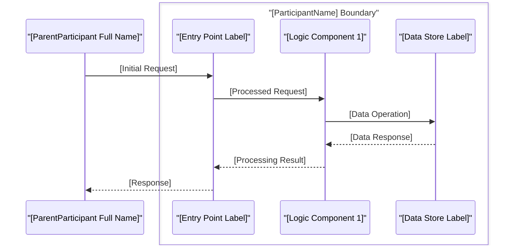

# Level N+1 Collaboration Diagram Template

Used by Workflow step 5 when a sub-process folder has only a stub `collaboration.md`. The stereotype, box, and validation rules it applies are owned by `diagram-generatecollaboration`.

Apply the following structural rules (aligned with `diagram-generatecollaboration`):

- **Parent participant becomes the external actor**: the decomposed participant's parent context is represented as an `actor`-type participant *outside* all boxes
- **New boundary-type participant is first recipient**: introduce a new `boundary`-type entry point inside the sub-process box
- **Add control and entity participants** that represent the internal logic of the decomposed component
- **Apply EDPS boundary rules**: VR-1 (single external interface), VR-2 (boundary-first reception), VR-3 (control-only decomposition)
- **MANDATORY participant ordering inside each `box`**: `boundary` first, then `control`, then `entity`
- **MANDATORY stereotype annotations**: include a `%% Stereotypes:` comment listing every participant's type (e.g., `Alias=actor | Alias=boundary, Alias=control | Alias=entity`)
- **MANDATORY**: Use `participant [Alias] as "[Label]"` syntax — NEVER use `@{ ... }` JSON metadata (not supported by most renderers)
- **MANDATORY**: Always quote box labels: `box "Name"` not `box Name`

**Template for the new `collaboration.md`:**

```markdown
# [ParticipantName] Boundary — Level [N+1]

**Parent Process**: [[ParentProcessName]](../collaboration.md)  
**Hierarchy Level**: [N+1]  
**Decomposed From**: `[ParticipantName]` ([parent folder name])


```

Infer participant names, labels, and interactions from:
- The parent diagram's message exchanges involving the decomposed participant
- The participant's name (use naming heuristics from `diagram-generatecollaboration` stereotype classification)
- Domain context from project requirements or `domain-concepts.json` if available
