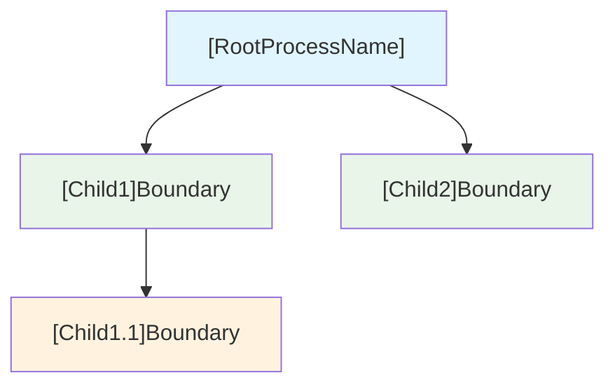
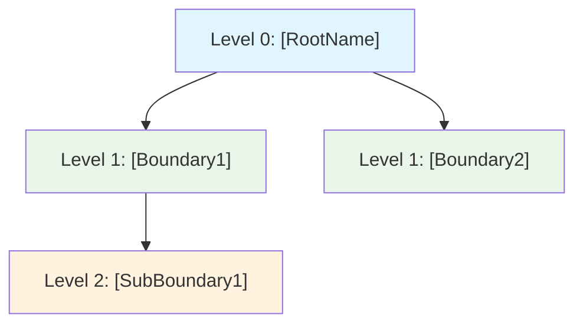

# Cross-Reference Navigation

How navigation links between hierarchy levels are built, verified, and repaired. Step numbers (7a-7d) are the sub-steps of Workflow step 7 in `SKILL.md`.

## Breadcrumb Construction Rules

Build the breadcrumb by walking up the folder hierarchy from the current level to the root. For each ancestor level:

1. Read `hierarchy-metadata.json` (if present) to retrieve the process name; otherwise derive it from the folder name by stripping the ordinal prefix and `Boundary` suffix.
2. Compute the relative path from the current file to the ancestor's `main.md` by counting the number of `../` steps needed.
3. For the root level (Level 0), always link to `[root]/main.md`.

**Example** — Level 3 process `ValidationEngineBoundary` nested inside `OrderServiceBoundary` (Level 1) inside `SkillDevProcess` (Level 0):

```
**Breadcrumb**: [Skill Dev Process](../../../main.md) › [Order Service Boundary](../../main.md) › [LogicEngineBoundary](../main.md) › Validation Engine Boundary
```

(The current level is shown as plain text, not a link.)

## Navigation Maintenance After a Decomposition

After generating all files and updating the parent, perform a cross-reference pass to ensure all navigation links are consistent and intact.

### 7a. Parent → Child Links (FR-T7.2)

Verify and update the **Sub-Processes** section in the parent's `main.md`:

1. Read the parent's `main.md`.
2. Locate (or create) the `## Sub-Processes` section.
3. Ensure a table row exists for every sub-folder under the parent that contains a `main.md`:

```markdown
## Sub-Processes

| Sub-Process | Collaboration | Process Flow | Domain Model |
|-------------|--------------|--------------|-------------|
| [[NN]-[ChildName]Boundary]([NN]-[ChildName]Boundary/main.md) | [diagram]([NN]-[ChildName]Boundary/collaboration.md) | [flow]([NN]-[ChildName]Boundary/process.md) | [model]([NN]-[ChildName]Boundary/domain-model.md) |
```

Rules:
- Use **relative paths** (e.g., `01-OrderServiceBoundary/main.md`), never absolute paths.
- Add one row per sub-process sorted by ordinal prefix.
- If a row already exists for a sub-folder (matched by folder name), do not duplicate it.

### 7b. Child → Parent Links (FR-T7.1)

Verify and update the **Navigation** section in each child's `main.md`:

1. Confirm `**Parent Process**: [[ParentProcessName]](../main.md)` is present and the target resolves.
2. Confirm the breadcrumb trail reflects the actual folder depth (count `../` hops required to reach root).
3. Confirm the current level number in `**Level**: [N+1]` matches the folder depth.

If any discrepancy is found, update the child's `main.md` Navigation section in place.

### 7c. Link Integrity Check (FR-T7.4)

After any hierarchy modification (add, remove, or rename a sub-folder), run this check:

1. Walk every `main.md` in the hierarchy tree (all levels).
2. For each `[text](path)` link in `## Navigation` and `## Sub-Processes`:
   - Resolve the relative path from the file's directory.
   - Verify the target file exists.
3. Collect broken links as a list `{ file, link_text, target_path, issue }`.
4. If broken links are found:
   - Report them to the user.
   - Offer to auto-fix relative paths where the target file exists but the path changed (e.g., after a rename or move).
5. If no broken links: confirm "All navigation links verified ✓".

When fixing a broken link caused by a **rename**:
- Detect the new folder name from the filesystem.
- Replace the old ordinal/name segment in every affected path.
- Append a `LINK-UPDATE` entry to `folder-creation.log`:
  ```
  [ISO-8601 timestamp] LINK-UPDATE  [affected-file]
    Old link: [old-path]
    New link: [new-path]
    Reason:   [rename | restructure | manual-correction]
  ```

### 7d. Cross-Reference Update on Decomposition Rollback

When rolling back a decomposition (see §Decomposition Rollback), also:

1. Remove the sub-process row from the parent's `## Sub-Processes` table.
2. Remove the breadcrumb reference and Navigation section from the (now deleted) child's `main.md` — this is handled implicitly by folder deletion, but confirm the parent `## Sub-Processes` table row is gone and the parent `## Navigation` breadcrumb is unchanged.

## Rebuilding Navigation Independently of a Decomposition

Manage the bi-directional navigation links between all levels of the hierarchy. This section provides instructions for generating and maintaining navigation independently of a decomposition event (e.g., after a bulk import or manual folder creation).

### Generate Navigation Links for an Existing Hierarchy

When the user has an existing folder tree without navigation links, rebuild all links in one pass:

1. **Discover** all `main.md` files under the given root folder (recursive).
2. **Build the parent map**: for each `main.md`, the parent is the `main.md` one folder level up. The root has no parent.
3. **Build the children map**: for each `main.md`, children are the `main.md` files in immediate sub-folders.
4. For each `main.md`, write or update:
   - The `## Navigation` section with breadcrumb and **Parent Process** link (skip for root).
   - The `## Sub-Processes` table with one row per child.
5. Run the Link Integrity Check (§7c) after all updates.

### Hierarchy Index at Root Level (FR-T7.3)

When the user requests a hierarchy index (or after any decomposition), generate or update `hierarchy-index.md` in the **root process folder**:

```markdown
# Process Hierarchy Index

**Generated**: [ISO-8601 timestamp]  
**Root Process**: [RootProcessName]

## Full Hierarchy Tree

| Level | Process | Collaboration | Process Flow | Domain Model |
|-------|---------|--------------|--------------|-------------|
| 0 | [[RootProcessName]](main.md) | [diagram](collaboration.md) | [flow](process.md) | [model](domain-model.md) |
| 1 | [[NN]-[Child1]Boundary]([NN]-[Child1]Boundary/main.md) | [diagram]([NN]-[Child1]Boundary/collaboration.md) | [flow]([NN]-[Child1]Boundary/process.md) | [model]([NN]-[Child1]Boundary/domain-model.md) |
| 1 | [[NN]-[Child2]Boundary]([NN]-[Child2]Boundary/main.md) | … | … | … |
| 2 | [[NN]-[Child1.1]Boundary]([NN]-[Child1]Boundary/[NN]-[Child1.1]Boundary/main.md) | … | … | … |

## Hierarchy Tree Diagram



## Statistics

| Metric | Value |
|--------|-------|
| Total Levels | [max depth + 1] |
| Total Processes | [count of all nodes] |
| Leaf Processes | [count of nodes with no children] |
| Decomposed Nodes | [count of nodes with status "decomposed"] |
| Last Updated | [ISO-8601 timestamp] |
```

**Generation rules:**
- Traverse `hierarchy-metadata.json` breadth-first to produce the flat table in level order.
- For processes without `hierarchy-metadata.json`, walk the filesystem instead.
- The Mermaid diagram uses `click` directives to make nodes navigable in supporting renderers.
- Regenerate `hierarchy-index.md` after every decomposition and every rollback.
- `hierarchy-index.md` is always at the root process folder; it is **not** created inside sub-folders.

## Hierarchy Tree Visualization

When the user requests a tree view, generate a Mermaid `flowchart TD` diagram from `hierarchy-metadata.json`:

```markdown

```

Node colors by level:
- Level 0: `#e1f5fe` (light blue)
- Level 1: `#e8f5e8` (light green)
- Level 2: `#fff3e0` (light amber)
- Level 3+: `#f3e5f5` (light lavender)
