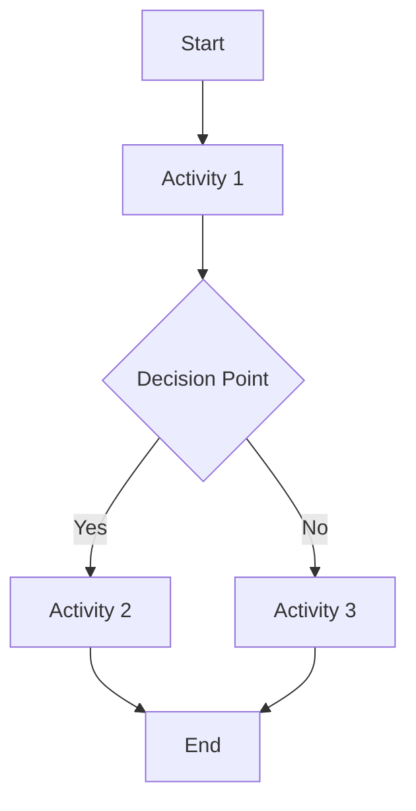
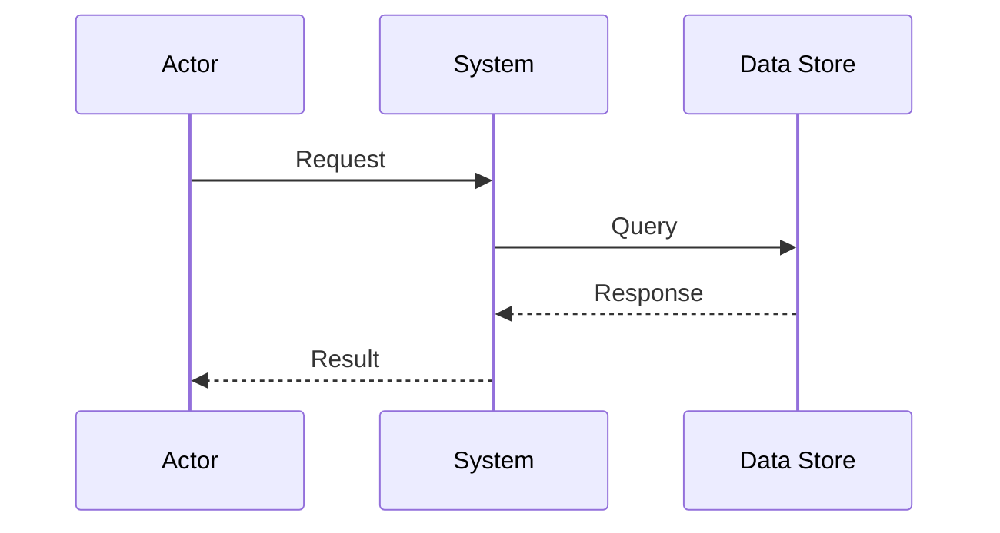

# OrgModel Document Templates

Templates for the orgModel documents this skill creates or updates. They apply only to folders this skill owns (see the EDPS-Hierarchy Guard in `SKILL.md`).

## Content Generation Patterns

#### main.md Structure
```markdown
<!-- Identifier: I-[NN] -->

# [NN] - [Process Name]

## Purpose
[Business purpose derived from requirements analysis]

## Process Flow  
See [process.md](process.md) for detailed activity diagram.

## Collaborations
See [collaboration.md](collaboration.md) for entity interactions.

## Domain Model
See [domain-model.md](domain-model.md) for actors and entities.

## Sub-Processes
[List nested processes identified from analysis]

## Test Coverage
See [test-case-list.md](test-case-list.md) for verification test cases.

## Related Changes
<!-- Traceability to source requirements and changes -->
```

#### domain-model.md Structure  
```markdown
<!-- Identifier: DM-[NN] -->

# Domain Model: [Process Name]

## Actors
[Human and system actors from domain analysis]

### [Actor Name]
- **Type**: Human/System/External
- **Responsibilities**: [key responsibilities]
- **Interactions**: [primary entity interactions]

## Key Entities
[Business entities from domain concepts extraction]

### [Entity Name] 
- **Definition**: [entity definition]
- **Attributes**: [key attributes]
- **Relationships**: [entity relationships]
- **Domain Area**: [functional area]

## Systems and Components
[Technical systems involved in process]

### [System Name]
- **Purpose**: [system role]
- **Interfaces**: [external connections]
- **Key Functions**: [primary capabilities]
```

#### process.md Structure
```markdown
<!-- Identifier: P-[NN] -->

# Process: [Process Name]

## Overview
[Process purpose and scope]

## Process Flow



## Activities

### [Activity Name]
- **Input**: [required inputs]
- **Process**: [activity description]
- **Output**: [produced outputs]
- **Responsible**: [actor/role responsible]
- **Validation**: [quality checks]

## Decision Points
[Critical decision points with criteria]

## Exception Handling  
[Error conditions and recovery procedures]
```

#### collaboration.md Structure
```markdown
<!-- Identifier: C-[NN] -->

# Collaboration: [Process Name]

## Entity Interactions



## Interaction Patterns
[Description of key interaction patterns]

## Communication Channels
[How entities communicate]

## Data Flow
[Information flow between entities]
```

#### vocabulary.md Structure
```markdown
<!-- Identifier: V-[NN] -->

# Vocabulary: [Process Name]

## Canonical Terms
[Standardized terminology for the process]

| Term | Definition | Aliases | Context |
|------|------------|---------|---------|
| [Term] | [Definition] | [Synonyms] | [Usage context] |

## Domain Alignment
[Mapping to enterprise domain models]

## Consistency Rules
[Guidelines for term usage across process]
```

#### test-case-list.md Structure
```markdown
<!-- Identifier: TCL-[NN] -->

# Test Case List: [Process Name]

## Test Coverage Overview
[Summary of testing scope and approach]

## Test Cases

| TC ID | Test Category | Title | Priority | Source Requirement |
|-------|---------------|-------|----------|-------------------|
| tc-[NN]-001 | Functional | [Test title] | High | R-[ID] |

## Test Categories
- **Functional**: Core process functionality
- **Integration**: Cross-entity interactions  
- **Exception**: Error handling and recovery
- **Performance**: Process efficiency measures
- **Compliance**: Regulatory/standards adherence

## Validation Criteria
[Process success criteria for testing]
```
