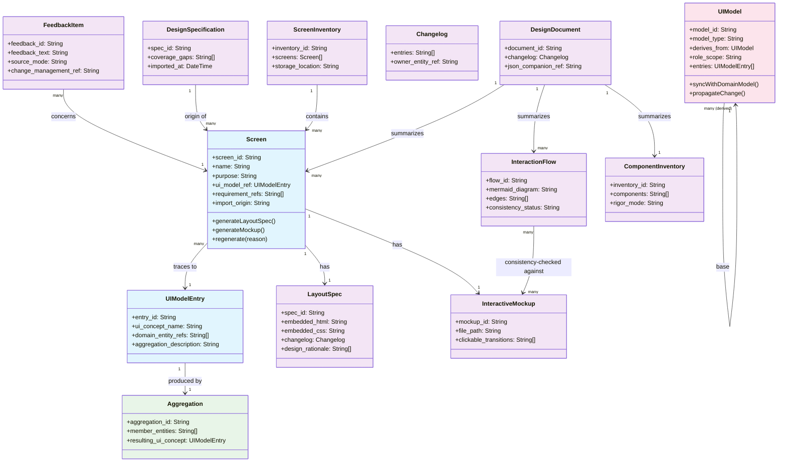
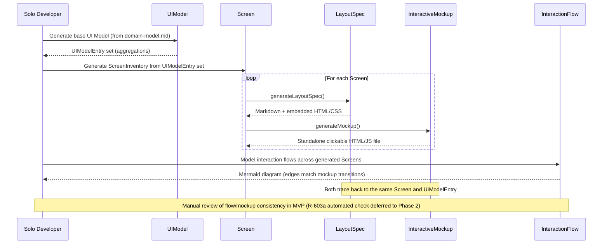
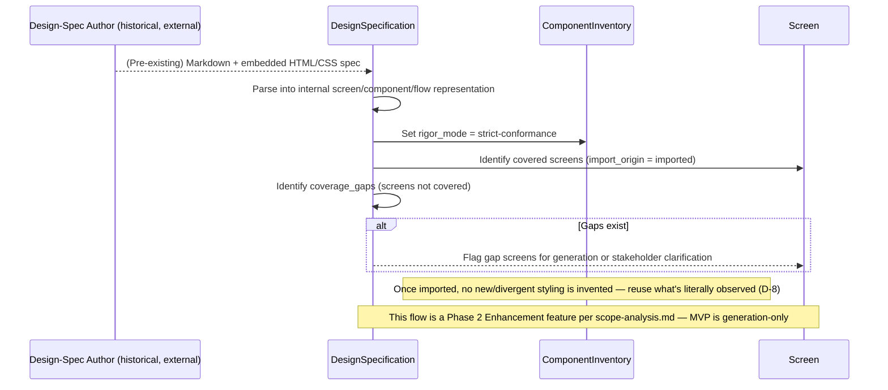
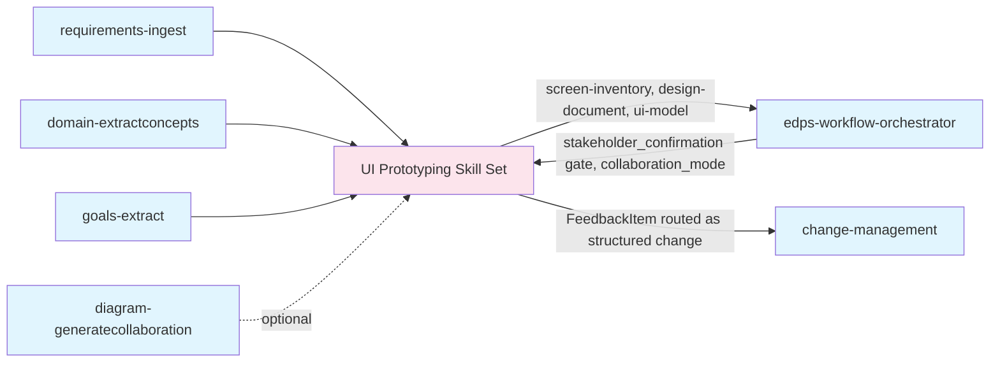
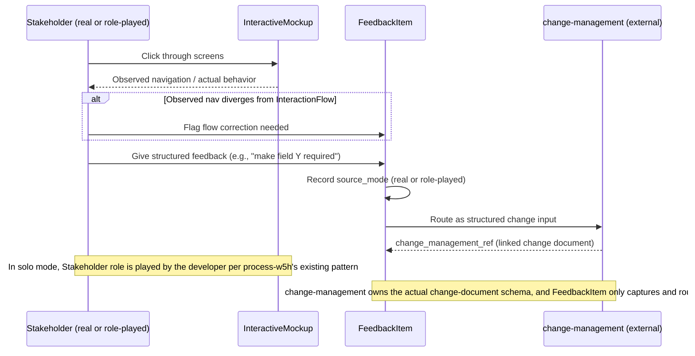

<!-- Generated by SpecStory, Markdown v2.1.0 -->

# 2026-10-27 18:00:25Z

<!-- VS Code Copilot IDE Session 844b2d36-9340-4836-9999-f8f92bf594ab (2026-10-27 18:00:25Z) -->

_**User (2026-10-27 18:00:25Z)**_

The diagram cannot be rendered, please fix it

---

_**Agent (copilot/auto)**_

I’ll check the selected Mermaid block for syntax issues and make the smallest correction, then validate the edited diagram.

_**Agent (copilot/auto)**_

<tool-use data-tool-type="read" data-tool-name="read_file"><details>
<summary>Tool use: **read_file**</summary>

Read `collaboration-diagrams.md`, lines 155 to 190

**Input:**

- endLine: `190`
- filePath: `e:\GitHub_zhongadamwang\AI_Slowcooker\OrgDocument\projects\06 - Building UI Prototype skills\artifacts\Analysis\collaboration-diagrams.md`
- startLine: `155`

**Result:**

````

    Note over LS,IM: Both trace back to the same Screen and UIModelEntry
    Note over Dev,IF: Manual review of flow/mockup consistency in MVP (R-603a automated check deferred to Phase 2)
```

### Mockup-Driven Discussion Flow *(Diagram D-603)*
**Source Requirements**: [R-611, R-611a, R-612, R-614, R-620]
**Entities Involved**: Business/Product Stakeholder (or role-played), InteractiveMockup, FeedbackItem, change-management (external skill)

```mermaid
sequenceDiagram
    participant S as Stakeholder (real or role-played)
    participant IM as InteractiveMockup
    participant FB as FeedbackItem
    participant CM as change-management (external)

    S->>IM: Click through screens
    IM-->>S: Observed navigation / actual behavior
    alt Observed nav diverges from InteractionFlow
        S->>FB: Flag flow correction needed
    end
    S->>FB: Give structured feedback (e.g., "make field Y required")
    FB->>FB: Record source_mode (real | role-played)
    FB->>CM: Route as structured change input
    CM-->>FB: change_management_ref (linked change document)

    Note over S,IM: In solo mode, Stakeholder role is played by the developer per process-w5h's existing pattern
    Note over FB,CM: change-management owns the actual change-document schema; FeedbackItem only captures and routes
```

### Regeneration-on-Change Flow *(Diagram D-604)*
**Source Requirements**: [R-627a, R-629, R-629a, D-10, D-11]
**Entities Involved**: domain-alignentities / model-integration (external), UIModel, Screen, Changelog

```mermaid
sequenceDiagram
````
</details></tool-use>

_**Agent (copilot/auto)**_

<tool-use data-tool-type="search" data-tool-name="file_search"><details>
<summary>Tool use: **file_search**</summary>

Searched for files matching `**/package.json`, no matches

**Input:**

- maxResults: `10`
- query: `**/package.json`

**Result:**

```
No files found
```
</details></tool-use>

_**Agent (copilot/auto)**_

<tool-use data-tool-type="search" data-tool-name="grep_search"><details>
<summary>Tool use: **grep_search**</summary>

Searched for regex `source_mode \(real \| role-played\)|Note over .*[,].*:` (`**/OrgDocument/projects/06 - Building UI Prototype skills/artifacts/Analysis/collaboration-diagrams.md`), 8 results

**Input:**

- includePattern: `OrgDocument/projects/06 - Building UI Prototype skills/artifacts/Analysis/collaboration-diagrams.md`
- isRegexp: `true`
- maxResults: `10`
- query: `source_mode \(real \| role-played\)|Note over .*[,].*:`

**Result:**

```
Found 8 matches in 1 file for "source_mode \(real \| role-played\)|Note over .*[,].*:"

OrgDocument/projects/06 - Building UI Prototype skills/artifacts/Analysis/collaboration-diagrams.md
156:    Note over LS,IM: Both trace back to the same Screen and UIModelEntry
157:    Note over Dev,IF: Manual review of flow/mockup consistency in MVP (R-603a automated check deferred to Phase 2)
177:    FB->>FB: Record source_mode (real | role-played)
181:    Note over S,IM: In solo mode, Stakeholder role is played by the developer per process-w5h's existing pattern
182:    Note over FB,CM: change-management owns the actual change-document schema; FeedbackItem only captures and routes
203:    Note over DA,UM: MVP implements this manually (developer re-runs); Phase 2 automates detection (R-627a enhancement)
204:    Note over SCR,CL: Regeneration always logged — satisfies D-11's "regenerate, don't just flag" decision while preserving traceability
228:    Note over DS,SCR: This flow is a Phase 2 Enhancement feature per scope-analysis.md — MVP is generation-only
```
</details></tool-use>

_**Agent (copilot/auto)**_

The selected block is structurally valid Mermaid, but it contains a literal `|` inside a sequence-message label (`real | role-played`), which is the strongest parser-compatibility suspect. I’ll replace that separator with plain wording; this preserves the meaning and avoids Mermaid token ambiguity.

_**Agent (copilot/auto)**_

<tool-use data-tool-type="write" data-tool-name="textEditGroup"><details>
<summary>Edit: **collaboration-diagrams.md**</summary>

@@ lines 1-261 @@

````
# Collaboration Diagrams

**Project**: PRJ-06 — 06 - Building UI Prototype skills
**Generated**: 2026-10-26
**Source**: domain-concepts.md, requirements.md (v1.3), domain-alignment.md

## Domain Class Model

### Entity Relationship Overview *(Diagram D-601)*
**Source Requirements**: [R-601, R-602, R-602a, R-603, R-606, R-627, R-628]
**Domain Source**: `orgModel/02 - UI Prototype Skill Development Process/domain-model.md`



**Note**: This class diagram is identical in substance to the one already embedded in `orgModel/02 - UI Prototype Skill Development Process/domain-model.md`; it is duplicated here per `diagram-generatecollaboration`'s own convention of keeping a project-level analysis copy alongside the organizational-model copy, so this project's `artifacts/Analysis/` folder is self-contained for review purposes.

## Developer–System Interactions

### MVP Generation Flow *(Diagram D-602)*
**Source Requirements**: [R-601, R-602, R-602a, R-603, R-606, R-627]
**Entities Involved**: Solo Developer, UIModel, Screen, LayoutSpec, InteractiveMockup, InteractionFlow



### Mockup-Driven Discussion Flow *(Diagram D-603)*
**Source Requirements**: [R-611, R-611a, R-612, R-614, R-620]
**Entities Involved**: Business/Product Stakeholder (or role-played), InteractiveMockup, FeedbackItem, change-management (external skill)

```mermaid
sequenceDiagram
    participant S as Stakeholder (real or role-played)
    participant IM as InteractiveMockup
    participant FB as FeedbackItem
    participant CM as change-management (external)

    S->>IM: Click through screens
    IM-->>S: Observed navigation / actual behavior
    alt Observed nav diverges from InteractionFlow
        S->>FB: Flag flow correction needed
    end
    S->>FB: Give structured feedback (e.g., "make field Y required")
    FB->>FB: Record source_mode (real or role-played)
    FB->>CM: Route as structured change input
    CM-->>FB: change_management_ref (linked change document)

    Note over S,IM: In solo mode, Stakeholder role is played by the developer per process-w5h's existing pattern
    Note over FB,CM: change-management owns the actual change-document schema; FeedbackItem only captures and routes
```

### Regeneration-on-Change Flow *(Diagram D-604)*
**Source Requirements**: [R-627a, R-629, R-629a, D-10, D-11]
**Entities Involved**: domain-alignentities / model-integration (external), UIModel, Screen, Changelog

```mermaid
sequenceDiagram
    participant DA as domain-alignentities / model-integration (external)
    participant UM as UIModel
    participant SCR as Screen
    participant CL as Changelog

    DA->>UM: Domain model changed
    UM->>UM: syncWithDomainModel() — co-evolve (R-627a)
    UM->>UM: Identify affected UIModelEntry items
    UM->>SCR: propagateChange() for each affected Screen
    SCR->>SCR: regenerate(reason)
    SCR->>CL: Append changelog entry (not silently destructive)

    Note over DA,UM: MVP implements this manually (developer re-runs); Phase 2 automates detection (R-627a enhancement)
    Note over SCR,CL: Regeneration always logged — satisfies D-11's "regenerate, don't just flag" decision while preserving traceability
```

### Import & Conformance Flow *(Diagram D-605, Phase 2 feature)*
**Source Requirements**: [R-615, R-616, R-617, R-618]
**Entities Involved**: Design-Spec Author (external, historical), DesignSpecification, ComponentInventory, Screen



## System-System Interactions

### Pipeline Position *(Diagram D-606)*
**Source Requirements**: [R-619, R-620, R-621, R-622]
**Entities Involved**: requirements-ingest, domain-extractconcepts, goals-extract, diagram-generatecollaboration (this project itself), UI Prototyping skill set, edps-workflow-orchestrator, change-management



**Note**: This diagram makes explicit what `domain-alignment.md`'s REC-003 argued against modeling as a new shared entity — the gate/orchestrator relationship is a *process* integration point, not a domain entity, and is visualized here rather than added to the class diagram.

---
**Traceability**: Diagrams generated from `domain-concepts.md` entities and `requirements.md` v1.3 requirement IDs as annotated per diagram
**Generated**: 2026-10-26

````
</details></tool-use>

_**Agent (copilot/auto)**_

<tool-use data-tool-type="generic" data-tool-name="get_errors"><details>
<summary>Tool use: **get_errors**</summary>

Checked `collaboration-diagrams.md`, no problems found

**Input:**

- filePaths:

```
[
  "e:\\GitHub_zhongadamwang\\AI_Slowcooker\\OrgDocument\\projects\\06 - Building UI Prototype skills\\artifacts\\Analysis\\collaboration-diagrams.md"
]
```


**Result:**

```
<errors path="e:\\GitHub_zhongadamwang\\AI_Slowcooker\\OrgDocument\\projects\\06 - Building UI Prototype skills\\artifacts\\Analysis\\collaboration-diagrams.md">
No errors found
</errors>
```
</details></tool-use>

_**Agent (copilot/auto)**_

Replaced the `|` in the `source_mode` message with “or” in `OrgDocument/projects/06 - Building UI Prototype skills/artifacts/Analysis/collaboration-diagrams.md#L177` to avoid a potentially ambiguous Mermaid label. The file reports no errors; I couldn’t verify it with a Mermaid renderer.

_**Agent (copilot/auto)**_

<tool-use data-tool-type="task" data-tool-name="manage_todo_list"><details>
<summary>Tool use: **manage_todo_list**</summary>

Created 2 todos
</details></tool-use>

---

_**User (2026-10-27 18:01:56Z)**_

Still not working

---

_**Agent (copilot/auto)**_

The first change didn’t address the render failure, so I’ll check the Mermaid diagram with an actual parser and use its error to target the fix.

_**Agent (copilot/auto)**_

<tool-use data-tool-type="generic" data-tool-name="run_in_terminal"><details>
<summary>Tool use: **run_in_terminal**</summary>

Running `$source = Get-Content -Raw 'OrgDocument/projects/06 - Building UI Prototype s...`

Extract and render the D-603 Mermaid block with Mermaid CLI to get the actual parser/rendering result.

````bash
$source = Get-Content -Raw 'OrgDocument/projects/06 - Building UI Prototype skills/artifacts/Analysis/collaboration-diagrams.md'; $match = [regex]::Match($source, '(?s)### Mockup-Driven Discussion Flow.*?```mermaid\s*(.*?)\s*```'); if (-not $match.Success) { throw 'Could not extract D-603 Mermaid block' }; $inputPath = Join-Path $env:TEMP 'd603.mmd'; $outputPath = Join-Path $env:TEMP 'd603.svg'; Set-Content -Path $inputPath -Value $match.Groups[1].Value -Encoding utf8; npx --yes @mermaid-js/mermaid-cli -i $inputPath -o $outputPath
````

**Result:**

```
npx : The term 'npx' is not recognized as the name of a cmdlet, function, 
script file, or operable program. Check the spelling of the name, or if a path 
was included, verify that the path is correct and try again.
At line:1 char:475
+ ...  $inputPath -Value $match.Groups[1].Value -Encoding utf8; npx --yes @ ...
+                                                               ~~~
    + CategoryInfo          : ObjectNotFound: (npx:String) [], CommandNotFound 
   Exception
    + FullyQualifiedErrorId : CommandNotFoundException

Command exited with code 1
```
</details></tool-use>

_**Agent (copilot/auto)**_

The workspace has no `npx`, so I couldn’t run Mermaid CLI locally. I’m checking whether VS Code’s Markdown preview can provide a real render result for this file.

_**Agent (copilot/auto)**_

<tool-use data-tool-type="generic" data-tool-name="tool_search"><details>
<summary>Tool use: **tool_search**</summary>

**Input:**

- query: `Open current markdown file in VS Code Markdown Preview using a command and inspect or screenshot rendered Mermaid block`

**Result:**

```
["run_vscode_command","vscode_reviewPlan","renderMermaidDiagram","vscode_get_terminal_confirmation","get_vscode_api"]
```
</details></tool-use>

_**Agent (copilot/auto)**_

<tool-use data-tool-type="generic" data-tool-name="tool_search"><details>
<summary>Tool use: **tool_search**</summary>

**Input:**

- query: `Open a web page or browser and execute JavaScript with Mermaid.js to parse/render Mermaid diagram code and report syntax errors`

**Result:**

```
["renderMermaidDiagram","open_browser_page","run_playwright_code","vscode_fetchWebPage_internal","run_vscode_command"]
```
</details></tool-use>

_**Agent (copilot/auto)**_

<tool-use data-tool-type="generic" data-tool-name="open_browser_page"><details>
<summary>Tool use: **open_browser_page**</summary>

Opened `Browser`

**Input:**

- forceNew: `true`
- url: `about:blank`

**Result:**

```
Page ID: 4a4ac7c4-7004-4e0c-bc40-17c078bdceb0

Summary:

URL: about:blank
Snapshot: <unchanged>
```
</details></tool-use>

_**Agent (copilot/auto)**_

<tool-use data-tool-type="generic" data-tool-name="run_playwright_code"><details>
<summary>Tool use: **run_playwright_code**</summary>

Ran Playwright code

**Input:**

- code:

```
const source = `sequenceDiagram
    participant S as Stakeholder (real or role-played)
    participant IM as InteractiveMockup
    participant FB as FeedbackItem
    participant CM as change-management (external)

    S->>IM: Click through screens
    IM-->>S: Observed navigation / actual behavior
    alt Observed nav diverges from InteractionFlow
        S->>FB: Flag flow correction needed
    end
    S->>FB: Give structured feedback (e.g., "make field Y required")
    FB->>FB: Record source_mode (real or role-played)
    FB->>CM: Route as structured change input
    CM-->>FB: change_management_ref (linked change document)

    Note over S,IM: In solo mode, Stakeholder role is played by the developer per process-w5h's existing pattern
    Note over FB,CM: change-management owns the actual change-document schema; FeedbackItem only captures and routes`;
await page.addScriptTag({url: 'https://cdn.jsdelivr.net/npm/mermaid@11/dist/mermaid.min.js'});
return await page.evaluate(async (diagram) => { mermaid.initialize({startOnLoad:false}); try { await mermaid.parse(diagram); return 'Mermaid parse succeeded'; } catch (error) { return String(error); } }, source);
```

- pageId: `4a4ac7c4-7004-4e0c-bc40-17c078bdceb0`
- timeoutMs: `15000`

**Result:**

```
Result: "Error: Parse error on line 18:\n... captures and routes\n-----------------------^\nExpecting '()', 'SOLID_OPEN_ARROW', 'DOTTED_OPEN_ARROW', 'SOLID_ARROW', 'SOLID_ARROW_TOP', 'SOLID_ARROW_BOTTOM', 'STICK_ARROW_TOP', 'STICK_ARROW_BOTTOM', 'SOLID_ARROW_TOP_DOTTED', 'SOLID_ARROW_BOTTOM_DOTTED', 'STICK_ARROW_TOP_DOTTED', 'STICK_ARROW_BOTTOM_DOTTED', 'SOLID_ARROW_TOP_REVERSE', 'SOLID_ARROW_BOTTOM_REVERSE', 'STICK_ARROW_TOP_REVERSE', 'STICK_ARROW_BOTTOM_REVERSE', 'SOLID_ARROW_TOP_REVERSE_DOTTED', 'SOLID_ARROW_BOTTOM_REVERSE_DOTTED', 'STICK_ARROW_TOP_REVERSE_DOTTED', 'STICK_ARROW_BOTTOM_REVERSE_DOTTED', 'BIDIRECTIONAL_SOLID_ARROW', 'DOTTED_ARROW', 'BIDIRECTIONAL_DOTTED_ARROW', 'SOLID_CROSS', 'DOTTED_CROSS', 'SOLID_POINT', 'DOTTED_POINT', got 'NEWLINE'"
URL: about:blank
Snapshot: <unchanged>
```
</details></tool-use>

_**Agent (copilot/auto)**_

The parser pinpointed the real issue: the second note contains a semicolon, which Mermaid treats as a statement separator. I’ll replace it with a comma, then rerun the same parser check against the corrected block.

_**Agent (copilot/auto)**_

<tool-use data-tool-type="write" data-tool-name="textEditGroup"><details>
<summary>Edit: **collaboration-diagrams.md**</summary>

@@ lines 1-261 @@

````
# Collaboration Diagrams

**Project**: PRJ-06 — 06 - Building UI Prototype skills
**Generated**: 2026-10-26
**Source**: domain-concepts.md, requirements.md (v1.3), domain-alignment.md

## Domain Class Model

### Entity Relationship Overview *(Diagram D-601)*
**Source Requirements**: [R-601, R-602, R-602a, R-603, R-606, R-627, R-628]
**Domain Source**: `orgModel/02 - UI Prototype Skill Development Process/domain-model.md`


**Note**: This class diagram is identical in substance to the one already embedded in `orgModel/02 - UI Prototype Skill Development Process/domain-model.md`; it is duplicated here per `diagram-generatecollaboration`'s own convention of keeping a project-level analysis copy alongside the organizational-model copy, so this project's `artifacts/Analysis/` folder is self-contained for review purposes.

## Developer–System Interactions

### MVP Generation Flow *(Diagram D-602)*
**Source Requirements**: [R-601, R-602, R-602a, R-603, R-606, R-627]
**Entities Involved**: Solo Developer, UIModel, Screen, LayoutSpec, InteractiveMockup, InteractionFlow


### Mockup-Driven Discussion Flow *(Diagram D-603)*
**Source Requirements**: [R-611, R-611a, R-612, R-614, R-620]
**Entities Involved**: Business/Product Stakeholder (or role-played), InteractiveMockup, FeedbackItem, change-management (external skill)



### Regeneration-on-Change Flow *(Diagram D-604)*
**Source Requirements**: [R-627a, R-629, R-629a, D-10, D-11]
**Entities Involved**: domain-alignentities / model-integration (external), UIModel, Screen, Changelog

```mermaid
sequenceDiagram
    participant DA as domain-alignentities / model-integration (external)
    participant UM as UIModel
    participant SCR as Screen
    participant CL as Changelog

    DA->>UM: Domain model changed
    UM->>UM: syncWithDomainModel() — co-evolve (R-627a)
    UM->>UM: Identify affected UIModelEntry items
    UM->>SCR: propagateChange() for each affected Screen
    SCR->>SCR: regenerate(reason)
    SCR->>CL: Append changelog entry (not silently destructive)

    Note over DA,UM: MVP implements this manually (developer re-runs); Phase 2 automates detection (R-627a enhancement)
    Note over SCR,CL: Regeneration always logged — satisfies D-11's "regenerate, don't just flag" decision while preserving traceability
```

### Import & Conformance Flow *(Diagram D-605, Phase 2 feature)*
**Source Requirements**: [R-615, R-616, R-617, R-618]
**Entities Involved**: Design-Spec Author (external, historical), DesignSpecification, ComponentInventory, Screen


## System-System Interactions

### Pipeline Position *(Diagram D-606)*
**Source Requirements**: [R-619, R-620, R-621, R-622]
**Entities Involved**: requirements-ingest, domain-extractconcepts, goals-extract, diagram-generatecollaboration (this project itself), UI Prototyping skill set, edps-workflow-orchestrator, change-management


**Note**: This diagram makes explicit what `domain-alignment.md`'s REC-003 argued against modeling as a new shared entity — the gate/orchestrator relationship is a *process* integration point, not a domain entity, and is visualized here rather than added to the class diagram.

---
**Traceability**: Diagrams generated from `domain-concepts.md` entities and `requirements.md` v1.3 requirement IDs as annotated per diagram
**Generated**: 2026-10-26

````
</details></tool-use>

_**Agent (copilot/auto)**_

<tool-use data-tool-type="generic" data-tool-name="run_playwright_code"><details>
<summary>Tool use: **run_playwright_code**</summary>

Ran Playwright code

**Input:**

- code:

```
const source = `sequenceDiagram
    participant S as Stakeholder (real or role-played)
    participant IM as InteractiveMockup
    participant FB as FeedbackItem
    participant CM as change-management (external)

    S->>IM: Click through screens
    IM-->>S: Observed navigation / actual behavior
    alt Observed nav diverges from InteractionFlow
        S->>FB: Flag flow correction needed
    end
    S->>FB: Give structured feedback (e.g., "make field Y required")
    FB->>FB: Record source_mode (real or role-played)
    FB->>CM: Route as structured change input
    CM-->>FB: change_management_ref (linked change document)

    Note over S,IM: In solo mode, Stakeholder role is played by the developer per process-w5h's existing pattern
    Note over FB,CM: change-management owns the actual change-document schema, and FeedbackItem only captures and routes`;
await page.addScriptTag({url: 'https://cdn.jsdelivr.net/npm/mermaid@11/dist/mermaid.min.js'});
return await page.evaluate(async (diagram) => { mermaid.initialize({startOnLoad:false}); try { await mermaid.parse(diagram); return 'Mermaid parse succeeded'; } catch (error) { return String(error); } }, source);
```

- pageId: `4a4ac7c4-7004-4e0c-bc40-17c078bdceb0`
- timeoutMs: `15000`

**Result:**

```
Result: "Mermaid parse succeeded"
URL: about:blank
Snapshot: <unchanged>
```
</details></tool-use>

_**Agent (copilot/auto)**_

The corrected block now parses successfully. The earlier pipe change wasn’t the cause, so I’m restoring that original wording and will confirm the final version still parses.

_**Agent (copilot/auto)**_

<tool-use data-tool-type="write" data-tool-name="textEditGroup"><details>
<summary>Edit: **collaboration-diagrams.md**</summary>

@@ lines 1-261 @@

````
# Collaboration Diagrams

**Project**: PRJ-06 — 06 - Building UI Prototype skills
**Generated**: 2026-10-26
**Source**: domain-concepts.md, requirements.md (v1.3), domain-alignment.md

## Domain Class Model

### Entity Relationship Overview *(Diagram D-601)*
**Source Requirements**: [R-601, R-602, R-602a, R-603, R-606, R-627, R-628]
**Domain Source**: `orgModel/02 - UI Prototype Skill Development Process/domain-model.md`


**Note**: This class diagram is identical in substance to the one already embedded in `orgModel/02 - UI Prototype Skill Development Process/domain-model.md`; it is duplicated here per `diagram-generatecollaboration`'s own convention of keeping a project-level analysis copy alongside the organizational-model copy, so this project's `artifacts/Analysis/` folder is self-contained for review purposes.

## Developer–System Interactions

### MVP Generation Flow *(Diagram D-602)*
**Source Requirements**: [R-601, R-602, R-602a, R-603, R-606, R-627]
**Entities Involved**: Solo Developer, UIModel, Screen, LayoutSpec, InteractiveMockup, InteractionFlow


### Mockup-Driven Discussion Flow *(Diagram D-603)*
**Source Requirements**: [R-611, R-611a, R-612, R-614, R-620]
**Entities Involved**: Business/Product Stakeholder (or role-played), InteractiveMockup, FeedbackItem, change-management (external skill)


### Regeneration-on-Change Flow *(Diagram D-604)*
**Source Requirements**: [R-627a, R-629, R-629a, D-10, D-11]
**Entities Involved**: domain-alignentities / model-integration (external), UIModel, Screen, Changelog

```mermaid
sequenceDiagram
    participant DA as domain-alignentities / model-integration (external)
    participant UM as UIModel
    participant SCR as Screen
    participant CL as Changelog

    DA->>UM: Domain model changed
    UM->>UM: syncWithDomainModel() — co-evolve (R-627a)
    UM->>UM: Identify affected UIModelEntry items
    UM->>SCR: propagateChange() for each affected Screen
    SCR->>SCR: regenerate(reason)
    SCR->>CL: Append changelog entry (not silently destructive)

    Note over DA,UM: MVP implements this manually (developer re-runs); Phase 2 automates detection (R-627a enhancement)
    Note over SCR,CL: Regeneration always logged — satisfies D-11's "regenerate, don't just flag" decision while preserving traceability
```

### Import & Conformance Flow *(Diagram D-605, Phase 2 feature)*
**Source Requirements**: [R-615, R-616, R-617, R-618]
**Entities Involved**: Design-Spec Author (external, historical), DesignSpecification, ComponentInventory, Screen


## System-System Interactions

### Pipeline Position *(Diagram D-606)*
**Source Requirements**: [R-619, R-620, R-621, R-622]
**Entities Involved**: requirements-ingest, domain-extractconcepts, goals-extract, diagram-generatecollaboration (this project itself), UI Prototyping skill set, edps-workflow-orchestrator, change-management


**Note**: This diagram makes explicit what `domain-alignment.md`'s REC-003 argued against modeling as a new shared entity — the gate/orchestrator relationship is a *process* integration point, not a domain entity, and is visualized here rather than added to the class diagram.

---
**Traceability**: Diagrams generated from `domain-concepts.md` entities and `requirements.md` v1.3 requirement IDs as annotated per diagram
**Generated**: 2026-10-26

````
</details></tool-use>

_**Agent (copilot/auto)**_

<tool-use data-tool-type="generic" data-tool-name="run_playwright_code"><details>
<summary>Tool use: **run_playwright_code**</summary>

Ran Playwright code

**Input:**

- code:

```
const source = `sequenceDiagram
    participant S as Stakeholder (real or role-played)
    participant IM as InteractiveMockup
    participant FB as FeedbackItem
    participant CM as change-management (external)

    S->>IM: Click through screens
    IM-->>S: Observed navigation / actual behavior
    alt Observed nav diverges from InteractionFlow
        S->>FB: Flag flow correction needed
    end
    S->>FB: Give structured feedback (e.g., "make field Y required")
    FB->>FB: Record source_mode (real | role-played)
    FB->>CM: Route as structured change input
    CM-->>FB: change_management_ref (linked change document)

    Note over S,IM: In solo mode, Stakeholder role is played by the developer per process-w5h's existing pattern
    Note over FB,CM: change-management owns the actual change-document schema, and FeedbackItem only captures and routes`;
await page.addScriptTag({url: 'https://cdn.jsdelivr.net/npm/mermaid@11/dist/mermaid.min.js'});
return await page.evaluate(async (diagram) => { mermaid.initialize({startOnLoad:false}); try { await mermaid.parse(diagram); return 'Mermaid parse succeeded'; } catch (error) { return String(error); } }, source);
```

- pageId: `4a4ac7c4-7004-4e0c-bc40-17c078bdceb0`
- timeoutMs: `15000`

**Result:**

```
Result: "Mermaid parse succeeded"
URL: about:blank
Snapshot: <unchanged>
```
</details></tool-use>

_**Agent (copilot/auto)**_

<tool-use data-tool-type="generic" data-tool-name="run_playwright_code"><details>
<summary>Tool use: **run_playwright_code**</summary>

Ran Playwright code

**Input:**

- code:

```
const source = `sequenceDiagram
    participant S as Stakeholder (real or role-played)
    participant IM as InteractiveMockup
    participant FB as FeedbackItem
    participant CM as change-management (external)

    S->>IM: Click through screens
    IM-->>S: Observed navigation / actual behavior
    alt Observed nav diverges from InteractionFlow
        S->>FB: Flag flow correction needed
    end
    S->>FB: Give structured feedback (e.g., "make field Y required")
    FB->>FB: Record source_mode (real | role-played)
    FB->>CM: Route as structured change input
    CM-->>FB: change_management_ref (linked change document)

    Note over S,IM: In solo mode, Stakeholder role is played by the developer per process-w5h's existing pattern
    Note over FB,CM: change-management owns the actual change-document schema, and FeedbackItem only captures and routes`;
return await page.evaluate(async (diagram) => { mermaid.initialize({startOnLoad:false}); try { const result = await mermaid.render('d603-validation', diagram); return result.svg.includes('<svg') ? 'Mermaid render succeeded (SVG generated)' : 'Render returned no SVG'; } catch (error) { return String(error); } }, source);
```

- pageId: `4a4ac7c4-7004-4e0c-bc40-17c078bdceb0`
- timeoutMs: `15000`

**Result:**

```
Result: "Mermaid render succeeded (SVG generated)"
URL: about:blank
Snapshot: <unchanged>
```
</details></tool-use>

_**Agent (copilot/auto)**_

Fixed the actual syntax issue in `OrgDocument/projects/06 - Building UI Prototype skills/artifacts/Analysis/collaboration-diagrams.md#L182`: Mermaid treated the semicolon in the final note as a statement separator. Replaced it with a comma and “and,” then verified the diagram parses and renders to SVG.

_**Agent (copilot/auto)**_

<tool-use data-tool-type="task" data-tool-name="manage_todo_list"><details>
<summary>Tool use: **manage_todo_list**</summary>

Created 2 todos
</details></tool-use>

---

_**User (2026-10-27 18:05:13Z)**_

This diabgram is not fixed

---

_**Agent (copilot/auto)**_

You’re right, the selected D-604 block is a separate diagram. I’ll validate that exact block with Mermaid first; its note text includes semicolons, so I’ll check whether the same parser issue is present before editing.

_**Agent (copilot/auto)**_

<tool-use data-tool-type="read" data-tool-name="read_file"><details>
<summary>Tool use: **read_file**</summary>

Read `collaboration-diagrams.md`, lines 189 to 205

**Input:**

- endLine: `205`
- filePath: `e:\GitHub_zhongadamwang\AI_Slowcooker\OrgDocument\projects\06 - Building UI Prototype skills\artifacts\Analysis\collaboration-diagrams.md`
- startLine: `189`

**Result:**

````
```mermaid
sequenceDiagram
    participant DA as domain-alignentities / model-integration (external)
    participant UM as UIModel
    participant SCR as Screen
    participant CL as Changelog

    DA->>UM: Domain model changed
    UM->>UM: syncWithDomainModel() — co-evolve (R-627a)
    UM->>UM: Identify affected UIModelEntry items
    UM->>SCR: propagateChange() for each affected Screen
    SCR->>SCR: regenerate(reason)
    SCR->>CL: Append changelog entry (not silently destructive)

    Note over DA,UM: MVP implements this manually (developer re-runs); Phase 2 automates detection (R-627a enhancement)
    Note over SCR,CL: Regeneration always logged — satisfies D-11's "regenerate, don't just flag" decision while preserving traceability
```
````
</details></tool-use>

_**Agent (copilot/auto)**_

<tool-use data-tool-type="generic" data-tool-name="run_playwright_code"><details>
<summary>Tool use: **run_playwright_code**</summary>

Browser action failed

**Input:**

- code:

```
const source = `sequenceDiagram
    participant DA as domain-alignentities / model-integration (external)
    participant UM as UIModel
    participant SCR as Screen
    participant CL as Changelog

    DA->>UM: Domain model changed
    UM->>UM: syncWithDomainModel() — co-evolve (R-627a)
    UM->>UM: Identify affected UIModelEntry items
    UM->>SCR: propagateChange() for each affected Screen
    SCR->>SCR: regenerate(reason)
    SCR->>CL: Append changelog entry (not silently destructive)

    Note over DA,UM: MVP implements this manually (developer re-runs); Phase 2 automates detection (R-627a enhancement)
    Note over SCR,CL: Regeneration always logged — satisfies D-11's "regenerate, don't just flag" decision while preserving traceability`;
return await page.evaluate(async (diagram) => { mermaid.initialize({startOnLoad:false}); try { await mermaid.parse(diagram); return 'Mermaid parse succeeded'; } catch (error) { return String(error); } }, source);
```

- pageId: `4a4ac7c4-7004-4e0c-bc40-17c078bdceb0`
- timeoutMs: `15000`

**Result:**

```
Code execution failed: Page "4a4ac7c4-7004-4e0c-bc40-17c078bdceb0" not found
```
</details></tool-use>

_**Agent (copilot/auto)**_

The earlier validation tab has expired, so I’m reopening a clean browser page to run the parser check on D-604.

_**Agent (copilot/auto)**_

<tool-use data-tool-type="generic" data-tool-name="open_browser_page"><details>
<summary>Tool use: **open_browser_page**</summary>

Opened `Browser`

**Input:**

- forceNew: `true`
- url: `about:blank`

**Result:**

```
Page ID: 3a64d03f-0467-4a65-9898-d0a1de9c6883

Summary:

URL: about:blank
Snapshot: <unchanged>
```
</details></tool-use>

_**Agent (copilot/auto)**_

<tool-use data-tool-type="generic" data-tool-name="run_playwright_code"><details>
<summary>Tool use: **run_playwright_code**</summary>

Ran Playwright code

**Input:**

- code:

```
const source = `sequenceDiagram
    participant DA as domain-alignentities / model-integration (external)
    participant UM as UIModel
    participant SCR as Screen
    participant CL as Changelog

    DA->>UM: Domain model changed
    UM->>UM: syncWithDomainModel() — co-evolve (R-627a)
    UM->>UM: Identify affected UIModelEntry items
    UM->>SCR: propagateChange() for each affected Screen
    SCR->>SCR: regenerate(reason)
    SCR->>CL: Append changelog entry (not silently destructive)

    Note over DA,UM: MVP implements this manually (developer re-runs); Phase 2 automates detection (R-627a enhancement)
    Note over SCR,CL: Regeneration always logged — satisfies D-11's "regenerate, don't just flag" decision while preserving traceability`;
await page.addScriptTag({url:'https://cdn.jsdelivr.net/npm/mermaid@11/dist/mermaid.min.js'});
return await page.evaluate(async (diagram) => { mermaid.initialize({startOnLoad:false}); try { await mermaid.parse(diagram); return 'Mermaid parse succeeded'; } catch (error) { return String(error); } }, source);
```

- pageId: `3a64d03f-0467-4a65-9898-d0a1de9c6883`
- timeoutMs: `15000`

**Result:**

```
Result: "Error: Parse error on line 14:\n...(R-627a enhancement)    Note over SCR,C\n-----------------------^\nExpecting '()', 'SOLID_OPEN_ARROW', 'DOTTED_OPEN_ARROW', 'SOLID_ARROW', 'SOLID_ARROW_TOP', 'SOLID_ARROW_BOTTOM', 'STICK_ARROW_TOP', 'STICK_ARROW_BOTTOM', 'SOLID_ARROW_TOP_DOTTED', 'SOLID_ARROW_BOTTOM_DOTTED', 'STICK_ARROW_TOP_DOTTED', 'STICK_ARROW_BOTTOM_DOTTED', 'SOLID_ARROW_TOP_REVERSE', 'SOLID_ARROW_BOTTOM_REVERSE', 'STICK_ARROW_TOP_REVERSE', 'STICK_ARROW_BOTTOM_REVERSE', 'SOLID_ARROW_TOP_REVERSE_DOTTED', 'SOLID_ARROW_BOTTOM_REVERSE_DOTTED', 'STICK_ARROW_TOP_REVERSE_DOTTED', 'STICK_ARROW_BOTTOM_REVERSE_DOTTED', 'BIDIRECTIONAL_SOLID_ARROW', 'DOTTED_ARROW', 'BIDIRECTIONAL_DOTTED_ARROW', 'SOLID_CROSS', 'DOTTED_CROSS', 'SOLID_POINT', 'DOTTED_POINT', got 'NEWLINE'"
URL: about:blank
Snapshot: <unchanged>
```
</details></tool-use>

_**Agent (copilot/auto)**_

Mermaid confirms the failure is the semicolon in D-604’s first note (`re-runs); Phase 2`). I’ll replace that separator with a comma and validate by generating the SVG.

_**Agent (copilot/auto)**_

<tool-use data-tool-type="write" data-tool-name="textEditGroup"><details>
<summary>Edit: **collaboration-diagrams.md**</summary>

@@ lines 1-261 @@

````
# Collaboration Diagrams

**Project**: PRJ-06 — 06 - Building UI Prototype skills
**Generated**: 2026-10-26
**Source**: domain-concepts.md, requirements.md (v1.3), domain-alignment.md

## Domain Class Model

### Entity Relationship Overview *(Diagram D-601)*
**Source Requirements**: [R-601, R-602, R-602a, R-603, R-606, R-627, R-628]
**Domain Source**: `orgModel/02 - UI Prototype Skill Development Process/domain-model.md`

```mermaid
classDiagram
    class Screen:::core {
        +screen_id: String
        +name: String
        +purpose: String
        +ui_model_ref: UIModelEntry
        +requirement_refs: String[]
        +import_origin: String
        +generateLayoutSpec()
        +generateMockup()
        +regenerate(reason)
    }

    class ScreenInventory:::entity {
        +inventory_id: String
        +screens: Screen[]
        +storage_location: String
    }

    class LayoutSpec:::entity {
        +spec_id: String
        +embedded_html: String
        +embedded_css: String
        +changelog: Changelog
        +design_rationale: String[]
    }

    class InteractiveMockup:::entity {
        +mockup_id: String
        +file_path: String
        +clickable_transitions: String[]
    }

    class InteractionFlow:::entity {
        +flow_id: String
        +mermaid_diagram: String
        +edges: String[]
        +consistency_status: String
    }

    class UIModel:::control {
        +model_id: String
        +model_type: String
        +derives_from: UIModel
        +role_scope: String
        +entries: UIModelEntry[]
        +syncWithDomainModel()
        +propagateChange()
    }

    class UIModelEntry:::core {
        +entry_id: String
        +ui_concept_name: String
        +domain_entity_refs: String[]
        +aggregation_description: String
    }

    class Aggregation:::ai {
        +aggregation_id: String
        +member_entities: String[]
        +resulting_ui_concept: UIModelEntry
    }

    class DesignDocument:::entity {
        +document_id: String
        +changelog: Changelog
        +json_companion_ref: String
    }

    class Changelog:::entity {
        +entries: String[]
        +owner_entity_ref: String
    }

    class FeedbackItem:::entity {
        +feedback_id: String
        +feedback_text: String
        +source_mode: String
        +change_management_ref: String
    }

    class DesignSpecification:::entity {
        +spec_id: String
        +coverage_gaps: String[]
        +imported_at: DateTime
    }

    class ComponentInventory:::entity {
        +inventory_id: String
        +components: String[]
        +rigor_mode: String
    }

    Screen "many" --> "1" UIModelEntry : traces to
    UIModelEntry "1" --> "1" Aggregation : produced by
    UIModel "many (derived)" --> "1" UIModel : base
    Screen "1" --> "1" LayoutSpec : has
    Screen "1" --> "1" InteractiveMockup : has
    InteractionFlow "many" --> "many" InteractiveMockup : consistency-checked against
    FeedbackItem "many" --> "1" Screen : concerns
    DesignSpecification "1" --> "many" Screen : origin of
    ScreenInventory "1" --> "many" Screen : contains
    DesignDocument "1" --> "many" Screen : summarizes
    DesignDocument "1" --> "many" InteractionFlow : summarizes
    DesignDocument "1" --> "1" ComponentInventory : summarizes

    %% Styling Definitions
    classDef core fill:#e1f5fe
    classDef entity fill:#f3e5f5
    classDef control fill:#fce4ec
    classDef ai fill:#e8f5e8
```

**Note**: This class diagram is identical in substance to the one already embedded in `orgModel/02 - UI Prototype Skill Development Process/domain-model.md`; it is duplicated here per `diagram-generatecollaboration`'s own convention of keeping a project-level analysis copy alongside the organizational-model copy, so this project's `artifacts/Analysis/` folder is self-contained for review purposes.

## Developer–System Interactions

### MVP Generation Flow *(Diagram D-602)*
**Source Requirements**: [R-601, R-602, R-602a, R-603, R-606, R-627]
**Entities Involved**: Solo Developer, UIModel, Screen, LayoutSpec, InteractiveMockup, InteractionFlow

```mermaid
sequenceDiagram
    participant Dev as Solo Developer
    participant UM as UIModel
    participant SCR as Screen
    participant LS as LayoutSpec
    participant IM as InteractiveMockup
    participant IF as InteractionFlow

    Dev->>UM: Generate base UI Model (from domain-model.md)
    UM-->>Dev: UIModelEntry set (aggregations)
    Dev->>SCR: Generate ScreenInventory from UIModelEntry set
    loop For each Screen
        SCR->>LS: generateLayoutSpec()
        LS-->>SCR: Markdown + embedded HTML/CSS
        SCR->>IM: generateMockup()
        IM-->>SCR: Standalone clickable HTML/JS file
    end
    Dev->>IF: Model interaction flows across generated Screens
    IF-->>Dev: Mermaid diagram (edges match mockup transitions)

    Note over LS,IM: Both trace back to the same Screen and UIModelEntry
    Note over Dev,IF: Manual review of flow/mockup consistency in MVP (R-603a automated check deferred to Phase 2)
```

### Mockup-Driven Discussion Flow *(Diagram D-603)*
**Source Requirements**: [R-611, R-611a, R-612, R-614, R-620]
**Entities Involved**: Business/Product Stakeholder (or role-played), InteractiveMockup, FeedbackItem, change-management (external skill)

```mermaid
sequenceDiagram
    participant S as Stakeholder (real or role-played)
    participant IM as InteractiveMockup
    participant FB as FeedbackItem
    participant CM as change-management (external)

    S->>IM: Click through screens
    IM-->>S: Observed navigation / actual behavior
    alt Observed nav diverges from InteractionFlow
        S->>FB: Flag flow correction needed
    end
    S->>FB: Give structured feedback (e.g., "make field Y required")
    FB->>FB: Record source_mode (real | role-played)
    FB->>CM: Route as structured change input
    CM-->>FB: change_management_ref (linked change document)

    Note over S,IM: In solo mode, Stakeholder role is played by the developer per process-w5h's existing pattern
    Note over FB,CM: change-management owns the actual change-document schema, and FeedbackItem only captures and routes
```

### Regeneration-on-Change Flow *(Diagram D-604)*
**Source Requirements**: [R-627a, R-629, R-629a, D-10, D-11]
**Entities Involved**: domain-alignentities / model-integration (external), UIModel, Screen, Changelog

```mermaid
sequenceDiagram
    participant DA as domain-alignentities / model-integration (external)
    participant UM as UIModel
    participant SCR as Screen
    participant CL as Changelog

    DA->>UM: Domain model changed
    UM->>UM: syncWithDomainModel() — co-evolve (R-627a)
    UM->>UM: Identify affected UIModelEntry items
    UM->>SCR: propagateChange() for each affected Screen
    SCR->>SCR: regenerate(reason)
    SCR->>CL: Append changelog entry (not silently destructive)

    Note over DA,UM: MVP implements this manually (developer re-runs), while Phase 2 automates detection (R-627a enhancement)
    Note over SCR,CL: Regeneration always logged — satisfies D-11's "regenerate, don't just flag" decision while preserving traceability
```

### Import & Conformance Flow *(Diagram D-605, Phase 2 feature)*
**Source Requirements**: [R-615, R-616, R-617, R-618]
**Entities Involved**: Design-Spec Author (external, historical), DesignSpecification, ComponentInventory, Screen

```mermaid
sequenceDiagram
    participant Author as Design-Spec Author (historical, external)
    participant DS as DesignSpecification
    participant CI as ComponentInventory
    participant SCR as Screen

    Author-->>DS: (Pre-existing) Markdown + embedded HTML/CSS spec
    DS->>DS: Parse into internal screen/component/flow representation
    DS->>CI: Set rigor_mode = strict-conformance
    DS->>SCR: Identify covered screens (import_origin = imported)
    DS->>DS: Identify coverage_gaps (screens not covered)
    alt Gaps exist
        DS-->>SCR: Flag gap screens for generation or stakeholder clarification
    end

    Note over CI: Once imported, no new/divergent styling is invented — reuse what's literally observed (D-8)
    Note over DS,SCR: This flow is a Phase 2 Enhancement feature per scope-analysis.md — MVP is generation-only
```

## System-System Interactions

### Pipeline Position *(Diagram D-606)*
**Source Requirements**: [R-619, R-620, R-621, R-622]
**Entities Involved**: requirements-ingest, domain-extractconcepts, goals-extract, diagram-generatecollaboration (this project itself), UI Prototyping skill set, edps-workflow-orchestrator, change-management

```mermaid
flowchart LR
    RI[requirements-ingest] --> UIP[UI Prototyping Skill Set]
    DE[domain-extractconcepts] --> UIP
    GE[goals-extract] --> UIP
    DGC[diagram-generatecollaboration] -.optional.-> UIP

    UIP -->|screen-inventory, design-document, ui-model| Orch[edps-workflow-orchestrator]
    UIP -->|FeedbackItem routed as structured change| CM[change-management]

    Orch -->|stakeholder_confirmation gate, collaboration_mode| UIP

    classDef existing fill:#e1f5fe
    classDef new fill:#fce4ec
    class RI,DE,GE,DGC,Orch,CM existing
    class UIP new
```

**Note**: This diagram makes explicit what `domain-alignment.md`'s REC-003 argued against modeling as a new shared entity — the gate/orchestrator relationship is a *process* integration point, not a domain entity, and is visualized here rather than added to the class diagram.

---
**Traceability**: Diagrams generated from `domain-concepts.md` entities and `requirements.md` v1.3 requirement IDs as annotated per diagram
**Generated**: 2026-10-26

````
</details></tool-use>

_**Agent (copilot/auto)**_

<tool-use data-tool-type="generic" data-tool-name="run_playwright_code"><details>
<summary>Tool use: **run_playwright_code**</summary>

Ran Playwright code

**Input:**

- code:

```
const source = `sequenceDiagram
    participant DA as domain-alignentities / model-integration (external)
    participant UM as UIModel
    participant SCR as Screen
    participant CL as Changelog

    DA->>UM: Domain model changed
    UM->>UM: syncWithDomainModel() — co-evolve (R-627a)
    UM->>UM: Identify affected UIModelEntry items
    UM->>SCR: propagateChange() for each affected Screen
    SCR->>SCR: regenerate(reason)
    SCR->>CL: Append changelog entry (not silently destructive)

    Note over DA,UM: MVP implements this manually (developer re-runs), while Phase 2 automates detection (R-627a enhancement)
    Note over SCR,CL: Regeneration always logged — satisfies D-11's "regenerate, don't just flag" decision while preserving traceability`;
return await page.evaluate(async (diagram) => { mermaid.initialize({startOnLoad:false}); try { const result = await mermaid.render('d604-validation', diagram); return result.svg.includes('<svg') ? 'Mermaid render succeeded (SVG generated)' : 'Render returned no SVG'; } catch (error) { return String(error); } }, source);
```

- pageId: `3a64d03f-0467-4a65-9898-d0a1de9c6883`
- timeoutMs: `15000`

**Result:**

```
Result: "Mermaid render succeeded (SVG generated)"
URL: about:blank
Snapshot: <unchanged>
```
</details></tool-use>

_**Agent (copilot/auto)**_

Fixed D-604: Mermaid treated the semicolon in its first note as a statement separator. Replaced it with a comma and “while”; the updated diagram rendered successfully to SVG. See `OrgDocument/projects/06 - Building UI Prototype skills/artifacts/Analysis/collaboration-diagrams.md#L203`.

_**Agent (copilot/auto)**_

<tool-use data-tool-type="task" data-tool-name="manage_todo_list"><details>
<summary>Tool use: **manage_todo_list**</summary>

Starting: *Validate the edited diagram* (2/2)
</details></tool-use>

---

_**User (2026-10-27 18:07:41Z)**_

Can you update the lesson learned from these errors to the related skills? So the skill can avoid the same issue in future.

---

_**Agent (copilot/auto)**_

I’ll capture the Mermaid-specific lesson in the skills that generate or embed these diagrams. First I’m checking the skill-editing guidance and the relevant skill files so the fix lands where future generation actually happens.

_**Agent (copilot/auto)**_

<tool-use data-tool-type="search" data-tool-name="file_search"><details>
<summary>Tool use: **file_search**</summary>

Searched for files matching `**/OrgDocument/.github/skills/**/SKILL.md`, no matches

**Input:**

- query: `OrgDocument/.github/skills/**/SKILL.md`

**Result:**

```
No files found
```
</details></tool-use>

_**Agent (copilot/auto)**_

<tool-use data-tool-type="read" data-tool-name="read_file"><details>
<summary>Tool use: **read_file**</summary>

Read skill `agent-customization`

**Input:**

- endLine: `240`
- filePath: `d:\Program Files (x86)\Microsoft VS Code\e646868227\resources\app\extensions\copilot\assets\prompts\skills\agent-customization\SKILL.md`
- startLine: `1`

**Result:**

```
---
name: agent-customization
user-invocable: false # don't show as slash command, we have sepcialized create-agent, create-instructions, create-hook prompts for that
description: '**WORKFLOW SKILL** — Create, update, review, fix, or debug VS Code agent customization files (.instructions.md, .prompt.md, .agent.md, SKILL.md, copilot-instructions.md, AGENTS.md). USE FOR: saving coding preferences; troubleshooting why instructions/skills/agents are ignored or not invoked; configuring applyTo patterns; defining tool restrictions; creating custom agent modes or specialized workflows; packaging domain knowledge; fixing YAML frontmatter syntax. DO NOT USE FOR: general coding questions (use default agent); runtime debugging or error diagnosis; MCP server configuration (use MCP docs directly); VS Code extension development. INVOKES: file system tools (read/write customization files), ask-questions tool (interview user for requirements), subagents for codebase exploration. FOR SINGLE OPERATIONS: For quick YAML frontmatter fixes or creating a single file from a known pattern, edit the file directly — no skill needed.'
---

# Agent Customization

## Decision Flow

| Primitive | When to Use |
|-----------|-------------|
| agent instructions | Always-on, applies everywhere in the project |
| File Instructions | Explicit via `applyTo` patterns, or on-demand via `description` |
| MCP | Integrates external systems, APIs, or data |
| Hooks | Deterministic shell commands at agent lifecycle points (block tools, auto-format, inject context) |
| Custom Agents | Subagents for context isolation, or multi-stage workflows with tool restrictions |
| Prompts | Single focused task with parameterized inputs |
| Skills | On-demand workflow with bundled assets (scripts/templates) |

## Quick Reference

Consult the reference docs for templates, domain examples, advanced frontmatter options, asset organization, anti-patterns, and creation checklists. If the references are not enough, load the offici
… (output truncated)
```
</details></tool-use>

_**Agent (copilot/auto)**_

<tool-use data-tool-type="generic" data-tool-name="memory"><details>
<summary>Tool use: **memory**</summary>

Read memory

**Input:**

- command: `view`
- path: `/memories/`

**Result:**

```
No memories found.
```
</details></tool-use>

_**Agent (copilot/auto)**_

The workspace uses the expected `.github/skills/<name>/SKILL.md` structure, but the listed `skill-creator` reference isn’t present at its provided path; I’ve read the customization guidance. I’m locating the diagram-generation and other Mermaid-producing skills now to keep this targeted.

_**Agent (copilot/auto)**_

<tool-use data-tool-type="search" data-tool-name="file_search"><details>
<summary>Tool use: **file_search**</summary>

Searched for files matching `**/SKILL.md`, 39 matches

**Input:**

- maxResults: `80`
- query: `**/SKILL.md`

**Result:**

```
39 total results
e:\GitHub_zhongadamwang\AI_Slowcooker\.github\skills\skill-creator\SKILL.md
e:\GitHub_zhongadamwang\AI_Slowcooker\.github\skills\change-management\SKILL.md
e:\GitHub_zhongadamwang\AI_Slowcooker\.github\skills\screen-generateflow\SKILL.md
e:\GitHub_zhongadamwang\AI_Slowcooker\.github\skills\screen-discussfeedback\SKILL.md
e:\GitHub_zhongadamwang\AI_Slowcooker\.github\skills\domain-alignentities\SKILL.md
e:\GitHub_zhongadamwang\AI_Slowcooker\.github\skills\process-findtopandupdate\SKILL.md
e:\GitHub_zhongadamwang\AI_Slowcooker\.github\skills\documentation-automation\SKILL.md
e:\GitHub_zhongadamwang\AI_Slowcooker\.github\skills\hierarchy-validation\SKILL.md
e:\GitHub_zhongadamwang\AI_Slowcooker\.github\skills\diagram-generatecollaboration\SKILL.md
e:\GitHub_zhongadamwang\AI_Slowcooker\.github\skills\screen-assembledocument\SKILL.md
e:\GitHub_zhongadamwang\AI_Slowcooker\.github\skills\project-document-management\SKILL.md
e:\GitHub_zhongadamwang\AI_Slowcooker\.github\skills\domain-proposenewconcepts\SKILL.md
e:\GitHub_zhongadamwang\AI_Slowcooker\.github\skills\process-scopemin\SKILL.md
e:\GitHub_zhongadamwang\AI_Slowcooker\.github\skills\change-impact-analysis\SKILL.md
e:\GitHub_zhongadamwang\AI_Slowcooker\.github\skills\hierarchy-management\SKILL.md
e:\GitHub_zhongadamwang\AI_Slowcooker\.github\skills\plan-estimateeffort\SKILL.md
e:\GitHub_zhongadamwang\AI_Slowcooker\.github\skills\domain-extractconcepts\SKILL.md
e:\GitHub_zhongadamwang\AI_Slowcooker\.github\skills\process-merge\SKILL.md
e:\GitHub_zhongadamwang\AI_Slowcooker\.github\skills\process-w5h\SKILL.md
e:\GitHub_zhongadamwang\AI_Slowcooker\.github\skills\edps-compliance\SKILL.md
e:\GitHub_zhongadamwang\AI_Slowcooker\.github\skills\requirements-sanitize\SKILL.md
e:\GitHub_zhongadamwang\AI_Slowcooker\.github\skills\project-status-reporting\SKILL.md
e:\GitHub_zhongadamwang\AI_Slowcooker\.github\skills\plan-derivetasks\SKILL.md
e:\GitHub_zhongadamwang\AI_Slowcooker\.github\skills\screen-generatemock
… (output truncated)
```
</details></tool-use>

_**Agent (copilot/auto)**_

<tool-use data-tool-type="search" data-tool-name="grep_search"><details>
<summary>Tool use: **grep_search**</summary>

Searched for regex `Mermaid|mermaid|diagram` (`**/.github/skills/**/SKILL.md`), 401 results

**Input:**

- includePattern: `.github/skills/**/SKILL.md`
- isRegexp: `true`
- maxResults: `80`
- query: `Mermaid|mermaid|diagram`

**Result:**

````
Found 401 matches in 18 files for "Mermaid|mermaid|diagram" (showing 80 matches in 18 files)

.github/skills/change-impact-analysis/SKILL.md
225:| CI-3 | Participant renames may affect diagram semantics and boundary definitions |

.github/skills/diagram-generatecollaboration/SKILL.md
2:name: diagram-generatecollaboration
3:description: Generate Mermaid collaboration diagrams embedded in markdown, visualizing system interactions and workflows from domain concepts and requirements. Creates sequence diagrams, flowcharts, class diagrams, and interaction patterns with traceability links to source requirements. This skill is the single authoritative source for boundary validation rules VR-1 through VR-4 and their check algorithms; other skills (e.g., edps-compliance) delegate VR checking to this skill rather than reimplementing it.
7:# Diagram Generate Collaboration
9:Generate visual collaboration diagrams from domain analysis to illustrate system interactions, user workflows, entity relationships, and domain models using Mermaid syntax embedded in markdown.
12:Transform analyzed domain concepts and requirements into clear, actionable collaboration diagrams that visualize key system interactions, user journeys, cross-system workflows, and domain entity relationships. Focus on communicating complex relationships through standardized diagram patterns.
17:- **Tertiary**: `orgModel/**/domain-model.md` (existing domain models for class diagram generation)
23:- `projects/[project-name]/artifacts/Analysis/collaboration-diagrams.md` - Markdown with embedded Mermaid diagrams
24:- `projects/[project-name]/artifacts/Analysis/collaboration-diagrams.json` - Structured diagram metadata
25:- `orgModel/**/domain-model.md` - Updated organizational domain models with embedded class diagrams (when domain-model integration is requested)
27:### Markdown Structure (`collaboration-diagrams.md`)
29:# Collaboration Diagrams
37:### Entity Relationship Overview *(Diagram D-001)*
41:```mermaid
42:cl
… (output truncated)
````
</details></tool-use>

_**Agent (copilot/auto)**_

<tool-use data-tool-type="search" data-tool-name="grep_search"><details>
<summary>Tool use: **grep_search**</summary>

Searched for regex `Mermaid|mermaid|diagram` (`**/skills/**/SKILL.md`), 401 results

**Input:**

- includePattern: `**/skills/**/SKILL.md`
- isRegexp: `true`
- maxResults: `80`
- query: `Mermaid|mermaid|diagram`

**Result:**

````
Found 401 matches in 18 files for "Mermaid|mermaid|diagram" (showing 80 matches in 18 files)

.github/skills/change-impact-analysis/SKILL.md
225:| CI-3 | Participant renames may affect diagram semantics and boundary definitions |

.github/skills/diagram-generatecollaboration/SKILL.md
2:name: diagram-generatecollaboration
3:description: Generate Mermaid collaboration diagrams embedded in markdown, visualizing system interactions and workflows from domain concepts and requirements. Creates sequence diagrams, flowcharts, class diagrams, and interaction patterns with traceability links to source requirements. This skill is the single authoritative source for boundary validation rules VR-1 through VR-4 and their check algorithms; other skills (e.g., edps-compliance) delegate VR checking to this skill rather than reimplementing it.
7:# Diagram Generate Collaboration
9:Generate visual collaboration diagrams from domain analysis to illustrate system interactions, user workflows, entity relationships, and domain models using Mermaid syntax embedded in markdown.
12:Transform analyzed domain concepts and requirements into clear, actionable collaboration diagrams that visualize key system interactions, user journeys, cross-system workflows, and domain entity relationships. Focus on communicating complex relationships through standardized diagram patterns.
17:- **Tertiary**: `orgModel/**/domain-model.md` (existing domain models for class diagram generation)
23:- `projects/[project-name]/artifacts/Analysis/collaboration-diagrams.md` - Markdown with embedded Mermaid diagrams
24:- `projects/[project-name]/artifacts/Analysis/collaboration-diagrams.json` - Structured diagram metadata
25:- `orgModel/**/domain-model.md` - Updated organizational domain models with embedded class diagrams (when domain-model integration is requested)
27:### Markdown Structure (`collaboration-diagrams.md`)
29:# Collaboration Diagrams
37:### Entity Relationship Overview *(Diagram D-001)*
41:```mermaid
42:cl
… (output truncated)
````
</details></tool-use>

_**Agent (copilot/auto)**_

The relevant owners are the core collaboration-diagram generator plus the UI flow and documentation generators, which each author Mermaid. I’m checking their existing validation steps to add one shared practical rule: avoid statement-separator semicolons in sequence-diagram text and render-check the generated blocks.

_**Agent (copilot/auto)**_

<tool-use data-tool-type="read" data-tool-name="read_file"><details>
<summary>Tool use: **read_file**</summary>

Read skill `skill-creator`, lines 1 to 220

**Input:**

- endLine: `220`
- filePath: `e:\GitHub_zhongadamwang\AI_Slowcooker\.github\skills\skill-creator\SKILL.md`
- startLine: `1`

**Result:**

```
---
name: skill-creator
description: Guide for creating effective skills. This skill should be used when users want to create a new skill (or update an existing skill) that extends Claude's capabilities with specialized knowledge, workflows, or tool integrations.
license: Complete terms in LICENSE.txt
---

# Skill Creator

This skill provides guidance for creating effective skills.

## Intent

Guide creation and update of well-formed EDPS skills. Enforce the canonical `SKILL.md` structure (`## Intent`, `## Inputs`, `## Outputs`, `## Workflow`), workflow specification patterns, upstream/downstream integration contracts, and quality standards for the skill suite.

## Inputs

- **Skill purpose**: Natural language description of what the new or updated skill should do
- **Optional**: Draft or existing `SKILL.md` content to review and improve
- **Optional**: Names of upstream skills providing inputs and downstream skills consuming outputs

## Outputs

- Complete `SKILL.md` scaffolded with all required sections (`## Intent`, `## Inputs`, `## Outputs`, `## Workflow`, integration notes, and quality checklist)
- Review report if updating an existing skill: section-by-section gap analysis with fix suggestions

## About Skills

Skills are modular, self-contained packages that extend Claude's capabilities by providing
specialized knowledge, workflows, and tools. Think of them as "onboarding guides" for specific
domains or tasks—they transform Claude from a general-purpose agent into a specialized agent
equipped with procedural knowledge that no model can fully possess.

### What Skills Provide

1. Specialized workflows - Multi-step procedures for specific domains
2. Tool integrations - Instructions for working with specific file formats or APIs
3. Domain expertise - Company-specific knowledge, schemas, business logic
4. Bundled resources - Scripts, references, and assets for complex and repetitive tasks

## Core Principles

### Concise i
… (output truncated)
```
</details></tool-use>

_**Agent (copilot/auto)**_

<tool-use data-tool-type="read" data-tool-name="read_file"><details>
<summary>Tool use: **read_file**</summary>

Read skill `diagram-generatecollaboration`, lines 1 to 220

**Input:**

- endLine: `220`
- filePath: `e:\GitHub_zhongadamwang\AI_Slowcooker\.github\skills\diagram-generatecollaboration\SKILL.md`
- startLine: `1`

**Result:**

```
---
name: diagram-generatecollaboration
description: Generate Mermaid collaboration diagrams embedded in markdown, visualizing system interactions and workflows from domain concepts and requirements. Creates sequence diagrams, flowcharts, class diagrams, and interaction patterns with traceability links to source requirements. This skill is the single authoritative source for boundary validation rules VR-1 through VR-4 and their check algorithms; other skills (e.g., edps-compliance) delegate VR checking to this skill rather than reimplementing it.
license: MIT
---

# Diagram Generate Collaboration

Generate visual collaboration diagrams from domain analysis to illustrate system interactions, user workflows, entity relationships, and domain models using Mermaid syntax embedded in markdown.

## Intent
Transform analyzed domain concepts and requirements into clear, actionable collaboration diagrams that visualize key system interactions, user journeys, cross-system workflows, and domain entity relationships. Focus on communicating complex relationships through standardized diagram patterns.

## Inputs
- **Primary**: `projects/[project-name]/artifacts/Analysis/domain-concepts.json` (from domain-extractconcepts skill)
- **Secondary**: `projects/[project-name]/artifacts/Analysis/requirements.json` (from requirements-ingest skill)
- **Tertiary**: `orgModel/**/domain-model.md` (existing domain models for class diagram generation)
- **Optional**: `projects/[project-name]/artifacts/Analysis/goals.json` (from goals-extract skill)
- **Format**: Structured domain entities, relationships, and requirements data

## Outputs
**Files Generated:**
- `projects/[project-name]/artifacts/Analysis/collaboration-diagrams.md` - Markdown with embedded Mermaid diagrams
- `projects/[project-name]/artifacts/Analysis/collaboration-diagrams.json` - Structured diagram metadata
- `orgModel/**/domain-model.md` - Updated organizational domain models with embedded class diagrams 
… (output truncated)
```
</details></tool-use>

_**Agent (copilot/auto)**_

<tool-use data-tool-type="read" data-tool-name="read_file"><details>
<summary>Tool use: **read_file**</summary>

Read skill `screen-generateflow`

**Input:**

- endLine: `220`
- filePath: `e:\GitHub_zhongadamwang\AI_Slowcooker\.github\skills\screen-generateflow\SKILL.md`
- startLine: `1`

**Result:**

```
---
name: screen-generateflow
description: Generate Mermaid interaction-flow diagrams across a project's screen set, reusing diagram-generatecollaboration's existing conventions, and manually verify the diagram's edges match the actual navigation implemented in generated mockups. Fourth skill in the UI Prototyping pipeline (Project 06); gives the screen set a connective narrative for stakeholder discussion.
license: MIT
version: 1.0.0
last-updated: 2026-10-27
---

# Screen Generate Flow

Generate Mermaid interaction-flow diagrams showing navigation between a project's screens, verified against the actual clickable mockups.

## Intent

Produce the **Interaction Flow** (`InteractionFlow`, R-603) for a project's screen set: a Mermaid diagram showing navigation/interaction between screens (e.g., "Login → Dashboard → Order Detail"), reusing `diagram-generatecollaboration`'s existing sequence-diagram conventions rather than inventing a new diagramming notation. Without this skill, a generated screen set is a disconnected pile of individually-clickable mockups with no narrative tying them together — this skill is what lets a stakeholder (or the developer, in solo mode) see and discuss the *journey* through the screens, not just each screen in isolation.

Critically, this skill's diagram is **not generated in a vacuum** — FR-07.1 requires its edges to correspond to the actual navigation already implemented in `screen-generatemockup`'s output (T06). The mockup is the ground truth; the flow diagram documents what the mockup actually does, not what was originally planned or intended. If the two diverge, the mockup wins and the diagram must be corrected (or, if the divergence reveals a mockup bug, the mockup is fixed and the diagram then documents the corrected behavior) — either way, this skill does not get to publish a diagram it hasn't verified against the real artifact.

## Inputs

- **Primary**: `artifacts/UI Prototype/screen-inventory.json` (from `scre
… (output truncated)
```
</details></tool-use>

_**Agent (copilot/auto)**_

<tool-use data-tool-type="read" data-tool-name="read_file"><details>
<summary>Tool use: **read_file**</summary>

Read skill `documentation-automation`, lines 1 to 240

**Input:**

- endLine: `240`
- filePath: `e:\GitHub_zhongadamwang\AI_Slowcooker\.github\skills\documentation-automation\SKILL.md`
- startLine: `1`

**Result:**

```
---
name: documentation-automation
description: Automate generation of process documentation at each hierarchy level following organizational standards. Auto-generates main.md (with hierarchy navigation and breadcrumb), process.md (level-appropriate activity diagram and description), collaboration.md (EDPS-compliant sequencing with box boundaries and participant stereotypes), and domain-model.md (entities scoped to the boundary). Use when a new process folder has been created (e.g., after hierarchy-management decomposition), when existing docs need to be regenerated from collaboration.md, or when a user asks to "document a process", "generate docs", "regenerate documentation", or "fill in the templates" for a hierarchy level.
---

# Documentation Automation

Generate rich, level-appropriate process documentation for every folder in an EDPS process hierarchy.

## Intent

Generate `main.md`, `process.md`, `collaboration.md`, and `domain-model.md` for every EDPS hierarchy node after decomposition events, or when regeneration from source `collaboration.md` is requested. Takes precedence over `orgmodel-update` for these four files in hierarchy-managed folders.

## Scope and Pipeline Position

**Trigger**: Hierarchy decomposition events — invoked after `hierarchy-management` creates a new process folder, or when existing docs need regeneration from `collaboration.md`.

**Primary input**: `[process-folder]/collaboration.md` (participant list, stereotypes, and message flows).

**Operates at**: Each individual EDPS hierarchy node folder (e.g., `orgModel/.../01-OrderServiceBoundary/`). Generates per-node process documentation.

### Relative to `orgmodel-update`

| Skill | Trigger | Primary Input | Owns |
|-------|---------|---------------|------|
| `documentation-automation` *(this skill)* | Hierarchy decomposition event | `[folder]/collaboration.md` | `main.md`, `process.md`, `collaboration.md`, `domain-model.md` at each EDPS hierarchy node |
| `org
… (output truncated)
```
</details></tool-use>

_**Agent (copilot/auto)**_

<tool-use data-tool-type="search" data-tool-name="grep_search"><details>
<summary>Tool use: **grep_search**</summary>

Searched for regex `Quality|Validation|validate|render|syntax|Final|Checklist|mermaid` (`**/.github/skills/diagram-generatecollaboration/SKILL.md`), 90 results

**Input:**

- includePattern: `.github/skills/diagram-generatecollaboration/SKILL.md`
- isRegexp: `true`
- maxResults: `80`
- query: `Quality|Validation|validate|render|syntax|Final|Checklist|mermaid`

**Result:**

````
Found 90 matches in 1 file for "Quality|Validation|validate|render|syntax|Final|Checklist|mermaid" (showing 80 matches in 1 file)

.github/skills/diagram-generatecollaboration/SKILL.md
3:description: Generate Mermaid collaboration diagrams embedded in markdown, visualizing system interactions and workflows from domain concepts and requirements. Creates sequence diagrams, flowcharts, class diagrams, and interaction patterns with traceability links to source requirements. This skill is the single authoritative source for boundary validation rules VR-1 through VR-4 and their check algorithms; other skills (e.g., edps-compliance) delegate VR checking to this skill rather than reimplementing it.
9:Generate visual collaboration diagrams from domain analysis to illustrate system interactions, user workflows, entity relationships, and domain models using Mermaid syntax embedded in markdown.
23:- `projects/[project-name]/artifacts/Analysis/collaboration-diagrams.md` - Markdown with embedded Mermaid diagrams
41:```mermaid
84:```mermaid
91:    AS->>DB: Validate credentials
109:```mermaid
134:```mermaid
180:      "mermaid_code": "classDiagram...",
192:      "mermaid_code": "sequenceDiagram...",
218:- **Validate decomposition eligibility** — only control-type participants may become sub-processes
219:- **Validate boundary-first reception** — boundary-type participants must receive actor messages first
244:- Use `box` syntax to represent system boundaries
251:### 3. Mermaid Generation Rules
318:- Messages: Action-oriented (Validate credentials, Process payment)
338:- Use `participant [Alias] as "[Label]"` syntax for all participants
345:- Quote box labels: `box "Boundary Name"` for maximum renderer compatibility
369:Every participant in a hierarchical collaboration diagram must be classified into exactly one of four stereotypes. Classification drives annotation generation, decomposition eligibility, and message routing validation.
439:### Mermaid Annotation Generation
441:After c
… (output truncated)
````
</details></tool-use>

_**Agent (copilot/auto)**_

<tool-use data-tool-type="search" data-tool-name="grep_search"><details>
<summary>Tool use: **grep_search**</summary>

Searched for regex `Quality Checks|Validation|validate|render|syntax|final|mermaid|flowchart` (`**/.github/skills/documentation-automation/SKILL.md`), 16 results

**Input:**

- includePattern: `.github/skills/documentation-automation/SKILL.md`
- isRegexp: `true`
- maxResults: `80`
- query: `Quality Checks|Validation|validate|render|syntax|final|mermaid|flowchart`

**Result:**

````
Found 16 matches in 1 file for "Quality Checks|Validation|validate|render|syntax|final|mermaid|flowchart"

.github/skills/documentation-automation/SKILL.md
49:| `collaboration.md` | EDPS-compliant sequence diagram with box syntax and stereotypes |
62:   - `02-ValidationEngineBoundary` → `Validation Engine`
87:- Contains only Mermaid comment markers (`%%`) or opening/closing code-block fences
174:```mermaid
175:flowchart TD
176:    [STEPS inferred from collaboration.md — see §Flowchart Inference Rules]
200:#### Flowchart Inference Rules
203:2. For each `loop` block in `collaboration.md`, generate a `subgraph` or decision loop in the flowchart.
214:3. Apply EDPS validation rules (VR-1, VR-2, VR-3) before writing.
216:If `collaboration.md` already exists, validate and annotate:
226:3. Ensure every `box` block uses the `box rgb(...) [Name]` syntax with level-appropriate color:
245:```mermaid
291:3. Placeholders in custom templates follow `{{variable_name}}` syntax (double braces). Supported placeholders mirror the section headings in this file (e.g., `{{ProcessName}}`, `{{Level}}`, `{{ParentProcessName}}`, `{{BreadcrumbTrail}}`, `{{ParticipantSummaryTable}}`).
300:| `diagram-generatecollaboration` | Validates EDPS boundary rules used in Step 5; apply its stereotype classification rules when adding annotations |
305:## Validation Checklist
312:- [ ] `process.md` flowchart entry/terminal nodes match collaboration.md first/last messages
````
</details></tool-use>

_**Agent (copilot/auto)**_

<tool-use data-tool-type="search" data-tool-name="grep_search"><details>
<summary>Tool use: **grep_search**</summary>

Searched for regex `Quality Checks|Validation|validate|render|syntax|final|mermaid` (`**/.github/skills/screen-generateflow/SKILL.md`), 13 results

**Input:**

- includePattern: `.github/skills/screen-generateflow/SKILL.md`
- isRegexp: `true`
- maxResults: `80`
- query: `Quality Checks|Validation|validate|render|syntax|final|mermaid`

**Result:**

```
Found 13 matches in 1 file for "Quality Checks|Validation|validate|render|syntax|final|mermaid"

.github/skills/screen-generateflow/SKILL.md
3:description: Generate Mermaid interaction-flow diagrams across a project's screen set, reusing diagram-generatecollaboration's existing conventions, and manually verify the diagram's edges match the actual navigation implemented in generated mockups. Fourth skill in the UI Prototyping pipeline (Project 06); gives the screen set a connective narrative for stakeholder discussion.
11:Generate Mermaid interaction-flow diagrams showing navigation between a project's screens, verified against the actual clickable mockups.
15:Produce the **Interaction Flow** (`InteractionFlow`, R-603) for a project's screen set: a Mermaid diagram showing navigation/interaction between screens (e.g., "Login → Dashboard → Order Detail"), reusi [match at col 91 · line truncated, 623 chars]
30:- `artifacts/UI Prototype/interaction-flows.md` — a single Markdown document containing one or more Mermaid flow diagrams for the project, consolidated rather than split per-screen (since a flow, by nature, spans multiple screens — splitting it per-screen would fragment a single coherent diagram across files for no benefit)
45:\`\`\`mermaid
61:**Traceability**: Diagram edges verified against actual mockup navigation per FR-07.1 (manual in MVP; see screen-generateflow's own Quality Checks)
77:Copilot will produce a verified Mermaid flow diagram.
95:Where the screen set has multiple distinct user journeys (e.g., an "order review" flow vs. a "customer management" flow), group edges into separate named Mermaid diagrams (`IF-001`, `IF-002`, ...) rather than one giant diagram mixing unrelated journeys — consistent with `diagram-generatecollaboration`'s practice of multiple focused diagrams over one monolithic one. A small screen set may only need one flow; don't force an artificial split.
97:### Step 3 — Render using `diagram-generatecollaboration`'s Mermaid conventions
… (output truncated)
```
</details></tool-use>

_**Agent (copilot/auto)**_

<tool-use data-tool-type="read" data-tool-name="read_file"><details>
<summary>Tool use: **read_file**</summary>

Read skill `skill-creator`, lines 220 to 372

**Input:**

- endLine: `450`
- filePath: `e:\GitHub_zhongadamwang\AI_Slowcooker\.github\skills\skill-creator\SKILL.md`
- startLine: `220`

**Result:**

```

1. Understand the skill with concrete examples
2. Plan reusable skill contents (scripts, references, assets)
3. Initialize the skill (run init_skill.py)
4. Edit the skill (implement resources and write SKILL.md)
5. Package the skill (run package_skill.py)
6. Iterate based on real usage

Follow these steps in order, skipping only if there is a clear reason why they are not applicable.

### Step 1: Understanding the Skill with Concrete Examples

Skip this step only when the skill's usage patterns are already clearly understood. It remains valuable even when working with an existing skill.

To create an effective skill, clearly understand concrete examples of how the skill will be used. This understanding can come from either direct user examples or generated examples that are validated with user feedback.

For example, when building an image-editor skill, relevant questions include:

- "What functionality should the image-editor skill support? Editing, rotating, anything else?"
- "Can you give some examples of how this skill would be used?"
- "I can imagine users asking for things like 'Remove the red-eye from this image' or 'Rotate this image'. Are there other ways you imagine this skill being used?"
- "What would a user say that should trigger this skill?"

To avoid overwhelming users, avoid asking too many questions in a single message. Start with the most important questions and follow up as needed for better effectiveness.

Conclude this step when there is a clear sense of the functionality the skill should support.

### Step 2: Planning the Reusable Skill Contents

To turn concrete examples into an effective skill, analyze each example by:

1. Considering how to execute on the example from scratch
2. Identifying what scripts, references, and assets would be helpful when executing these workflows repeatedly

Example: When building a `pdf-editor` skill to handle queries like "Help me rotate this PDF," the analysis shows:

1. Ro
… (output truncated)
```
</details></tool-use>

_**Agent (copilot/auto)**_

<tool-use data-tool-type="read" data-tool-name="read_file"><details>
<summary>Tool use: **read_file**</summary>

Read skill `diagram-generatecollaboration`, lines 230 to 365

**Input:**

- endLine: `365`
- filePath: `e:\GitHub_zhongadamwang\AI_Slowcooker\.github\skills\diagram-generatecollaboration\SKILL.md`
- startLine: `230`

**Result:**

````
- Include system responses and error paths
- Show authentication, authorization flows

**System-System Interactions:**
- Use sequence diagrams for API communications
- Include timeouts, retries, and failure scenarios
- Show data flow between services

**Business Process Workflows:**
- Use flowcharts for decision trees and branching logic
- Include parallel processes and synchronization points
- Show approval workflows and state transitions

**Hierarchical Diagrams:**
- Use `box` syntax to represent system boundaries
- Generate Level 0 diagrams showing high-level system interactions
- Decompose `<<System>>` participants into Level 1+ diagrams
- Follow EDPS decomposition rules for participant stereotypes
- **Apply stereotype classification** to all participants before generating diagrams
- **Enforce decomposition rules** — block decomposition of non-control participants

### 3. Mermaid Generation Rules

**Class Diagrams:**
```
classDiagram
    class [EntityName]:::[styleCategory] {
        +attribute_name: Type
        -private_attribute: Type
        +operation_name()
        -private_operation()
    }
    
    %% UML Relationship Notation (MANDATORY — do NOT use ER notation like ||--o{ )
    %% Association:   ClassA "1" --> "*" ClassB : label
    %% Composition:   Parent "1" *-- "*" Child : label
    %% Aggregation:   Whole "1" o-- "*" Part : label
    %% Inheritance:   Parent <|-- Child
    %% Dependency:    Client ..> Service : uses
    %% Realization:   Interface <|.. Implementation
    %%
    %% Multiplicity: "1", "*", "0..1", "1..*", "0..*"
    %% FORBIDDEN: ||--o{  }o--||  }o--o{  ||--||  (these are ER notation, not UML)
    
    [SourceEntity] "1" --> "*" [TargetEntity] : relationship_label
    [ParentEntity] <|-- [ChildEntity]
    [CompositeEntity] "1" *-- "*" [ComponentEntity] : contains
    [AggregateEntity] "1" o-- "*" [PartEntity] : has
    [Client] ..> [Service] : uses
    
    %% Apply :::style directly
… (output truncated)
````
</details></tool-use>

_**Agent (copilot/auto)**_

<tool-use data-tool-type="read" data-tool-name="read_file"><details>
<summary>Tool use: **read_file**</summary>

Read skill `diagram-generatecollaboration`, lines 1170 to 1225

**Input:**

- endLine: `1225`
- filePath: `e:\GitHub_zhongadamwang\AI_Slowcooker\.github\skills\diagram-generatecollaboration\SKILL.md`
- startLine: `1170`

**Result:**

````
        "description": "All boundary participants should share related functional concerns"
      }
    }
  }
}
```

---

### Validation Pipeline Integration

Boundary validation is integrated into the diagram generation pipeline at the **pre-render** stage:

```
1. Input Analysis              ← load domain-concepts.json + requirements.json
2. Participant Classification  ← stereotype inference + manual overrides
3. Box Syntax Generation       ← generate box blocks with participant ordering
4. ► Boundary Validation ◄     ← run VR-1 through VR-4 against generated structure
     ├── strict mode  → block generation on errors; return validation report only
     └── advisory mode → annotate output with violations; continue generation
5. Mermaid Output Generation   ← render final diagram with optional violation comments
6. Validation Report Emit      ← write boundary_validation_report to JSON + markdown
```

## Quality Guidelines

### Readability Standards
- **Class diagrams**: Limit to 10-15 entities maximum for clarity
- **Sequence diagrams**: Limit to 8-10 participants maximum  
- For hierarchical diagrams, Level 0 should have 2-5 boundaries
- Use meaningful, business-friendly entity names
- Include essential attributes and methods only
- Include notes for non-obvious business rules
- Show both happy path and key error scenarios

### Technical Standards  
- Valid Mermaid syntax that renders in VS Code
- Consistent naming conventions across all diagram types
- Appropriate use of visibility markers (+/- for public/private)
- Clear distinction between inheritance, composition, and association
- Proper use of inline styling with :::category syntax AND corresponding classDef definitions
- Consistent participant naming across related diagrams
- Appropriate use of activation boxes for long-running operations
- Clear distinction between synchronous and asynchronous calls
- For hierarchical diagrams, validate against EDPS boundary rule
… (output truncated)
````
</details></tool-use>

_**Agent (copilot/auto)**_

<tool-use data-tool-type="read" data-tool-name="read_file"><details>
<summary>Tool use: **read_file**</summary>

Read skill `documentation-automation`, lines 295 to 316

**Input:**

- endLine: `335`
- filePath: `e:\GitHub_zhongadamwang\AI_Slowcooker\.github\skills\documentation-automation\SKILL.md`
- startLine: `295`

**Result:**

```
## Integration with Related Skills

| Skill | Relationship |
|-------|-------------|
| `hierarchy-management` | Creates folder structure and hierarchy-metadata.json; documentation-automation populates file content |
| `diagram-generatecollaboration` | Validates EDPS boundary rules used in Step 5; apply its stereotype classification rules when adding annotations |
| `orgmodel-update` | **Downstream / lower precedence for shared files**. Consumes completed per-node docs to update root-level OrgModel analysis. Must be run after `documentation-automation` completes for hierarchy-managed folders. When `hierarchy-metadata.json` is present, `orgmodel-update` defers to this skill for `main.md`, `process.md`, `collaboration.md`, `domain-model.md` and writes proposed changes to `pending-orgmodel-updates.md` instead. See `orgmodel-update/SKILL.md §Scope and Pipeline Position` for details. |

---

## Validation Checklist

After generating all files, confirm:

- [ ] All four files exist in the target folder
- [ ] `main.md` overview accurately summarizes the folder's purpose and process content
- [ ] `main.md` breadcrumb depth matches actual folder nesting
- [ ] `process.md` flowchart entry/terminal nodes match collaboration.md first/last messages
- [ ] `collaboration.md` every participant has a stereotype listed in the `%% Stereotypes:` comment
- [ ] `domain-model.md` class count equals participant count in collaboration.md
- [ ] VR-1 and VR-2 status in `main.md` correctly reflects collaboration.md structure
```
</details></tool-use>

_**Agent (copilot/auto)**_

<tool-use data-tool-type="read" data-tool-name="read_file"><details>
<summary>Tool use: **read_file**</summary>

Read skill `screen-generateflow`, lines 105 to 135

**Input:**

- endLine: `135`
- filePath: `e:\GitHub_zhongadamwang\AI_Slowcooker\.github\skills\screen-generateflow\SKILL.md`
- startLine: `105`

**Result:**

```
### Step 5 — Reconcile mockup/flow divergence, if found

If Step 4 reveals a mockup has a navigation link the diagram hadn't captured, or the diagram had assumed an edge that the mockup doesn't actually implement, resolve the divergence before finalizing: either add the missing edge (if the mockup's link is correct and intentional) or flag the mockup for correction (if the link exists but shouldn't, or is missing but should exist per the screen's purpose) — do not silently publish a diagram known to diverge from the real mockups.

## Quality Checks

1. **Every edge traces to a real `<a href>`**: no edge in any diagram lacks a corresponding Verification Log entry pointing to an actual mockup link.
2. **No orphaned diagrams**: every screen that has at least one navigation link in its mockup should appear in at least one flow diagram — a screen with real navigation that's absent from every diagram is a gap, not an acceptable omission.
3. **Consolidated, not fragmented**: output is one project-level `interaction-flows.md`, never split per-screen (contrast with `layout-spec.md`/`mockup.html`, which are correctly per-screen since those entities genuinely are per-screen; a flow is not).
4. **Manual verification actually performed**: per TR-07.1, this is a required, logged step in MVP (the Verification Log *is* the evidence this happened) — not an automated gate check yet (that's R-603a, Phase 2 Enhancement, deferred per `scope-analysis.md`).

## Integration

**Upstream**: `screen-generateinventory` (screen set), `screen-generatemockup` (ground-truth navigation links)

**Downstream**: `screen-assembledocument` (T08, summarizes/references `interaction-flows.md` in the consolidated design document), `screen-discussfeedback` (T09, R-611a's mockup-driven walkthrough can use this flow diagram as a map of the discussion, and observed stakeholder clicks during discussion may themselves surface a needed correction to this diagram — see R-611a)

**Typical pipeline**
… (output truncated)
```
</details></tool-use>

_**Agent (copilot/auto)**_

I found existing validation sections in all three authoring skills. I’ll add the same focused safeguard to each: don’t use literal semicolons inside Mermaid labels/notes, and render-check every generated Mermaid block before publishing; the structural EDPS checks remain separate.

_**Agent (copilot/auto)**_

<tool-use data-tool-type="write" data-tool-name="textEditGroup"><details>
<summary>Edit: **SKILL.md**</summary>

@@ lines 1-1311 @@

````
---
name: diagram-generatecollaboration
description: Generate Mermaid collaboration diagrams embedded in markdown, visualizing system interactions and workflows from domain concepts and requirements. Creates sequence diagrams, flowcharts, class diagrams, and interaction patterns with traceability links to source requirements. This skill is the single authoritative source for boundary validation rules VR-1 through VR-4 and their check algorithms; other skills (e.g., edps-compliance) delegate VR checking to this skill rather than reimplementing it.
license: MIT
---

# Diagram Generate Collaboration

Generate visual collaboration diagrams from domain analysis to illustrate system interactions, user workflows, entity relationships, and domain models using Mermaid syntax embedded in markdown.

## Intent
Transform analyzed domain concepts and requirements into clear, actionable collaboration diagrams that visualize key system interactions, user journeys, cross-system workflows, and domain entity relationships. Focus on communicating complex relationships through standardized diagram patterns.

## Inputs
- **Primary**: `projects/[project-name]/artifacts/Analysis/domain-concepts.json` (from domain-extractconcepts skill)
- **Secondary**: `projects/[project-name]/artifacts/Analysis/requirements.json` (from requirements-ingest skill)
- **Tertiary**: `orgModel/**/domain-model.md` (existing domain models for class diagram generation)
- **Optional**: `projects/[project-name]/artifacts/Analysis/goals.json` (from goals-extract skill)
- **Format**: Structured domain entities, relationships, and requirements data

## Outputs
**Files Generated:**
- `projects/[project-name]/artifacts/Analysis/collaboration-diagrams.md` - Markdown with embedded Mermaid diagrams
- `projects/[project-name]/artifacts/Analysis/collaboration-diagrams.json` - Structured diagram metadata
- `orgModel/**/domain-model.md` - Updated organizational domain models with embedded class diagrams (when domain-model integration is requested)

### Markdown Structure (`collaboration-diagrams.md`)
```markdown
# Collaboration Diagrams

**Project**: [project_id]  
**Generated**: [timestamp]  
**Source**: domain-concepts.json, requirements.json

## Domain Class Model

### Entity Relationship Overview *(Diagram D-001)*
**Source Requirements**: [R-001], [R-003]  
**Domain Source**: orgModel/01-skill-dev/domain-model.md

```mermaid
classDiagram
    class User:::core {
        +user_id: String
        +name: String
        +email: String
        +role: UserRole
        +authenticate()
        +updateProfile()
    }
    
    class UserRole:::core {
        +role_id: String
        +name: String
        +permissions: String[]
        +grantAccess()
    }
    
    class Session:::entity {
        +session_id: String
        +start_time: DateTime
        +expiry_time: DateTime
        +is_active: Boolean
        +extend()
        +terminate()
    }
    
    User "1" --> "1" UserRole : has
    User "1" *-- "*" Session : creates
    
    %% Styling Definitions
    classDef core fill:#e1f5fe
    classDef entity fill:#f3e5f5
    classDef enum fill:#fff3e0
    classDef ai fill:#e8f5e8
```

## User-System Interactions

### Authentication Flow *(Diagram D-002)*
**Source Requirements**: [R-001], [R-003]  
**Entities Involved**: User, AuthenticationService, Database

```mermaid
sequenceDiagram
    participant U as User
    participant AS as AuthenticationService  
    participant DB as Database
    
    U->>AS: Login request (username, password)
    AS->>DB: Validate credentials
    DB-->>AS: User record
    AS->>AS: Generate JWT token
    AS-->>U: Authentication response (token)
    
    Note over AS: Token valid for 24 hours
    Note over U,DB: Secure HTTPS communication
```


### [Additional User-System Diagrams...]

## System-System Interactions

### API Integration Flow *(Diagram D-002)*
**Source Requirements**: [R-005], [R-007]  
**Entities Involved**: APIGateway, ExternalService, Cache

```mermaid
sequenceDiagram
    participant AG as API Gateway
    participant ES as External Service
    participant C as Cache
    
    AG->>C: Check cache for data
    alt Cache Hit
        C-->>AG: Return cached data
    else Cache Miss
        AG->>ES: Request external data
        ES-->>AG: Return fresh data
        AG->>C: Store in cache (TTL: 5min)
    end
    AG-->>Client: Return data response
```

### [Additional System-System Diagrams...]

## Hierarchical Collaboration Diagrams

### System Boundary View *(Diagram D-005)*
**Source Requirements**: [R-010]
**Decomposition**: `01-ECommerce-Platform/collaboration.md`

```mermaid
sequenceDiagram
    %% Stereotypes: User=actor | ECommerce=control | Payment=control | Shipping=control
    participant User as "User"
    
    box "E-commerce Platform"
        participant ECommerce as "E-commerce Platform"
    end
    
    box "Payment System"
        participant Payment as "Payment System"
    end
    
    box "Shipping System"
        participant Shipping as "Shipping System"
    end
    
    User->>ECommerce: Place Order
    ECommerce->>Payment: Process Payment
    ECommerce->>Shipping: Schedule Delivery
```

## Process Workflows

### [Business Process Diagrams...]
```

### JSON Structure (`collaboration-diagrams.json`)
```json
{
  "project_id": "string",
  "generation_metadata": {
    "generated_at": "ISO8601",
    "source_files": ["domain-concepts.json", "requirements.json"],
    "total_diagrams": "number",
    "diagram_types": ["class", "sequence", "flowchart", "stateDiagram"]
  },
  "diagrams": [
    {
      "id": "D-001",
      "title": "Entity Relationship Overview", 
      "type": "class",
      "category": "domain-model",
      "description": "Core domain entities and their relationships",
      "entities": ["User", "UserRole", "Session"],
      "source_requirements": ["R-001", "R-003"],
      "mermaid_code": "classDiagram...",
      "complexity": "medium",
      "maintenance_priority": "high"
    },
    {
      "id": "D-002",
      "title": "Authentication Flow", 
      "type": "sequence",
      "category": "user-system",
      "description": "User authentication and JWT token generation",
      "entities": ["User", "AuthenticationService", "Database"],
      "source_requirements": ["R-001", "R-003"],
      "mermaid_code": "sequenceDiagram...",
      "complexity": "medium",
      "maintenance_priority": "high"
    }
  ]
}
```

## Processing Workflow

### 1. Input Analysis
**From `domain-concepts.json`:**
- Extract entities with their relationships
- Identify domain areas and key processes
- Map entity interactions and dependencies

**From `requirements.json`:**
- Find interaction patterns in requirement text
- Identify user journeys and system flows
- Extract temporal sequences and decision points

**For Hierarchical Diagrams (Optional):**
- Identify participant stereotypes (`<<Actor>>`, `<<System>>`, `<<UI>>`, `<<Entity>>`) from domain concepts
- **Classify participants** using stereotype inference rules (see Participant Stereotype Classification)
- Detect boundary definitions from configuration or automatic analysis
- Map decomposition links between parent and child diagrams
- **Validate decomposition eligibility** — only control-type participants may become sub-processes
- **Validate boundary-first reception** — boundary-type participants must receive actor messages first

### 2. Diagram Type Selection
**Domain Class Models:**
- Use class diagrams to visualize entity relationships and domain structure
- Include core entities with attributes and operations
- Show inheritance, composition, and association relationships
- Add styling to distinguish entity types (actors, core entities, enums)

**User-System Interactions:**
- Use sequence diagrams for user workflows
- Include system responses and error paths
- Show authentication, authorization flows

**System-System Interactions:**
- Use sequence diagrams for API communications
- Include timeouts, retries, and failure scenarios
- Show data flow between services

**Business Process Workflows:**
- Use flowcharts for decision trees and branching logic
- Include parallel processes and synchronization points
- Show approval workflows and state transitions

**Hierarchical Diagrams:**
- Use `box` syntax to represent system boundaries
- Generate Level 0 diagrams showing high-level system interactions
- Decompose `<<System>>` participants into Level 1+ diagrams
- Follow EDPS decomposition rules for participant stereotypes
- **Apply stereotype classification** to all participants before generating diagrams
- **Enforce decomposition rules** — block decomposition of non-control participants

### 3. Mermaid Generation Rules

**Class Diagrams:**
```
classDiagram
    class [EntityName]:::[styleCategory] {
        +attribute_name: Type
        -private_attribute: Type
        +operation_name()
        -private_operation()
    }
    
    %% UML Relationship Notation (MANDATORY — do NOT use ER notation like ||--o{ )
    %% Association:   ClassA "1" --> "*" ClassB : label
    %% Composition:   Parent "1" *-- "*" Child : label
    %% Aggregation:   Whole "1" o-- "*" Part : label
    %% Inheritance:   Parent <|-- Child
    %% Dependency:    Client ..> Service : uses
    %% Realization:   Interface <|.. Implementation
    %%
    %% Multiplicity: "1", "*", "0..1", "1..*", "0..*"
    %% FORBIDDEN: ||--o{  }o--||  }o--o{  ||--||  (these are ER notation, not UML)
    
    [SourceEntity] "1" --> "*" [TargetEntity] : relationship_label
    [ParentEntity] <|-- [ChildEntity]
    [CompositeEntity] "1" *-- "*" [ComponentEntity] : contains
    [AggregateEntity] "1" o-- "*" [PartEntity] : has
    [Client] ..> [Service] : uses
    
    %% Apply :::style directly on class body declarations
    %% RIGHT:  class User:::core { +name: String }
    %% WRONG:  class User { +name: String }  then  User:::core
    
    %% Styling Definitions
    classDef [styleCategory] fill:#[color]
    classDef actor fill:#e1f5fe
    classDef entity fill:#f3e5f5
    classDef enum fill:#fff3e0
    classDef ai fill:#e8f5e8
```

**Naming Conventions for Class Diagrams:**
- Entity names: PascalCase (User, UserProfile, PaymentGateway)
- Attributes: snake_case (user_id, created_at, is_active)
- Methods: camelCase (authenticate(), updateProfile(), calculateTotal())
- Relationships: **Use UML notation only** — `-->` (association), `*--` (composition), `o--` (aggregation), `<|--` (inheritance), `..>` (dependency)
- Multiplicity: Always annotate with `"1"`, `"*"`, `"0..1"`, etc. on both sides of the relationship
- **NEVER use ER notation** (`||--o{`, `}o--||`, `}o--o{`, `||--||`) in class diagrams — those belong in `erDiagram` blocks only
- Styling: Apply `:::styleCategory` directly on class body declarations: `class Name:::style { }` — this is the preferred format
- Style categories: actor, entity, enum, ai (or custom categories as needed)
- Standard colors: actor (#e1f5fe), entity (#f3e5f5), enum (#fff3e0), ai (#e8f5e8)

**Sequence Diagrams:**
```
participant [ShortName] as [Full Entity Name]
[Actor]->>+[Target]: [Action description]
[Target]-->>-[Actor]: [Response description]
Note over [Entity]: [Important information]
alt [Condition]
    [Alternative flow]
else [Other condition]
    [Alternative flow]
end
```

**Naming Conventions:**
- Entity names: PascalCase (UserService, PaymentGateway)
- Messages: Action-oriented (Validate credentials, Process payment)
- Notes: Clarify business rules, timeouts, constraints
- Alt blocks: Show error handling and edge cases

**Mermaid text and render checks:**
- Do not place literal semicolons (`;`) inside Mermaid labels, messages, or notes, especially sequence-diagram text. Mermaid can interpret them as statement separators and fail to parse the diagram; use a comma, conjunction, or a separate statement instead.
- Before finalizing output, parse and render every fenced Mermaid block with the target renderer (for example, the project's VS Code Markdown preview). Fix render errors and repeat the check; EDPS boundary validation does not validate Mermaid syntax.

**Hierarchical Sequence Diagrams (with Boundaries):**
```
sequenceDiagram
    %% Stereotypes: [ActorAlias]=actor | [BoundaryAlias]=boundary, [ControlAlias]=control, [EntityAlias]=entity
    participant [ActorName] as "[Full Actor Name]"
    
    box "[BoundaryName]"
        participant [BoundaryAlias] as "[Full Participant Name]"
        participant [ControlAlias] as "[Full Participant Name]"
        participant [EntityAlias] as "[Full Participant Name]"
    end
    
    [ActorName]->>[BoundaryAlias]: [Interaction]
```

**Naming and Stereotype Conventions:**
- Use `participant [Alias] as "[Label]"` syntax for all participants
- Track stereotypes in a `%% Stereotypes:` comment at the top of the diagram, using the format: `Alias=type` separated by commas within a boundary and `|` between boundaries
- Valid stereotype types: `actor`, `boundary`, `control`, `entity`
- **actor**: External participants, cannot be decomposed
- **boundary**: Entry point to a boundary (e.g., UI, API Gateway)
- **control**: Decomposable system/service component
- **entity**: Stable data store or resource
- Quote box labels: `box "Boundary Name"` for maximum renderer compatibility
- Boundary names should reflect the encapsulated capability
- See **Participant Stereotype Classification** section for inference and enforcement rules

### 4. Traceability Integration
**Requirement References:**
- Link each diagram to source requirements using `[R-XXX]` format
- Include entity references using `ENT-XXX` identifiers from domain concepts
- Maintain bidirectional traceability for change impact analysis
- Reference domain models using `orgModel/**/*domain-model.md` paths for class diagrams

**Diagram Metadata:**
- Assign unique diagram IDs (`D-001`, `D-002`, etc.)
- Track complexity level (simple/medium/complex)
- Set maintenance priority based on business criticality
- Category classification: domain-model, user-system, system-system, process-workflow

**For Hierarchical Diagrams:**
- Add `decomposition` field in diagram metadata to link to child diagrams
- Ensure participant names are consistent across hierarchy levels
- Propagate requirement traceability down the decomposition chain

## Participant Stereotype Classification

Every participant in a hierarchical collaboration diagram must be classified into exactly one of four stereotypes. Classification drives annotation generation, decomposition eligibility, and message routing validation.

### Stereotype Definitions

| Stereotype | Comment value | Role | Decomposable? |
|-----------|---------------------|------|---------------|
| Actor | `actor` | External entity that initiates interactions | No |
| Boundary | `boundary` | Interface mediator between actors and internal components | No |
| Control | `control` | Business logic / orchestration component | **Yes** |
| Entity | `entity` | Data store or passive resource | No |

### Automatic Type Inference Rules

When a participant does not have an explicit stereotype, the skill infers its type using the following ordered heuristic rules:

1. **Actor inference** — A participant is classified as `actor` when:
   - It appears **outside all `box` boundaries**
   - It only **initiates** interactions (sends first messages) and never receives unsolicited internal messages
   - Its name matches common actor patterns: *User*, *Customer*, *Client*, *Admin*, *External*, *Partner*
   - It has a `<<Actor>>` stereotype tag in domain concepts

2. **Boundary inference** — A participant is classified as `boundary` when:
   - It is the **first participant inside a `box`** to receive a message from an external actor
   - Its name matches interface patterns: *UI*, *API*, *Gateway*, *Portal*, *Interface*, *Handler*, *Endpoint*, *Facade*
   - It primarily **mediates** between external actors and internal components
   - It has a `<<UI>>` stereotype tag in domain concepts

3. **Entity inference** — A participant is classified as `entity` when:
   - It primarily **receives** data operation messages (CRUD: store, retrieve, query, update, delete)
   - Its name matches data patterns: *DB*, *Database*, *Repository*, *Store*, *Cache*, *Registry*, *Storage*, *Table*, *Queue*
   - It **does not initiate** complex orchestration sequences
   - It has a `<<Entity>>` stereotype tag in domain concepts

4. **Control inference (default)** — A participant is classified as `control` when:
   - It does **not** match actor, boundary, or entity patterns
   - It performs **business logic**, orchestration, or coordination
   - Its name matches service patterns: *Service*, *Manager*, *Processor*, *Engine*, *Handler*, *Coordinator*, *Orchestrator*, *Validator*
   - It has a `<<System>>` stereotype tag in domain concepts
   - **Fallback**: any participant that cannot be classified by the above rules defaults to `control`

### Manual Type Override

Explicit type specification always takes precedence over inference. Types can be set via:

**Input JSON:**
```json
{
  "participants": [
    { "name": "OrderService", "stereotype": "control" },
    { "name": "AuditLog", "stereotype": "entity" },
    { "name": "AdminPortal", "stereotype": "boundary" }
  ]
}
```

**Inline annotation (already in diagram):**
```
%% Stereotypes: OrderService=control
participant OrderService as "Order Service"
```

When a manual override conflicts with inferred type, the override wins and a note is added to the diagram metadata:
```json
{
  "type_overrides": [
    { "participant": "AuditLog", "inferred": "control", "override": "entity", "reason": "manual" }
  ]
}
```

### Mermaid Annotation Generation

After classification, every participant definition in the Mermaid output must use the standard `participant [Alias] as "[Label]"` syntax, with stereotypes tracked in a `%% Stereotypes:` comment:

```
sequenceDiagram
    %% Stereotypes: Customer=actor | API=boundary, OrderSvc=control, OrderDB=entity
    participant Customer as "Customer"
    
    box "Order Processing"
        participant API as "Order API"
        participant OrderSvc as "Order Service"
        participant OrderDB as "Order Database"
    end
    
    Customer->>API: Place Order
    API->>OrderSvc: Process Order
    OrderSvc->>OrderDB: Store Order
```

**Generation rules:**
- Use `participant [Alias] as "[Label]"` for every participant
- Include a `%% Stereotypes:` comment listing all participants with their types
- Format: `Alias=type` pairs, separated by commas within a box and `|` between boxes
- Actors are declared **before** any `box` block
- Boundary participants are declared **first** inside their `box` block
- **NEVER** use `@{ "type": "...", "label": "..." }` syntax — it is not supported by most Mermaid renderers (GitHub, Mermaid Live, VS Code preview)
- Always quote box labels: `box "Name"` not `box Name`

### Decomposition Rule Enforcement

Before generating a decomposition (sub-process diagram) for any participant, the skill **must** validate decomposition eligibility:

#### Rule 1: Control-Only Decomposition
- **Only** participants with `"type": "control"` may be decomposed into sub-process diagrams
- Attempting to decompose an `actor`, `boundary`, or `entity` participant **must** produce a validation error

**Validation output on violation:**
```json
{
  "validation_errors": [
    {
      "rule": "control-only-decomposition",
      "participant": "CustomerDB",
      "type": "entity",
      "message": "Cannot decompose participant 'CustomerDB' (type: entity). Only control-type participants can be decomposed into sub-processes.",
      "suggestion": "If this participant requires internal detail, consider reclassifying it as 'control' or modeling its internals as a separate entity-focused diagram."
    }
  ]
}
```

#### Rule 2: Boundary-First Reception
- Within any `box` boundary, the **first message from an external actor** must be received by a `boundary`-type participant
- If no boundary-type participant exists in a box, a validation warning is generated
- If an actor sends a message directly to a `control` or `entity` participant inside a box, a validation error is generated

**Valid pattern:**
```
Customer (actor) ->> API (boundary) ->> Service (control) ->> DB (entity)
```

**Invalid pattern (produces error):**
```
Customer (actor) ->> Service (control)   ❌ skips boundary
```

**Validation output on violation:**
```json
{
  "validation_errors": [
    {
      "rule": "boundary-first-reception",
      "boundary": "Order Processing",
      "actor": "Customer",
      "received_by": "OrderService",
      "received_by_type": "control",
      "message": "Actor 'Customer' sends directly to 'OrderService' (type: control) inside boundary 'Order Processing'. Messages from actors must be received by a boundary-type participant first.",
      "suggestion": "Add or designate a boundary-type participant (e.g., API Gateway) as the entry point for this boundary."
    }
  ]
}
```

#### Rule 3: Actor Externality
- `actor`-type participants must **never** appear inside a `box` boundary
- Actors must be declared at the top level, before any `box` block

#### Rule 4: Entity Stability
- `entity`-type participants **should not** be decomposed
- Entities represent stable data/resource concerns; if internal detail is needed, model it as a separate entity-relationship diagram rather than a process decomposition

### Type Consistency Across Hierarchy Levels

When a participant is decomposed from Level N to Level N+1:
- The **parent participant** at Level N retains its original type annotation
- The **decomposed diagram** at Level N+1 introduces new participants with their own type classifications
- The **entry point** in the Level N+1 diagram should be a `boundary`-type participant matching the parent's external interface
- Type classifications must be **consistent** — a participant classified as `control` at Level N cannot appear as `entity` at Level N+1

### Participant Type Summary

After classification, the skill generates a type summary in the diagram metadata:

```json
{
  "participant_type_summary": {
    "total_participants": 8,
    "by_type": {
      "actor": { "count": 2, "participants": ["Customer", "Admin"] },
      "boundary": { "count": 2, "participants": ["WebUI", "AdminPortal"] },
      "control": { "count": 3, "participants": ["OrderService", "PaymentService", "NotificationService"] },
      "entity": { "count": 1, "participants": ["OrderDB"] }
    },
    "decomposable": ["OrderService", "PaymentService", "NotificationService"],
    "type_overrides": [],
    "inference_confidence": {
      "high": ["Customer", "WebUI", "OrderDB"],
      "medium": ["OrderService", "PaymentService"],
      "low": ["NotificationService"]
    }
  }
}
```

### Classification Input Parameters

```json
{
  "stereotype_classification": true,
  "auto_inference": true,
  "manual_overrides": [
    { "participant": "AuditLog", "type": "entity" }
  ],
  "enforce_decomposition_rules": true,
  "enforce_boundary_first_reception": true,
  "generate_type_summary": true
}
```

## Box Syntax Generation

This section defines how the skill generates Mermaid `box ... end` syntax blocks for boundary grouping in hierarchical sequence diagrams. All rules in this section apply whenever `hierarchical_decomposition: true` or explicit boundaries are configured.

### Core Box Syntax Template

Every boundary is rendered as a `box` block. External actors are declared **before** all box blocks; participants inside a boundary appear inside the corresponding `box ... end` block:

```
sequenceDiagram

    %% Stereotypes: [ActorName]=actor | [BoundaryParticipant]=boundary, [ControlParticipant1]=control, [ControlParticipant2]=control, [EntityParticipant1]=entity

    %% External participants (actors) — outside all boundaries
    participant [ActorName] as "[Human-readable Actor Label]"

    %% Boundary: [BoundaryName]
    box "[BoundaryName]"
        participant [BoundaryParticipant] as "[Label]"
        participant [ControlParticipant1] as "[Label]"
        participant [ControlParticipant2] as "[Label]"
        participant [EntityParticipant1] as "[Label]"
    end

    %% Interactions
    [ActorName]->>[BoundaryParticipant]: [Action]
    ...
```

**Generation rules:**
- All `actor`-type participants are emitted **before** any `box` block
- Each boundary produces exactly one `box "[BoundaryName]" ... end` block — always quote the label
- Box blocks are separated by a blank line plus a `%% Boundary:` comment for readability
- **MANDATORY**: Include a `%% Stereotypes:` comment listing every participant's type
- **MANDATORY**: Use `participant [Alias] as "[Label]"` syntax — NEVER use `@{ ... }` JSON metadata
- **MANDATORY**: Participants inside each `box` must follow strict ordering: `boundary` first, then `control`, then `entity` (see Participant Ordering Within a Box)
- **MANDATORY**: Box blocks are ordered by first interaction received from the actor — boundaries that receive the actor's first message come first
- Mermaid does not support nested `box` blocks; decomposition to sub-boundaries is expressed through separate diagrams linked by decomposition references

### Participant Ordering Within a Box

Participants inside each `box` block must follow a strict ordering to satisfy EDPS boundary rules and produce readable diagrams:

| Order | Stereotype | Rationale |
|-------|-----------|-----------|
| 1st | `boundary` | First recipient of actor messages; entry point to boundary |
| 2nd–Nth | `control` | Business logic components; eligible for further decomposition |
| Last | `entity` | Data / resource stores; passive, no first-message routing needed |

**Example of correct ordering:**
```
box "Payment Service Boundary"
    participant Gateway as "Payment Gateway"
    participant Processor as "Transaction Processor"
    participant Validator as "Payment Validator"
    participant Ledger as "Transaction Ledger"
end
```

If a boundary contains **no** `boundary`-type participant, emit a validation warning and list all `control` participants first, followed by `entity` participants.

### Multi-Boundary Generation

Multiple non-overlapping boundaries are supported in a single sequence diagram. Each gets its own `box` block, declared in order of first interaction:

```
sequenceDiagram

    %% Stereotypes: Customer=actor | Web=boundary, Order=control, Inventory=control, CustomerDB=entity | PayAPI=boundary, TxProcessor=control, Ledger=entity | FulfillAPI=boundary, Warehouse=control, Shipment=entity
    participant Customer as "Customer"

    %% Boundary: E-commerce Platform
    box "E-commerce Platform Boundary"
        participant Web as "Web Frontend"
        participant Order as "Order Service"
        participant Inventory as "Inventory Service"
        participant CustomerDB as "Customer Database"
    end

    %% Boundary: Payment System
    box "Payment System Boundary"
        participant PayAPI as "Payment API"
        participant TxProcessor as "Transaction Processor"
        participant Ledger as "Transaction Ledger"
    end

    %% Boundary: Fulfillment Center
    box "Fulfillment Center Boundary"
        participant FulfillAPI as "Fulfillment API"
        participant Warehouse as "Warehouse Manager"
        participant Shipment as "Shipment Record"
    end

    Customer->>Web: Place Order
    Web->>Order: Create Order
    Order->>PayAPI: Process Payment
    Order->>FulfillAPI: Schedule Delivery
```

**Multi-boundary constraints:**
- Participants cannot belong to more than one boundary block
- Boundaries must be non-overlapping; if a conflict is detected during generation, report a validation error
- Recommended maximum of **5 boundaries** per diagram for readability; beyond 5, consider splitting into multiple diagrams
- Order of `box` blocks follows the sequence of first message receipt by each boundary

### Boundary Naming Conventions

Boundary names are derived automatically from context using the following priority order:

| Priority | Source | Example Output |
|----------|--------|----------------|
| 1 | Manual `name` in input configuration | `"Payment Gateway"` → `Payment Gateway` |
| 2 | Domain concept name + `" Boundary"` suffix | concept `OrderManagement` → `Order Management Boundary` |
| 3 | Dominant participant name + type suffix | primary control `CreditChecker` → `Credit Check Service Boundary` |
| 4 | Functional role inference from participant names | names contain `inventory`, `stock` → `Inventory Management Boundary` |
| 5 | Generic fallback with ordinal | `System Boundary 1`, `System Boundary 2` |

**Naming formatting rules:**
- Use Title Case for all boundary names
- Append `" Boundary"` suffix to system/component names; omit suffix for naturally scoped phrases that are already descriptive (e.g., `E-commerce Platform`)
- Avoid acronyms unless they are widely understood in the project domain
- Maximum name length: 50 characters; truncate with `...` if exceeded

### Boundary Color and Styling

Boundaries support optional color customization. Colors are applied via Mermaid's `box` color parameter:

```
box rgb(235, 245, 255) "E-commerce Platform Boundary"
    participant Web as "Web Frontend"
    ...
end
```

**Default color palette (applied round-robin when `auto_color: true`):**

| Boundary Index | Color | RGB Value | Semantic Meaning |
|---------------|-------|-----------|-----------------|
| 1st boundary | Light blue | `rgb(235, 245, 255)` | Primary system |
| 2nd boundary | Light green | `rgb(235, 255, 240)` | Secondary system |
| 3rd boundary | Light amber | `rgb(255, 250, 235)` | Supporting system |
| 4th boundary | Light lavender | `rgb(245, 235, 255)` | Integration layer |
| 5th+ boundary | Light grey | `rgb(245, 245, 245)` | Additional systems |

**Styling configuration:**
```json
{
  "boundary_styling": {
    "auto_color": true,
    "manual_colors": {
      "Payment System Boundary": "rgb(255, 243, 224)",
      "Security Boundary": "rgb(255, 235, 235)"
    }
  }
}
```

When `auto_color: false` (default) and no `manual_colors` are provided, the `box` keyword is used without a color parameter.

### Boundary Summary Comments

When `generate_boundary_comments: true` is set (recommended), the skill inserts structured comments into the Mermaid output to improve readability and navigation:

```
sequenceDiagram
    %% ─────────────────────────────────────────────────────
    %% BOUNDARY SUMMARY
    %% ─────────────────────────────────────────────────────    
    %% [B-1] E-commerce Platform Boundary
    %%         Participants: Web Frontend (boundary), Order Service (control),
    %%                       Inventory Service (control), Customer Database (entity)
    %%         Decomposable: Order Service, Inventory Service
    %%         External actor: Customer
    %%
    %% [B-2] Payment System Boundary
    %%         Participants: Payment API (boundary), Transaction Processor (control),
    %%                       Transaction Ledger (entity)
    %%         Decomposable: Transaction Processor
    %%         External actor: none (called from E-commerce Platform)
    %% ─────────────────────────────────────────────────────

    participant Customer as "Customer"

    %% [B-1] E-commerce Platform Boundary
    box "E-commerce Platform Boundary"
        ...
    end

    %% [B-2] Payment System Boundary
    box "Payment System Boundary"
        ...
    end
```

### Edge Case Handling

| Edge Case | Detection | Handling |
|-----------|-----------|----------|
| **Single participant boundary** | Only one participant inside a `box` block | Emit a warning in metadata; still generate the box; suggest merging with a related boundary |
| **External participants between boxes** | Participants not assigned to any boundary | Declare outside all `box` blocks; include in `external_participants` metadata list |
| **No `boundary`-type participant in box** | Box contains only `control`/`entity` participants | Emit validation warning; list controls first, entities last; add `%% WARNING: No boundary-type entry point` comment inside the box |
| **Empty boundary** | Boundary configured with zero participants | Skip generation; emit error `empty-boundary-skipped` in metadata |
| **Duplicate participant across boundaries** | Same participant ID appears in two boxes | Emit validation error `duplicate-participant`; use first boundary assignment; suggest renaming |
| **More than 5 boundaries** | `boundary_count > 5` | Emit readability warning; continue generation; recommend splitting into multiple diagrams |

### Box Syntax Configuration Parameters

```json
{
  "box_syntax": {
    "enabled": true,
    "participant_ordering": "boundary-control-entity",
    "generate_boundary_comments": true,
    "boundary_naming": {
      "strategy": "domain-concept-first",
      "suffix": "Boundary",
      "title_case": true
    },
    "boundary_styling": {
      "auto_color": false,
      "manual_colors": {}
    },
    "validation": {
      "enforce_participant_ordering": true,
      "warn_single_participant_boundary": true,
      "error_on_empty_boundary": true,
      "warn_no_boundary_type_entry_point": true,
      "error_on_duplicate_participant": true,
      "warn_exceeds_boundary_count": 5
    }
  }
}
```

### Box Syntax Metadata Output

After box syntax generation the skill emits a `box_syntax_metadata` block in `collaboration-diagrams.json`:

```json
{
  "box_syntax_metadata": {
    "total_boundaries": 3,
    "boundaries": [
      {
        "id": "B-1",
        "name": "E-commerce Platform Boundary",
        "color": null,
        "participants": {
          "boundary": ["Web"],
          "control": ["Order", "Inventory"],
          "entity": ["CustomerDB"]
        },
        "decomposable_participants": ["Order", "Inventory"],
        "external_actors": ["Customer"],
        "warnings": []
      },
      {
        "id": "B-2",
        "name": "Payment System Boundary",
        "color": null,
        "participants": {
          "boundary": ["PayAPI"],
          "control": ["TxProcessor"],
          "entity": ["Ledger"]
        },
        "decomposable_participants": ["TxProcessor"],
        "external_actors": [],
        "warnings": []
      }
    ],
    "external_participants": [],
    "validation_errors": [],
    "validation_warnings": []
  }
}
```

## Boundary Validation

This section defines the complete set of boundary validation rules, the two execution modes (strict vs advisory), and the machine-readable validation report format emitted by the skill. Boundary validation runs as a **pre-render check** after participant classification and box syntax generation, and before final Mermaid output is written.

### Overview

All hierarchical collaboration diagrams produced by this skill are validated against four EDPS boundary rules. Each rule can independently raise an **error** (hard violation) or a **warning** (advisory issue) depending on the active mode.

| Rule ID | Rule Name | Default Severity |
|---------|-----------|-----------------|
| VR-1 | Single External Interface | Error |
| VR-2 | Boundary-First Reception | Error |
| VR-3 | Control-Only Decomposition | Error |
| VR-4 | Cohesive Responsibility | Warning |

---

### Rule VR-1: Single External Interface

**Requirement**: Each boundary must have exactly one external actor sending messages directly into it. Multiple external actors communicating directly with internal boundary participants violates EDPS encapsulation principles.

**Valid:**
```
Customer (actor) ->> API (boundary) [inside Order Boundary]
```

**Invalid:**
```
Customer (actor)  ->> API     [inside Order Boundary]  ✅
Admin (actor)     ->> Service [inside Order Boundary]  ❌  second actor enters boundary directly
```

**Detection logic:**
- Collect all message senders that are `actor`-type and outside the boundary
- If `count(distinct external actors sending into boundary) > 1` → violation

**Validation output on violation:**
```json
{
  "rule": "VR-1",
  "rule_name": "single-external-interface",
  "severity": "error",
  "boundary": "Order Processing Boundary",
  "actors_found": ["Customer", "Admin"],
  "message": "Boundary 'Order Processing Boundary' is accessed by 2 external actors (Customer, Admin). Only one external actor may interact directly with a boundary.",
  "suggestion": "Split into two separate boundaries — one per external actor — or introduce a shared entry-point gateway that aggregates actor messages before forwarding into a single boundary."
}
```

---

### Rule VR-2: Boundary-First Reception

**Requirement**: Within any `box` boundary, the first message sent from an external actor must be received by a `boundary`-type participant. Actors must not bypass the boundary-type entry point and send directly to `control` or `entity` participants.

**Valid:**
```
Customer (actor) ->> Gateway (boundary) ->> OrderService (control)
```

**Invalid:**
```
Customer (actor) ->> OrderService (control)   ❌  skips boundary-type entry point
```

**Detection logic:**
- For each boundary, identify the first inbound message from an external actor
- Check the receiver's type; if it is not `boundary` → violation

**Validation output on violation:**
```json
{
  "rule": "VR-2",
  "rule_name": "boundary-first-reception",
  "severity": "error",
  "boundary": "Order Processing Boundary",
  "actor": "Customer",
  "received_by": "OrderService",
  "received_by_type": "control",
  "message": "Actor 'Customer' sends directly to 'OrderService' (type: control) inside boundary 'Order Processing Boundary'. The first recipient inside a boundary must be a boundary-type participant.",
  "suggestion": "Add or designate a boundary-type participant (e.g., 'Order API' or 'Order Portal') as the single entry point. Route the actor message through that participant first."
}
```

---

### Rule VR-3: Control-Only Decomposition

**Requirement**: Only participants with `type: control` may be decomposed into sub-process diagrams. Attempting to decompose an `actor`, `boundary`, or `entity` participant is a structural violation.

**Valid:**
```
decompose: OrderService (control)  ✅
```

**Invalid:**
```
decompose: OrderDB (entity)        ❌
decompose: API (boundary)          ❌
decompose: Customer (actor)        ❌
```

**Detection logic:**
- For each participant listed in `decomposable` or referenced as a sub-diagram root
- If participant type ≠ `control` → violation

**Validation output on violation:**
```json
{
  "rule": "VR-3",
  "rule_name": "control-only-decomposition",
  "severity": "error",
  "participant": "OrderDB",
  "participant_type": "entity",
  "message": "Cannot decompose participant 'OrderDB' (type: entity). Only control-type participants are eligible for sub-process decomposition.",
  "suggestion": "If this participant requires internal detail, reclassify it as 'control', or model its internal structure as a separate entity-relationship class diagram rather than a process decomposition."
}
```

---

### Rule VR-4: Cohesive Responsibility

**Requirement**: All participants grouped inside a `box` boundary should share related functionality or capability. Mixing unrelated concerns (e.g., database queries, email sending, and user authentication) inside a single boundary is a cohesion violation.

**Detection logic (heuristic):**
- Extract domain area tags or functional keywords from each participant's label and domain-concept entry
- Compute pairwise similarity across participants in the boundary
- If `min_cohesion_score < 0.3` (configurable) → warning
- Cohesion check is advisory by default; it does not block diagram generation

**Validation output on violation:**
```json
{
  "rule": "VR-4",
  "rule_name": "cohesive-responsibility",
  "severity": "warning",
  "boundary": "Mixed Services Boundary",
  "participants": ["QueryEngine", "EmailSender", "AuthHandler"],
  "cohesion_score": 0.18,
  "message": "Boundary 'Mixed Services Boundary' contains participants with unrelated functional concerns (query, email, authentication). Low cohesion score: 0.18.",
  "suggestion": "Refactor into separate boundaries — e.g., 'Data Access Boundary' (QueryEngine), 'Notification Boundary' (EmailSender), 'Security Boundary' (AuthHandler) — to enforce single-responsibility encapsulation."
}
```

---

### Validation Modes

The boundary validation pipeline supports two modes controlling how violations affect diagram generation:

#### Strict Mode (`validation_mode: "strict"`)
- **Errors** (VR-1, VR-2, VR-3 violations) **block** diagram generation
- The skill returns a validation report and does **not** produce Mermaid output
- Displays a clear error message identifying which rule was violated and where
- **Warnings** (VR-4 violations) are included in the report but do not block output
- Use this mode in automated pipelines or CI/CD environments where diagram correctness is mandatory

#### Advisory Mode (`validation_mode: "advisory"`)  *(default)*
- All violations (errors and warnings) are **reported** but do **not** block diagram generation
- Mermaid output is generated; validation findings are embedded as structured comments inside the output and in the JSON report
- Violation comments are injected inline in the Mermaid source at the point of violation:
  ```
  %% [VR-2 ERROR] Actor 'Customer' bypasses boundary-type entry point → OrderService (control)
  Customer->>OrderService: Place Order
  ```
- Use this mode during iterative modeling sessions where diagrams may be intentionally incomplete

**Mode configuration:**
```json
{
  "boundary_validation": {
    "validation_mode": "advisory",
    "rules": {
      "VR-1": { "enabled": true, "severity": "error" },
      "VR-2": { "enabled": true, "severity": "error" },
      "VR-3": { "enabled": true, "severity": "error" },
      "VR-4": { "enabled": true, "severity": "warning", "cohesion_threshold": 0.3 }
    }
  }
}
```

---

### Validation Report Format

After validation the skill emits a `boundary_validation_report` block in `collaboration-diagrams.json` and a matching markdown summary in `collaboration-diagrams.md`.

#### Machine-Readable JSON Report

```json
{
  "boundary_validation_report": {
    "validation_mode": "advisory",
    "validated_at": "2026-03-14T10:00:00Z",
    "overall_status": "PASS_WITH_WARNINGS",
    "summary": {
      "total_boundaries_checked": 3,
      "passed": 2,
      "failed": 0,
      "warnings": 1,
      "errors": 0
    },
    "rule_results": [
      {
        "rule": "VR-1",
        "rule_name": "single-external-interface",
        "status": "PASS",
        "boundaries_checked": 3,
        "violations": []
      },
      {
        "rule": "VR-2",
        "rule_name": "boundary-first-reception",
        "status": "PASS",
        "boundaries_checked": 3,
        "violations": []
      },
      {
        "rule": "VR-3",
        "rule_name": "control-only-decomposition",
        "status": "PASS",
        "participants_checked": 7,
        "violations": []
      },
      {
        "rule": "VR-4",
        "rule_name": "cohesive-responsibility",
        "status": "WARNING",
        "boundaries_checked": 3,
        "violations": [
          {
            "severity": "warning",
            "boundary": "Mixed Services Boundary",
            "participants": ["QueryEngine", "EmailSender", "AuthHandler"],
            "cohesion_score": 0.18,
            "message": "Boundary 'Mixed Services Boundary' contains participants with unrelated functional concerns.",
            "suggestion": "Refactor into separate boundaries by functional domain."
          }
        ]
      }
    ],
    "blocking_errors": [],
    "diagram_generation_blocked": false
  }
}
```

**`overall_status` values:**

| Status | Meaning |
|--------|---------|
| `PASS` | All rules passed with no violations |
| `PASS_WITH_WARNINGS` | No errors; one or more warnings |
| `FAIL` | One or more error-level violations (only in strict mode blocks generation) |
| `BLOCKED` | Diagram generation blocked due to errors in strict mode |

#### Markdown Validation Summary

The skill embeds a formatted validation summary section in `collaboration-diagrams.md` directly above the first diagram:

```markdown
## Boundary Validation Summary

**Validated**: 2026-03-14T10:00:00Z  
**Mode**: Advisory  
**Overall Status**: ⚠️ PASS WITH WARNINGS

| Rule | Name | Status | Details |
|------|------|--------|---------|
| VR-1 | Single External Interface | ✅ PASS | 3 boundaries checked |
| VR-2 | Boundary-First Reception | ✅ PASS | 3 boundaries checked |
| VR-3 | Control-Only Decomposition | ✅ PASS | 7 participants checked |
| VR-4 | Cohesive Responsibility | ⚠️ WARNING | 1 boundary has low cohesion |

### Warnings

**[VR-4] Cohesive Responsibility — Mixed Services Boundary**  
Participants with unrelated concerns: QueryEngine, EmailSender, AuthHandler (cohesion score: 0.18)  
*Suggestion*: Refactor into separate boundaries by functional domain.
```

---

### Validation Configuration Parameters

```json
{
  "boundary_validation": {
    "enabled": true,
    "validation_mode": "advisory",
    "inject_inline_comments": true,
    "generate_markdown_summary": true,
    "rules": {
      "VR-1": {
        "enabled": true,
        "severity": "error",
        "description": "Each boundary must have exactly one external actor interface"
      },
      "VR-2": {
        "enabled": true,
        "severity": "error",
        "description": "Boundary-type participant must be first recipient of actor messages"
      },
      "VR-3": {
        "enabled": true,
        "severity": "error",
        "description": "Only control-type participants may be decomposed"
      },
      "VR-4": {
        "enabled": true,
        "severity": "warning",
        "cohesion_threshold": 0.3,
        "description": "All boundary participants should share related functional concerns"
      }
    }
  }
}
```

---

### Validation Pipeline Integration

Boundary validation is integrated into the diagram generation pipeline at the **pre-render** stage:

```
1. Input Analysis              ← load domain-concepts.json + requirements.json
2. Participant Classification  ← stereotype inference + manual overrides
3. Box Syntax Generation       ← generate box blocks with participant ordering
4. ► Boundary Validation ◄     ← run VR-1 through VR-4 against generated structure
     ├── strict mode  → block generation on errors; return validation report only
     └── advisory mode → annotate output with violations; continue generation
5. Mermaid Output Generation   ← render final diagram with optional violation comments
6. Validation Report Emit      ← write boundary_validation_report to JSON + markdown
```

## Quality Guidelines

### Readability Standards
- **Class diagrams**: Limit to 10-15 entities maximum for clarity
- **Sequence diagrams**: Limit to 8-10 participants maximum  
- For hierarchical diagrams, Level 0 should have 2-5 boundaries
- Use meaningful, business-friendly entity names
- Include essential attributes and methods only
- Include notes for non-obvious business rules
- Show both happy path and key error scenarios

### Technical Standards  
- Valid Mermaid syntax that renders in VS Code
- Parse and render every generated Mermaid block before publishing; do not rely on visual inspection of source alone.
- Consistent naming conventions across all diagram types
- Appropriate use of visibility markers (+/- for public/private)
- Clear distinction between inheritance, composition, and association
- Proper use of inline styling with :::category syntax AND corresponding classDef definitions
- Consistent participant naming across related diagrams
- Appropriate use of activation boxes for long-running operations
- Clear distinction between synchronous and asynchronous calls
- For hierarchical diagrams, validate against EDPS boundary rules (e.g., single external interface)

### Business Value
- **Class diagrams**: Focus on core business entities and critical relationships
- **Interaction diagrams**: Focus on high-value interactions that need visualization
- Prioritize user-facing workflows and critical system integrations
- Include compliance and security-related flows
- Show cross-system dependencies that affect architecture decisions
- Ensure domain models align with organizational standards and terminology
- Use boundaries to model complex systems and hide internal details, improving clarity for different stakeholders

## Usage Pattern
```
1. Call after domain-extractconcepts skill completion
2. Load domain-concepts.json and requirements.json
3. **Optional**: Provide boundary configuration for hierarchical diagrams
4. Review existing orgModel domain models for class diagram context
5. Generate domain class diagrams showing entity relationships and structure
6. Generate collaboration diagrams for key interaction patterns
   - For hierarchical, generate Level 0 and decomposed child diagrams
7. Output markdown file with embedded Mermaid diagrams and JSON metadata
8. Update project documentation with visual collaboration and domain models
9. For domain model integration: Update orgModel/**/domain-model.md with generated class diagrams
```

## Hierarchical Decomposition Mode
When called with `hierarchical_decomposition: true`, this skill:

1. **Analyzes participant stereotypes** and interaction patterns to detect boundaries
2. **Generates a Level 0 diagram** with high-level system boundaries
3. **Decomposes each `<<System>>` participant** into a separate Level 1 collaboration diagram in a corresponding subfolder
4. **Creates a folder structure** that mirrors the decomposition hierarchy
5. **Maintains traceability** and context across all levels

### Hierarchical Input Parameters
```json
{
  "hierarchical_decomposition": true,
  "root_diagram_name": "SystemOverview",
  "auto_boundary_detection": true,
  "manual_boundaries": [
    {
      "name": "Payment Gateway",
      "participants": ["PaymentAPI", "TransactionProcessor"]
    }
  ]
}
```

## Domain Model Integration Mode
When called with `domain_model_integration: true`, this skill:

1. **Extracts existing domain model structure** from `orgModel/**/domain-model.md`
2. **Generates enhanced class diagrams** based on textual domain descriptions
3. **Updates domain-model.md** by adding or replacing the "Domain Class Diagram" section
4. **Maintains consistency** with existing textual domain descriptions
5. **Preserves traceability** links to requirements and domain concepts

### Integration Input Parameters
```json
{
  "domain_model_integration": true,
  "target_domain_model": "orgModel/01-skill-dev/domain-model.md",
  "diagram_placement": "after_title|before_actors|replace_existing",
  "sync_with_text": true
}
```

## Integration Notes
- **Domain Model Sync**: Class diagrams complement and enhance textual domain models
- **Cross-Skill Integration**: Works with domain-extractconcepts, domain-alignentities, and orgmodel-update
- **Bidirectional Updates**: Can generate diagrams from text or update text from aligned concepts
- **Organizational Standards**: Domain class diagrams align with organizational domain model standards
- **Iterative Refinement**: Supports incremental updates as requirements and domain understanding evolve
- **VS Code Compatible**: All diagrams render properly in VS Code Mermaid preview

## Cross-Skill Workflow Integration

### With domain-extractconcepts:
- Consume `domain-concepts.json` as primary input
- Generate class diagrams from extracted entities and relationships
- Maintain entity IDs and traceability to source requirements

### With domain-alignentities:
- Use alignment results to update class diagrams with organizational standards
- Incorporate entity mappings and terminology standardization
- Reflect alignment recommendations in diagram structure

### With orgmodel-update:
- Coordinate domain-model.md updates to avoid conflicts
- Ensure diagram updates align with organizational model changes
- Support rollback capabilities for diagram modifications
````
</details></tool-use>

_**Agent (copilot/auto)**_

<tool-use data-tool-type="generic" data-tool-name="get_errors"><details>
<summary>Tool use: **get_errors**</summary>

Checked `SKILL.md`, no problems found

**Input:**

- filePaths:

```
[
  "e:\\GitHub_zhongadamwang\\AI_Slowcooker\\.github\\skills\\diagram-generatecollaboration\\SKILL.md"
]
```


**Result:**

```
<errors path="e:\\GitHub_zhongadamwang\\AI_Slowcooker\\.github\\skills\\diagram-generatecollaboration\\SKILL.md">
No errors found
</errors>
```
</details></tool-use>

_**Agent (copilot/auto)**_

The core diagram skill now records both the failure mode and the render gate, and its Markdown diagnostics are clean. I’m applying the same safeguard to the two downstream skills that also generate Mermaid, then I’ll validate those skill files.

_**Agent (copilot/auto)**_

<tool-use data-tool-type="write" data-tool-name="textEditGroup"><details>
<summary>Edit: **SKILL.md**</summary>

@@ lines 1-149 @@

````
---
name: screen-generateflow
description: Generate Mermaid interaction-flow diagrams across a project's screen set, reusing diagram-generatecollaboration's existing conventions, and manually verify the diagram's edges match the actual navigation implemented in generated mockups. Fourth skill in the UI Prototyping pipeline (Project 06); gives the screen set a connective narrative for stakeholder discussion.
license: MIT
version: 1.0.0
last-updated: 2026-10-27
---

# Screen Generate Flow

Generate Mermaid interaction-flow diagrams showing navigation between a project's screens, verified against the actual clickable mockups.

## Intent

Produce the **Interaction Flow** (`InteractionFlow`, R-603) for a project's screen set: a Mermaid diagram showing navigation/interaction between screens (e.g., "Login → Dashboard → Order Detail"), reusing `diagram-generatecollaboration`'s existing sequence-diagram conventions rather than inventing a new diagramming notation. Without this skill, a generated screen set is a disconnected pile of individually-clickable mockups with no narrative tying them together — this skill is what lets a stakeholder (or the developer, in solo mode) see and discuss the *journey* through the screens, not just each screen in isolation.

Critically, this skill's diagram is **not generated in a vacuum** — FR-07.1 requires its edges to correspond to the actual navigation already implemented in `screen-generatemockup`'s output (T06). The mockup is the ground truth; the flow diagram documents what the mockup actually does, not what was originally planned or intended. If the two diverge, the mockup wins and the diagram must be corrected (or, if the divergence reveals a mockup bug, the mockup is fixed and the diagram then documents the corrected behavior) — either way, this skill does not get to publish a diagram it hasn't verified against the real artifact.

## Inputs

- **Primary**: `artifacts/UI Prototype/screen-inventory.json` (from `screen-generateinventory`) — the full screen set and their names/purposes
- **Secondary**: `artifacts/UI Prototype/SCR-[###]/mockup.html` for every screen (from `screen-generatemockup`) — specifically, each mockup's actual `<a href="../SCR-[###]/mockup.html">` navigation links, which are this skill's ground truth for what edges to draw
- **Format**: The screen list plus the real navigation links embedded in each mockup file

> **Pre-condition**: Both `screen-generateinventory` and `screen-generatemockup` must have already run for the screens being diagrammed. This skill does not invent navigation — it documents navigation that already exists in the mockups.

## Outputs

**Files Generated** (project-level, not per-screen, per T02's file layout convention):
- `artifacts/UI Prototype/interaction-flows.md` — a single Markdown document containing one or more Mermaid flow diagrams for the project, consolidated rather than split per-screen (since a flow, by nature, spans multiple screens — splitting it per-screen would fragment a single coherent diagram across files for no benefit)

### Markdown Structure (`interaction-flows.md`)

```markdown
# Interaction Flows

**Project**: [project_id]
**Generated**: [timestamp]
**Source**: screen-inventory.json, SCR-[###]/mockup.html (all screens)

## Primary Navigation Flow *(IF-001)*
**Screens Involved**: SCR-001 (Order Summary), SCR-002 (Customer Order History)
**Verified Against**: SCR-001/mockup.html, SCR-002/mockup.html *(see Verification Log below)*

\`\`\`mermaid
flowchart LR
    SCR001["Order Summary (SCR-001)"] -->|"View Customer Order History"| SCR002["Customer Order History (SCR-002)"]
    SCR002 -->|"Back to Order"| SCR001
\`\`\`

## [Additional Flows...]

## Verification Log

| Flow | Edge | Mockup Source | Status |
|---|---|---|---|
| IF-001 | SCR-001 → SCR-002 | SCR-001/mockup.html, line [N]: `<a href="../SCR-002/mockup.html">` | ✅ Verified |
| IF-001 | SCR-002 → SCR-001 | SCR-002/mockup.html, line [N]: `<a href="../SCR-001/mockup.html">` | ✅ Verified |

---
**Traceability**: Diagram edges verified against actual mockup navigation per FR-07.1 (manual in MVP; see screen-generateflow's own Quality Checks)
**Generated**: [timestamp]
```

## Core Function

**Input**: Screen inventory + all screens' mockup.html navigation links
**Output**: A single consolidated flow-diagram document for the project
**Output Destination**: `artifacts/UI Prototype/interaction-flows.md`

## Usage

**GitHub Copilot Integration (Recommended):**
```markdown
Use this skill directly in Copilot by providing screen-inventory.json and
the full set of generated mockup.html files.
Copilot will produce a verified Mermaid flow diagram.

Example prompt:
"Use screen-generateflow to diagram navigation across these screens,
verifying every edge against the actual <a href> links in their mockup.html
files — do not include an edge unless you can point to its source link."
```

## Flow Generation Process

### Step 1 — Extract actual navigation edges from the mockups

For every screen's `mockup.html`, scan for `<a href="../SCR-[###]/mockup.html">` links (the real navigation, per `screen-generatemockup`'s Step 2 convention). Record each one as a directed edge: source screen → target screen, with the link's visible text/label as the edge's description.

**Do not** derive edges from the screen inventory's purposes/descriptions alone, and do not derive them from what the requirements *implied* the flow should be — only from links that actually exist in the generated mockups. This is the mechanism that satisfies FR-07.1.

### Step 2 — Group edges into coherent named flows

Where the screen set has multiple distinct user journeys (e.g., an "order review" flow vs. a "customer management" flow), group edges into separate named Mermaid diagrams (`IF-001`, `IF-002`, ...) rather than one giant diagram mixing unrelated journeys — consistent with `diagram-generatecollaboration`'s practice of multiple focused diagrams over one monolithic one. A small screen set may only need one flow; don't force an artificial split.

### Step 3 — Render using `diagram-generatecollaboration`'s Mermaid conventions

Use `flowchart LR` (left-to-right) for screen-to-screen navigation flows — distinct from `diagram-generatecollaboration`'s `sequenceDiagram` style, which models message exchanges between system participants (actors/boundaries/controls/entities), not screen-to-screen UI navigation. Screen navigation is more naturally a flowchart (nodes = screens, edges = navigation actions) than a sequence diagram (which implies time-ordered messages between distinct system components). Reuse `diagram-generatecollaboration`'s general Mermaid styling conventions (clear node labels including the screen's ID, descriptive edge labels) while choosing the diagram *type* appropriate to this skill's actual content.

### Step 4 — Build the Verification Log (FR-07.1's non-skippable step)

Per TR-07.1, this step is **mandatory and non-skippable in MVP** — do not publish `interaction-flows.md` without it. For every edge in every diagram, record in the Verification Log table: which mockup file and (approximately) which line contains the actual `<a href>` that justifies this edge's existence. If an edge cannot be matched to a real link, **do not include it in the diagram** — go back to Step 1 and re-check, or flag the discrepancy explicitly rather than drawing an aspirational edge that doesn't exist yet.

### Step 5 — Reconcile mockup/flow divergence, if found

If Step 4 reveals a mockup has a navigation link the diagram hadn't captured, or the diagram had assumed an edge that the mockup doesn't actually implement, resolve the divergence before finalizing: either add the missing edge (if the mockup's link is correct and intentional) or flag the mockup for correction (if the link exists but shouldn't, or is missing but should exist per the screen's purpose) — do not silently publish a diagram known to diverge from the real mockups.

## Quality Checks

1. **Every edge traces to a real `<a href>`**: no edge in any diagram lacks a corresponding Verification Log entry pointing to an actual mockup link.
2. **No orphaned diagrams**: every screen that has at least one navigation link in its mockup should appear in at least one flow diagram — a screen with real navigation that's absent from every diagram is a gap, not an acceptable omission.
3. **Consolidated, not fragmented**: output is one project-level `interaction-flows.md`, never split per-screen (contrast with `layout-spec.md`/`mockup.html`, which are correctly per-screen since those entities genuinely are per-screen; a flow is not).
4. **Manual verification actually performed**: per TR-07.1, this is a required, logged step in MVP (the Verification Log *is* the evidence this happened) — not an automated gate check yet (that's R-603a, Phase 2 Enhancement, deferred per `scope-analysis.md`).
5. **Mermaid syntax verified**: render every fenced Mermaid block with the target renderer before publishing; fix any parse or render errors.
6. **No statement-separator text in labels**: avoid literal semicolons (`;`) in Mermaid labels or diagram text, where they can be parsed as statement separators. Use commas, conjunctions, or separate statements instead.

## Integration

**Upstream**: `screen-generateinventory` (screen set), `screen-generatemockup` (ground-truth navigation links)

**Downstream**: `screen-assembledocument` (T08, summarizes/references `interaction-flows.md` in the consolidated design document), `screen-discussfeedback` (T09, R-611a's mockup-driven walkthrough can use this flow diagram as a map of the discussion, and observed stakeholder clicks during discussion may themselves surface a needed correction to this diagram — see R-611a)

**Typical pipeline**:
```
screen-inventory.json + all SCR-[###]/mockup.html (navigation links)
        → screen-generateflow → interaction-flows.md (verified against real mockup links)
                                        ↓
                              screen-assembledocument (T08)
                              screen-discussfeedback (T09)
```

**Relationship to R-603a (Phase 2, not this task)**: this skill's Step 4/5 verification process is explicitly manual in MVP. The Phase 2 Enhancement feature (R-603a) will eventually automate this same check as a gate (`flow_mockup_consistency` check type, already reserved in `domain-concepts.md`'s `GateCheck` entity) — when that's built, it should automate exactly what Steps 4–5 already do manually, not redesign the verification logic from scratch.

## Example Prompt

```
Use the screen-generateflow skill to diagram navigation for this project.

Screen Inventory (from screen-inventory.json): [paste or reference]
Mockups (from SCR-*/mockup.html): [paste or reference all generated mockup files]

Produce interaction-flows.md with Mermaid flowchart diagrams, grouped into
coherent named flows. Include a Verification Log confirming every edge traces
to a real <a href> link in the mockups — do not include any edge you cannot
verify against an actual link.
```

````
</details></tool-use>

_**Agent (copilot/auto)**_

<tool-use data-tool-type="task" data-tool-name="manage_todo_list"><details>
<summary>Tool use: **manage_todo_list**</summary>

Created 3 todos
</details></tool-use>

_**Agent (copilot/auto)**_

<tool-use data-tool-type="generic" data-tool-name="get_errors"><details>
<summary>Tool use: **get_errors**</summary>

Checked `SKILL.md`, no problems found

**Input:**

- filePaths:

```
[
  "e:\\GitHub_zhongadamwang\\AI_Slowcooker\\.github\\skills\\screen-generateflow\\SKILL.md"
]
```


**Result:**

```
<errors path="e:\\GitHub_zhongadamwang\\AI_Slowcooker\\.github\\skills\\screen-generateflow\\SKILL.md">
No errors found
</errors>
```
</details></tool-use>

_**Agent (copilot/auto)**_

The screen-flow checks are in place and clean. I’m adding the equivalent final gate to documentation automation so its generated process, collaboration, and domain-model diagrams get checked too.

_**Agent (copilot/auto)**_

<tool-use data-tool-type="write" data-tool-name="textEditGroup"><details>
<summary>Edit: **SKILL.md**</summary>

@@ lines 1-319 @@

````
---
name: documentation-automation
description: Automate generation of process documentation at each hierarchy level following organizational standards. Auto-generates main.md (with hierarchy navigation and breadcrumb), process.md (level-appropriate activity diagram and description), collaboration.md (EDPS-compliant sequencing with box boundaries and participant stereotypes), and domain-model.md (entities scoped to the boundary). Use when a new process folder has been created (e.g., after hierarchy-management decomposition), when existing docs need to be regenerated from collaboration.md, or when a user asks to "document a process", "generate docs", "regenerate documentation", or "fill in the templates" for a hierarchy level.
---

# Documentation Automation

Generate rich, level-appropriate process documentation for every folder in an EDPS process hierarchy.

## Intent

Generate `main.md`, `process.md`, `collaboration.md`, and `domain-model.md` for every EDPS hierarchy node after decomposition events, or when regeneration from source `collaboration.md` is requested. Takes precedence over `orgmodel-update` for these four files in hierarchy-managed folders.

## Scope and Pipeline Position

**Trigger**: Hierarchy decomposition events — invoked after `hierarchy-management` creates a new process folder, or when existing docs need regeneration from `collaboration.md`.

**Primary input**: `[process-folder]/collaboration.md` (participant list, stereotypes, and message flows).

**Operates at**: Each individual EDPS hierarchy node folder (e.g., `orgModel/.../01-OrderServiceBoundary/`). Generates per-node process documentation.

### Relative to `orgmodel-update`

| Skill | Trigger | Primary Input | Owns |
|-------|---------|---------------|------|
| `documentation-automation` *(this skill)* | Hierarchy decomposition event | `[folder]/collaboration.md` | `main.md`, `process.md`, `collaboration.md`, `domain-model.md` at each EDPS hierarchy node |
| `orgmodel-update` | Project analysis outputs | `domain-alignment.json`, `domain-concepts.json` | `vocabulary.md`, `test-case-list.md` (always); shared files only in non-hierarchy-managed folders |

**Ordering rule**: Within a single process:
- `documentation-automation` always runs **after** `hierarchy-management` decomposition.
- `orgmodel-update` runs from project analysis outputs. If both skills target the same folder, **`documentation-automation` takes precedence** for the four shared files. `orgmodel-update` detects this via `hierarchy-metadata.json` and writes to `pending-orgmodel-updates.md` instead of overwriting.
- `documentation-automation` does **not** generate `vocabulary.md` or `test-case-list.md`; those are owned by `orgmodel-update`.

## Inputs

- **Primary**: `[process-folder]/collaboration.md` — participant list, stereotypes, and message flows
- **Hierarchy context**: `[process-folder]/hierarchy-metadata.json` (if present) or folder-path depth
- **Parent context**: `../collaboration.md` — message exchanges involving the decomposed participant
- **Optional**: `[process-folder]/domain-concepts.json` — for additional entity attributes

## Outputs

Four files written or overwritten in `[process-folder]/`:

| File | Purpose |
|------|---------|
| `main.md` | Business overview, navigation links, decomposition status |
| `process.md` | Level-appropriate activity diagram + step descriptions |
| `collaboration.md` | EDPS-compliant sequence diagram with box syntax and stereotypes |
| `domain-model.md` | Class diagram scoped to this boundary's participants |

## Workflow

### 1. Determine Hierarchy Level and Process Name

1. If `hierarchy-metadata.json` exists, read `level` and `process_name` from the current node entry.
2. Otherwise, count the number of `[NN]-[Name]Boundary/` ancestor folders from the root:
   - 0 ancestors = Level 0
   - 1 ancestor = Level 1, etc.
3. Derive the process name from the folder name: strip the ordinal prefix and `Boundary` suffix, then insert spaces at PascalCase boundaries.
   - `01-OrderServiceBoundary` → `Order Service`
   - `02-ValidationEngineBoundary` → `Validation Engine`
   - Acronym rule: treat a run of consecutive uppercase letters as a single word unit (insert space only before the run, not between letters). Example: `03-EDPSSkillNavigatorBoundary` → `EDPS Skill Navigator`.
4. Identify parent process name: the folder name one level up (applying the same stripping rule), or `[Root Process]` for Level 0.

### 2. Extract Participant Inventory from `collaboration.md`

Parse the `sequenceDiagram` block:

1. For each `participant [Alias] as "[Label]"` declaration and the `%% Stereotypes:` comment, record:
   - `alias`, `type` (actor | boundary | control | entity), `label`
   - `box_name`: the `box "[Name]"` block the participant belongs to (empty string if outside all boxes)
2. Build a message list: each `->>`, `-->>`, `-x` arrow becomes `{ from, to, label, async: bool }`.
3. For each participant, calculate `involvement_count` = number of messages where it is sender or receiver.

### 2b. Content Guard Pre-Check

Before writing any of the four files (`main.md`, `process.md`, `collaboration.md`, `domain-model.md`), evaluate each file's current state:

**Stub detection**: A file is classified as a **stub** if it contains the exact substring `[TO BE GENERATED - invoke documentation-automation]` anywhere in its content.

**Non-stub content threshold (FR-T20.5)**: A file is considered to contain non-stub content if it has more than **10 non-placeholder, non-header lines** of substantive text or diagram code. A line is excluded from this count if it:
- Is blank
- Begins with `#` (Markdown heading)
- Contains `[TO BE GENERATED`
- Is a front-matter key/value line (e.g., `**Level**: [N]`)
- Contains only Mermaid comment markers (`%%`) or opening/closing code-block fences

**Decision matrix for each file:**

| File state | Action |
|------------|--------|
| File does not exist | Proceed with generation (no guard) |
| File exists and is a stub (contains `[TO BE GENERATED - invoke documentation-automation]`) | Proceed with generation — replace stub |
| File exists and non-stub line count ≤ 10 | Proceed with generation |
| File exists and non-stub line count > 10 | Prompt user: **"[filename] already contains generated content. Overwrite? (y/N)"** |

If the user responds `y` → overwrite. If the user responds `N` or provides no input → skip that file and preserve its content.

**`--force` flag**: When `documentation-automation` is invoked with `--force`, skip all Content Guard prompts and overwrite all files unconditionally. Use this flag in CI/automated pipelines where interactive prompts are unavailable.

### 3. Generate `main.md`

Use the **Level Content Guide** (§Level Content Guide) to calibrate description depth.
Because `main.md` is also the directory index for this process folder, its Overview must briefly state the folder's purpose and the process content it contains. Its Navigation section must accurately link to the parent, immediate sub-process folders, and core process documents that exist; do not describe unavailable files as present.

```markdown
# [ProcessName] [Boundary|Process]

**Level**: [N]  
**Parent Process**: [[ParentProcessName]](../main.md)  
**Status**: [Active | Decomposed | Draft]  
**Decomposed From**: `[DecomposedParticipantLabel]` (type: control)  <!-- omit for Level 0 -->

## Navigation

**Breadcrumb**: [build from root per breadcrumb rules in hierarchy-management §4 Breadcrumb Construction Rules]

**Parent Process**: [[ParentProcessName]](../main.md)  <!-- omit for Level 0 -->

**Sub-Processes**: [table per hierarchy-management §5 if sub-folders exist; else placeholder text]

## Overview

[Level-appropriate description — see §Level Content Guide]

## Participant Summary

| Participant | Type | Role |
|-------------|------|------|
| [Label] | [type] | [one-phrase role inferred from message labels] |

## Boundary Rules Applied

| Rule | Status |
|------|--------|
| VR-1: Single External Interface | [✓ Compliant / ⚠ Review] |
| VR-2: Boundary-First Reception | [✓ Compliant / ⚠ Review] |
| VR-3: Control-Only Decomposition | [✓ Compliant / N/A] |

## Decomposition Status

| Participant | Type | Decomposition Status |
|-------------|------|---------------------|
| [ControlLabel] | control | [Available / Decomposed → link] |

## Key Documents

- [Collaboration Diagram](collaboration.md)
- [Process Flow](process.md)
- [Domain Model](domain-model.md)

## Related Changes
<!-- List changes that have impacted this level -->
```

**Boundary rule evaluation:**
- **VR-1 compliant**: only one boundary-type participant exists in the primary box, or there is exactly one actor interacting with the box from outside.
- **VR-2 compliant**: the first message arrow inside the box (from any external participant) targets the boundary-type participant.
- **VR-3 compliant**: only control-type participants are listed in `decomposition_candidates`.

### 4. Generate `process.md`

Use the message sequence in `collaboration.md` to infer activity steps. Map each send-to-boundary → process-call → store interaction triplet to an activity block.

```markdown
<!-- Identifier: P-[NN] -->

# [ProcessName] — Process Flow

**Parent Process**: [[ParentProcessName]](../process.md)  <!-- omit at Level 0 -->
**Hierarchy Level**: [N]

```mermaid
flowchart TD
    [STEPS inferred from collaboration.md — see §Flowchart Inference Rules]
```

## Process Description

### 1. [Step derived from first message group]
[Description]

### 2. [Step derived from second message group]
[Description]

...

## Boundary Rules Applied

- **VR-1** (Single External Interface): All external requests enter through `[BoundaryLabel]`
- **VR-2** (Boundary-First Reception): `[BoundaryLabel]` is the first recipient of every inbound message

## Error Handling

- **Invalid Request**: `[BoundaryLabel]` returns error to caller before engaging control participants
- **Processing Failure**: `[ControlLabel]` rolls back and signals `[BoundaryLabel]` to return failure response
```

#### Flowchart Inference Rules

1. Group consecutive messages by sender/receiver pattern into logical "steps".
2. For each `loop` block in `collaboration.md`, generate a `subgraph` or decision loop in the flowchart.
3. For each `alt` / `else` block, generate a diamond decision node with two branches.
4. The entry node is always the first external actor sending to the boundary.
5. The terminal node is always the boundary returning to the external actor.

### 5. Generate `collaboration.md`

If `collaboration.md` does not yet exist (new sub-folder without a diagram), synthesize one from parent context:

1. Identify the parent participant that was decomposed (the one whose `status` → `decomposed` in parent's `hierarchy-metadata.json`).
2. Apply the **Level N+1 collaboration diagram template** from `hierarchy-management` §3 as the starting point.
3. Apply EDPS validation rules (VR-1, VR-2, VR-3) before writing.

If `collaboration.md` already exists, validate and annotate:

1. Add missing `@{ "type": "..." }` annotations for any participant lacking a stereotype (infer from hierarchy-management §Participant Stereotype Inference).
2. Add `%% BOUNDARY SUMMARY` comment block at the top of each `sequenceDiagram` block if absent:
   ```
   %% [B-N] [BoxName]
   %%         Participants: [alias] ([type]), ...
   %%         Decomposable: [control aliases]
   %%         External actor: [actor alias]
   ```
3. Ensure every `box` block uses the `box rgb(...) [Name]` syntax with level-appropriate color:
   - Level 1: `rgb(235, 245, 255)` (light blue)
   - Level 2: `rgb(235, 255, 240)` (light green)
   - Level 3: `rgb(255, 248, 225)` (light amber)
   - Level 4+: `rgb(243, 229, 245)` (light lavender)
4. Write the annotated file back.

### 6. Generate `domain-model.md`

```markdown
<!-- Identifier: D-[NN] -->

# [ProcessName] — Domain Model

**Parent Process**: [[ParentProcessName]](../domain-model.md)  <!-- omit at Level 0 -->
**Hierarchy Level**: [N]

## Domain Class Diagram

```mermaid
classDiagram
    [CLASS BLOCKS — one per participant, stereotype as CSS class]
    [RELATIONSHIP lines inferred from message labels]
```

## Key Domain Concepts

| Term | Type | Description |
|------|------|-------------|
| [Label] | [actor|boundary|control|entity] | [inferred from role in messages] |

## Relationships to Parent Domain  <!-- omit at Level 0 -->

- Inherits context from [[ParentProcessName] Domain Model](../domain-model.md)
- `[DecomposedParticipantLabel]` maps to the decomposed participant in the parent diagram
```

**Class diagram inference rules:**
- Each participant record → one `class [Alias]:::[type]` block.
- Infer 2–3 attributes from message labels (e.g., a message "Submit Order" → `order_id: String`, `submit()`).
- Infer relationships from directional message arrows: `->>` becomes `-->` association; `-->>` becomes `..>` dependency.

---

## Level Content Guide

Calibrate description depth in `main.md`'s **Overview** section by hierarchy level:

| Level | Scope | Overview tone | Process detail |
|-------|-------|---------------|----------------|
| 0 | Whole-organisation | Strategic: business goals, stakeholder groups, value proposition | High-level phases, major decision gates |
| 1 | Functional boundary | Functional: sub-system responsibility, key interfaces | Numbered activity steps with decision points |
| 2 | Sub-system component | Technical: component contract, data flows, error paths | Low-level steps, exception paths, retry logic |
| 3+ | Implementation detail | Implementation: specific algorithms, SLA constraints | Pseudocode-level granularity for steps |

For Level 0, omit "Parent Process" navigation links and the "Decomposed From" header field.

---

## Template Customization

To override the default templates for an organization:

1. Create `[process-folder-root]/doc-templates/` with overrides for any of: `main.md.template`, `process.md.template`, `collaboration.md.template`, `domain-model.md.template`.
2. When documentation-automation runs, check for `doc-templates/[filename].template` walking up to root; if found, use it instead of the built-in template.
3. Placeholders in custom templates follow `{{variable_name}}` syntax (double braces). Supported placeholders mirror the section headings in this file (e.g., `{{ProcessName}}`, `{{Level}}`, `{{ParentProcessName}}`, `{{BreadcrumbTrail}}`, `{{ParticipantSummaryTable}}`).

---

## Integration with Related Skills

| Skill | Relationship |
|-------|-------------|
| `hierarchy-management` | Creates folder structure and hierarchy-metadata.json; documentation-automation populates file content |
| `diagram-generatecollaboration` | Validates EDPS boundary rules used in Step 5; apply its stereotype classification rules when adding annotations |
| `orgmodel-update` | **Downstream / lower precedence for shared files**. Consumes completed per-node docs to update root-level OrgModel analysis. Must be run after `documentation-automation` completes for hierarchy-managed folders. When `hierarchy-metadata.json` is present, `orgmodel-update` defers to this skill for `main.md`, `process.md`, `collaboration.md`, `domain-model.md` and writes proposed changes to `pending-orgmodel-updates.md` instead. See `orgmodel-update/SKILL.md §Scope and Pipeline Position` for details. |

---

## Validation Checklist

After generating all files, confirm:

- [ ] All four files exist in the target folder
- [ ] `main.md` overview accurately summarizes the folder's purpose and process content
- [ ] `main.md` breadcrumb depth matches actual folder nesting
- [ ] `process.md` flowchart entry/terminal nodes match collaboration.md first/last messages
- [ ] `collaboration.md` every participant has a stereotype listed in the `%% Stereotypes:` comment
- [ ] `domain-model.md` class count equals participant count in collaboration.md
- [ ] VR-1 and VR-2 status in `main.md` correctly reflects collaboration.md structure
- [ ] Every Mermaid block in `process.md`, `collaboration.md`, and `domain-model.md` parses and renders with the target renderer
- [ ] Mermaid labels and text contain no literal semicolons (`;`) that could be interpreted as statement separators; rephrase with commas/conjunctions or split into separate statements

````
</details></tool-use>

_**Agent (copilot/auto)**_

<tool-use data-tool-type="generic" data-tool-name="get_errors"><details>
<summary>Tool use: **get_errors**</summary>

Checked `SKILL.md`, no problems found

**Input:**

- filePaths:

```
[
  "e:\\GitHub_zhongadamwang\\AI_Slowcooker\\.github\\skills\\documentation-automation\\SKILL.md"
]
```


**Result:**

```
<errors path="e:\\GitHub_zhongadamwang\\AI_Slowcooker\\.github\\skills\\documentation-automation\\SKILL.md">
No errors found
</errors>
```
</details></tool-use>

_**Agent (copilot/auto)**_

Updated the three Mermaid-producing skills:

- diagram-generatecollaboration documents the semicolon parsing failure and requires rendering every Mermaid block before publishing. It also distinguishes syntax validation from EDPS boundary checks.
- screen-generateflow adds Mermaid rendering and semicolon checks to its quality criteria.
- documentation-automation adds the same checks for generated process, collaboration, and domain-model diagrams.

All three skill files report no editor errors.

_**Agent (copilot/auto)**_

<tool-use data-tool-type="task" data-tool-name="manage_todo_list"><details>
<summary>Tool use: **manage_todo_list**</summary>

Starting: *Validate the edited diagram* (1/2)
</details></tool-use>
