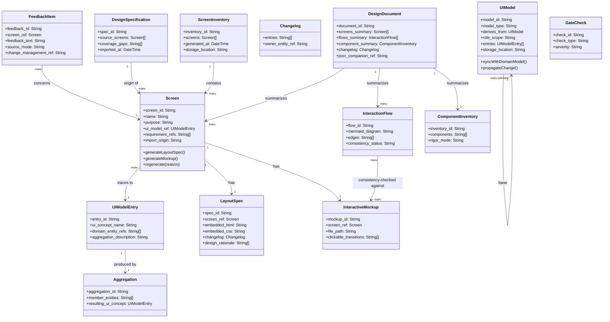

<!-- Identifier: D-02 -->

# UI Prototype Skill Development Process Domain Model

## Relationship to Domain Model

This document defines the domain model for **PRJ-06's own process area** (UI Prototype Skill Development). It is distinct from, and should not be confused with, the generic `DomainModel` entity referenced elsewhere in the EDPS framework (the general concept of "a domain model artifact"). This document's central new concept, **UIModel**, is likewise **not** a subtype or replacement of a project's existing `domain-model.md` — it is a separate, derived model that *consumes* an existing domain model as input and aggregates its entities into UI-facing concepts. See `artifacts/Analysis/domain-alignment.md` (REC-001) for the full rationale.

No direct entity matches were found against the existing `orgModel/01 - Skill Development Process/domain-model.md` during alignment — this process area's domain (UI prototyping) is genuinely new to this organization, not an extension of skill/competency-development concepts. See `domain-alignment.md` for the full comparison.

## Domain Class Diagram

## Actors

### Primary Actors
- **Solo Developer**: Builds requirements/domain models, then generates and iterates on UI prototypes using this process's skills
- **Business/Product Stakeholder**: Reviews the clickable mockup, gives feedback; in solo mode, role-played by the developer
- **Future Developer**: Consumes the design document to implement the actual UI

### Supporting Actors
- **Design-Spec Author**: External, pre-existing origin of any imported design specification
- **EDPS Framework Maintainer**: Ensures new skills integrate with the orchestrator/gates (role played by the same developer)

## Core Entities

### Screen
- **Screen ID**: Unique identifier
- **Name**: Human-readable screen name
- **Purpose**: Why this screen exists, in business terms
- **UI Model Reference**: Link to the UIModelEntry this screen represents — never a direct domain-entity reference
- **Requirement References**: Source requirement IDs justifying this screen
- **Import Origin**: Whether generated or sourced from an imported DesignSpecification

### ScreenInventory
- **Inventory ID**: Unique identifier
- **Screens**: List of Screen references
- **Storage Location**: Standalone artifact at `artifacts/UI Prototype/screen-inventory.md`/`.json` — not embedded in the consolidated DesignDocument

### LayoutSpec
- **Spec ID**: Unique identifier
- **Screen Reference**: The Screen this spec belongs to
- **Embedded HTML/CSS**: Literal markup/styling, implementation-ready, not placeholder text
- **Changelog**: In-document version history (see Changelog entity)
- **Design Rationale**: Captured reasoning behind design decisions

### InteractiveMockup
- **Mockup ID**: Unique identifier
- **Screen Reference**: The Screen this mockup renders
- **File Path**: Standalone HTML/JS, `file://`-openable, zero build step
- **Clickable Transitions**: Actual implemented navigation, checked against InteractionFlow

### InteractionFlow
- **Flow ID**: Unique identifier
- **Mermaid Diagram**: The flow's Mermaid source, following `diagram-generatecollaboration`'s conventions
- **Edges**: Screen-to-screen transitions
- **Consistency Status**: Result of the automated check against the mockup's actual transitions

### UIModel
- **Model ID**: Unique identifier
- **Model Type**: `base` (exactly one per project, role-agnostic) or `derived` (role/context-scoped)
- **Derives From**: For derived models, the base UIModel being filtered/adapted
- **Entries**: UIModelEntry items this model contains
- **Storage Location**: `orgModel/[NN] - [Process Name]/ui-model.md`/`.json`, alongside `domain-model.md`

### UIModelEntry
- **Entry ID**: Unique identifier
- **UI Concept Name**: The UI-facing name for this aggregation (e.g., "Order Summary")
- **Domain Entity References**: Domain entities this entry aggregates

### Aggregation
- **Aggregation ID**: Unique identifier
- **Member Entities**: Domain entities being combined
- **Resulting UI Concept**: The UIModelEntry this aggregation produces

### DesignDocument
- **Document ID**: Unique identifier
- **Screens/Flows/Component Summary**: Summarized references to generated artifacts
- **Changelog**: Same in-document versioning pattern as LayoutSpec
- **JSON Companion Reference**: Pointer to the machine-readable output

### Changelog
- **Entries**: Ordered version history, each with version/date/description
- **Owner Entity Reference**: Which entity (DesignDocument, LayoutSpec, UIModel) this changelog belongs to — modeled as a reusable structural element, not a standalone file

### FeedbackItem
- **Feedback ID**: Unique identifier
- **Screen Reference**: The Screen this feedback concerns
- **Feedback Text**: Structured stakeholder feedback statement
- **Source Mode**: `real` or `role-played` (per `collaboration_mode`)
- **Change Management Reference**: Link to the resulting `change-management` structured change document

### DesignSpecification
- **Spec ID**: Unique identifier
- **Source Screens**: Screens/components parsed from the import
- **Coverage Gaps**: Required screens/flows not covered by this import
- **Imported At**: Timestamp

### ComponentInventory
- **Inventory ID**: Unique identifier
- **Components**: Named component entries
- **Rigor Mode**: `evolving` (no import present) or `strict-conformance` (import present)

## Key Relationships

- Screen **traces to** exactly one UIModelEntry (never a domain entity directly)
- UIModelEntry **is produced by** exactly one Aggregation
- Derived UIModel **derives from** exactly one base UIModel
- Screen **has** one LayoutSpec and one InteractiveMockup
- InteractionFlow **is consistency-checked against** InteractiveMockup (via GateCheck)
- FeedbackItem **concerns** a Screen and **routes to** `change-management` (external skill, referenced not owned)
- DesignSpecification **is the origin of** zero or more Screens
- ScreenInventory **contains** all Screens for the project
- DesignDocument **summarizes** Screens, InteractionFlows, and ComponentInventory (without being their sole storage — see ScreenInventory's standalone-artifact status)
- UIModel **co-evolves with** the project's `domain-model.md`, coordinated through `domain-alignentities`/`model-integration` (external skills, referenced not owned)

## Business Rules

1. **No Direct Domain Reference**: Screens must never reference domain entities directly; all traceability routes through a UIModelEntry
2. **Single Base Model**: Every project has exactly one base UIModel; derived models are filtered/adapted views, never independently authored
3. **Regenerate, Don't Flag**: When a UIModel entry changes, dependent Screens are regenerated (with changelog entries), not merely flagged stale
4. **Conditional Conformance**: ComponentInventory rigor is `evolving` by default, but becomes `strict-conformance` the moment a DesignSpecification is imported
5. **No Target Framework Assumption**: No entity in this model assumes or targets a specific application framework; scope stops at standalone HTML/CSS/JS artifacts
6. **Gate/Mode Reuse**: Stakeholder confirmation and collaboration-mode behavior are not modeled here as new mechanisms — they reference the existing `stakeholder_confirmation` gate check type and `collaboration_mode` setting from Iteration 3/4

---
**See also**: `artifacts/Analysis/domain-concepts.md` (source extraction), `artifacts/Analysis/domain-alignment.md` (alignment rationale against the organizational model)
