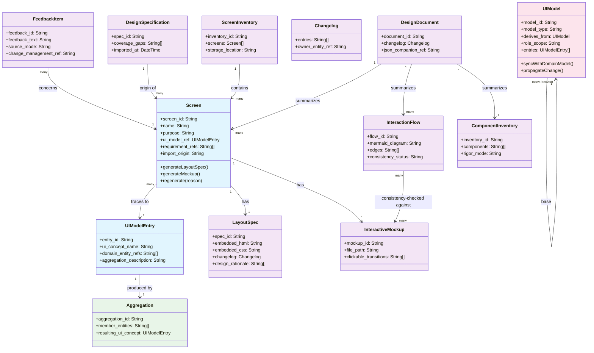
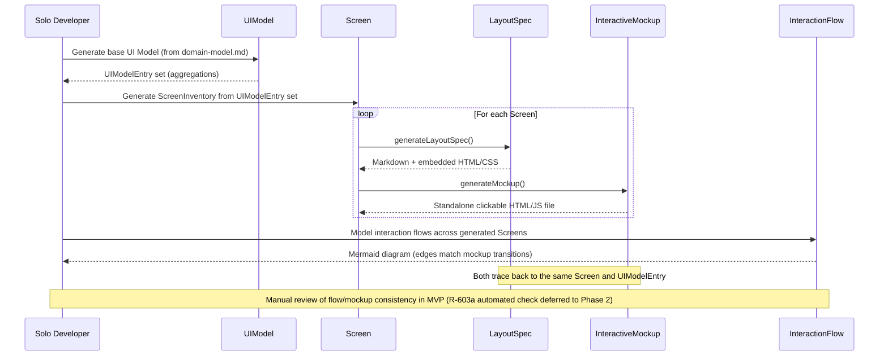
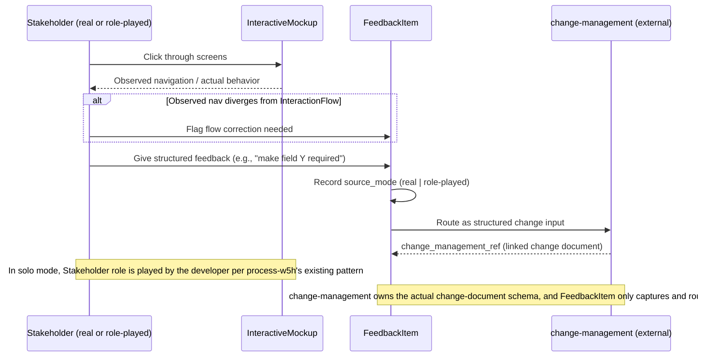
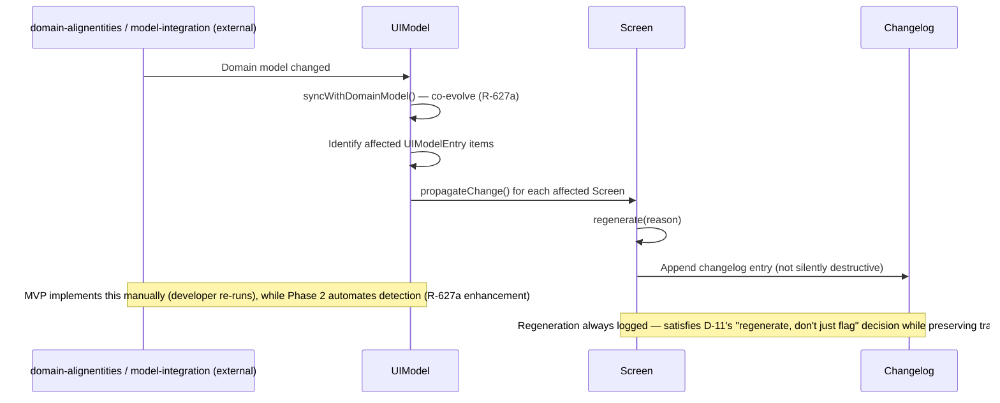
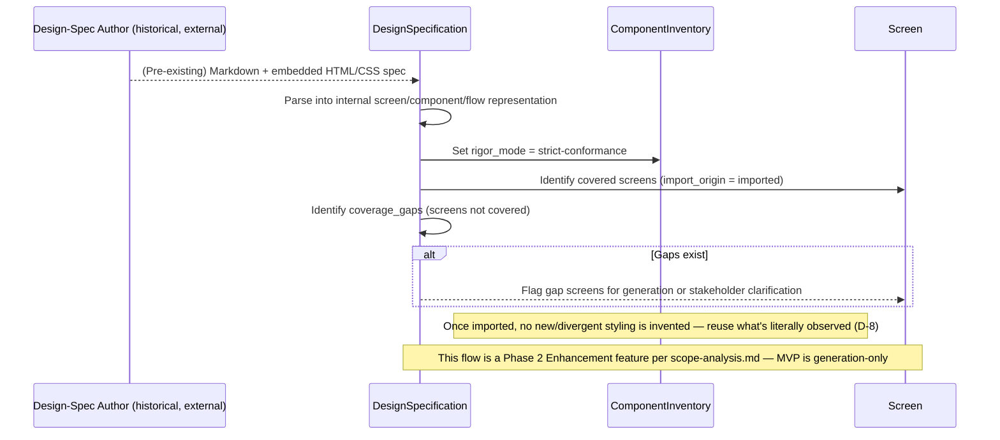
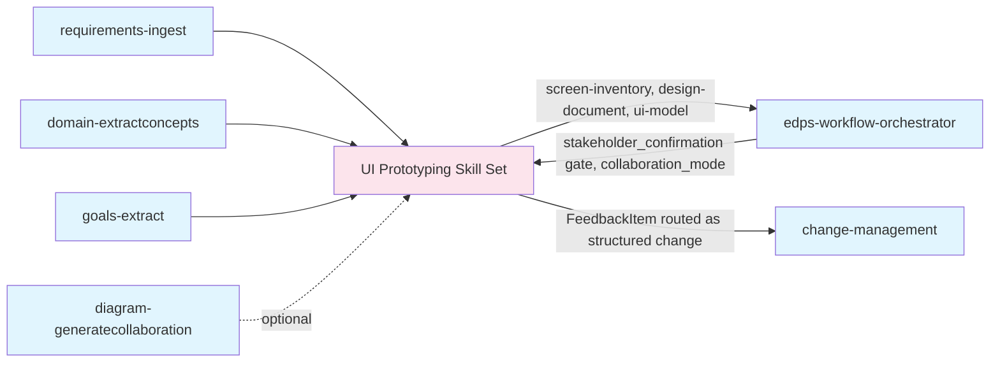

# Collaboration Diagrams

**Project**: PRJ-06 — 06 - Building UI Prototype skills
**Generated**: 2026-10-26
**Source**: domain-concepts.md, requirements.md (v1.3), domain-alignment.md

## Domain Class Model

### Entity Relationship Overview *(Diagram D-601)*
**Source Requirements**: [R-601, R-602, R-602a, R-603, R-606, R-627, R-628]
**Domain Source**: `orgModel/02 - UI Prototype Skill Development Process/domain-model.md`

**Note**: This class diagram is identical in substance to the one already embedded in `orgModel/02 - UI Prototype Skill Development Process/domain-model.md`; it is duplicated here per `diagram-generatecollaboration`'s own convention of keeping a project-level analysis copy alongside the organizational-model copy, so this project's `artifacts/Analysis/` folder is self-contained for review purposes.

## Developer–System Interactions

### MVP Generation Flow *(Diagram D-602)*
**Source Requirements**: [R-601, R-602, R-602a, R-603, R-606, R-627]
**Entities Involved**: Solo Developer, UIModel, Screen, LayoutSpec, InteractiveMockup, InteractionFlow

### Mockup-Driven Discussion Flow *(Diagram D-603)*
**Source Requirements**: [R-611, R-611a, R-612, R-614, R-620]
**Entities Involved**: Business/Product Stakeholder (or role-played), InteractiveMockup, FeedbackItem, change-management (external skill)

### Regeneration-on-Change Flow *(Diagram D-604)*
**Source Requirements**: [R-627a, R-629, R-629a, D-10, D-11]
**Entities Involved**: domain-alignentities / model-integration (external), UIModel, Screen, Changelog

### Import & Conformance Flow *(Diagram D-605, Phase 2 feature)*
**Source Requirements**: [R-615, R-616, R-617, R-618]
**Entities Involved**: Design-Spec Author (external, historical), DesignSpecification, ComponentInventory, Screen

## System-System Interactions

### Pipeline Position *(Diagram D-606)*
**Source Requirements**: [R-619, R-620, R-621, R-622]
**Entities Involved**: requirements-ingest, domain-extractconcepts, goals-extract, diagram-generatecollaboration (this project itself), UI Prototyping skill set, edps-workflow-orchestrator, change-management

**Note**: This diagram makes explicit what `domain-alignment.md`'s REC-003 argued against modeling as a new shared entity — the gate/orchestrator relationship is a *process* integration point, not a domain entity, and is visualized here rather than added to the class diagram.

---
**Traceability**: Diagrams generated from `domain-concepts.md` entities and `requirements.md` v1.3 requirement IDs as annotated per diagram
**Generated**: 2026-10-26
