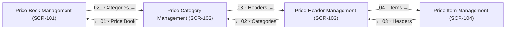
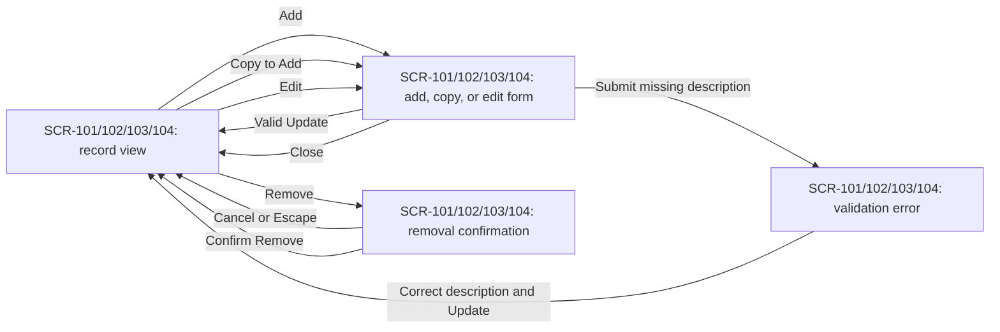

# Interaction Flows

**Project**: PRICE-BOOK-TEST-001
**Generated**: 2026-11-01
**Source**: screen-inventory.json, SCR-101/mockup.html, SCR-102/mockup.html, SCR-103/mockup.html, SCR-104/mockup.html

## Primary Navigation Flow (IF-101)

**Screens Involved**: SCR-101 (Price Book), SCR-102 (Price Category), SCR-103 (Price Header), SCR-104 (Price Item)
**Verified Against**: all four mockup.html files (see Verification Log below)

The four screens form a linear drill-down journey that follows the Price Book → Category → Header → Item dependency.

## Record Management and Confirmation States (IF-102)

The same record-management lifecycle is implemented on SCR-101 through SCR-104. This diagram groups the repeated states while retaining the owning screen IDs on every node.

Create and copy produce a new version 0 sample record. Editing increments the selected version. Close discards unsaved edits. Confirm Remove updates the local sample list.

## Verification Log

| Flow | Edge | Kind | Mockup Source and Behavior | Observed Browser Evidence | Status |
|---|---|---|---|---|---|
| IF-101 | SCR-101 → SCR-102 | Navigation | `SCR-101/mockup.html#category-link`, `href="../SCR-102/mockup.html"` | Clicked the visible “02 · Categories →” link; SCR-102 opened. | Verified |
| IF-101 | SCR-102 → SCR-101 | Navigation | `SCR-102/mockup.html#price-book-link`, `href="../SCR-101/mockup.html"` | Clicked the visible “← 01 · Price Book” link; SCR-101 opened. | Verified |
| IF-101 | SCR-102 → SCR-103 | Navigation | `SCR-102/mockup.html#header-link`, `href="../SCR-103/mockup.html"` | Clicked the visible “03 · Headers →” link; SCR-103 opened. | Verified |
| IF-101 | SCR-103 → SCR-102 | Navigation | `SCR-103/mockup.html#category-link`, `href="../SCR-102/mockup.html"` | Clicked the visible “← 02 · Categories” link; SCR-102 opened. | Verified |
| IF-101 | SCR-103 → SCR-104 | Navigation | `SCR-103/mockup.html#item-link`, `href="../SCR-104/mockup.html"` | Clicked the visible “04 · Items →” link; SCR-104 opened. | Verified |
| IF-101 | SCR-104 → SCR-103 | Navigation | `SCR-104/mockup.html#header-link`, `href="../SCR-103/mockup.html"` | Clicked the visible “← 03 · Headers” link; SCR-103 opened. Browser Back and Forward also traversed the tested journey. | Verified |
| IF-102 | Record view → create form | Local state | All four mockups: `#add-record`, `#copy-record` | Add and Copy to Add opened editable forms with a new ID and version 0. | Verified |
| IF-102 | Record view → edit form | Local state | All four mockups: `#edit-record` | Edit enabled editable fields and kept ID/version references read-only. | Verified |
| IF-102 | Form → validation error | Local state | All four mockups: `#update-record`, description field and validation message | Submitting a blank required description showed the inline error and did not save. | Verified |
| IF-102 | Validation error → record view | Local state | All four mockups: description field, `#update-record` | Correcting the description and submitting completed the local save. | Verified |
| IF-102 | Form → record view | Local state | All four mockups: `#update-record` | Valid creates/copies used version 0; edits incremented the selected version and announced success. | Verified |
| IF-102 | Form → record view | Local state | All four mockups: `#close-record` | Close discarded unsaved changes and restored the selected record. | Verified |
| IF-102 | Record view → removal confirmation | Local state | All four mockups: `#remove-record`, `#remove-dialog` | Remove opened an accessible confirmation dialog for the selected record. | Verified |
| IF-102 | Removal confirmation → record view | Local state | All four mockups: `#cancel-remove`; explicit Escape handler | Cancel and Escape dismissed the dialog without deleting and restored focus to Remove. | Verified |
| IF-102 | Removal confirmation → updated list | Local state | All four mockups: `#confirm-remove` | Confirm Remove deleted the in-memory sample record and refreshed the list. | Verified |

The browser run also exercised filter and tab controls on the individual screens. Responsive rendering was visually reviewed at 375x844 and 1440x900. All pages opened from `file://`, had no page-level horizontal overflow, runtime errors, or unexpected external requests. Sample edits reset on reload.

---
**Traceability**: Navigation edges match the real links and local-state edges match exercised handlers per FR-07.1.
**Generated**: 2026-11-01T14:07:40-06:00
