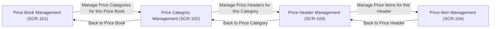

# Interaction Flows

**Project**: PRICE-BOOK-TEST-001
**Generated**: 2026-10-27
**Source**: screen-inventory.json, SCR-101/mockup.html, SCR-102/mockup.html, SCR-103/mockup.html, SCR-104/mockup.html

## Primary Navigation Flow *(IF-101)*
**Screens Involved**: SCR-101 (Price Book), SCR-102 (Price Category), SCR-103 (Price Header), SCR-104 (Price Item)
**Verified Against**: all four mockup.html files *(see Verification Log below)*

This is a straight four-level drill-down chain — directly mirroring the cascading-dependency business rule (R-722: Price Book → Price Category → Price Header → Price Item) that the source requirements described. No branching or cross-cutting paths exist beyond this chain, since nothing in the source document described any other navigation relationship between these four screens.

## Verification Log

| Flow | Edge | Mockup Source | Status |
|---|---|---|---|
| IF-101 | SCR-101 → SCR-102 | SCR-101/mockup.html: `<a href="../SCR-102/mockup.html" ... data-transition-target="SCR-102">Manage Price Categories for this Price Book →</a>` | ✅ Verified |
| IF-101 | SCR-102 → SCR-101 | SCR-102/mockup.html: `<a href="../SCR-101/mockup.html" ... data-transition-target="SCR-101">← Back to Price Book</a>` | ✅ Verified |
| IF-101 | SCR-102 → SCR-103 | SCR-102/mockup.html: `<a href="../SCR-103/mockup.html" ... data-transition-target="SCR-103">Manage Price Headers for this Category →</a>` | ✅ Verified |
| IF-101 | SCR-103 → SCR-102 | SCR-103/mockup.html: `<a href="../SCR-102/mockup.html" ... data-transition-target="SCR-102">← Back to Price Category</a>` | ✅ Verified |
| IF-101 | SCR-103 → SCR-104 | SCR-103/mockup.html: `<a href="../SCR-104/mockup.html" ... data-transition-target="SCR-104">Manage Price Items for this Header →</a>` | ✅ Verified |
| IF-101 | SCR-104 → SCR-103 | SCR-104/mockup.html: `<a href="../SCR-103/mockup.html" ... data-transition-target="SCR-103">← Back to Price Header</a>` | ✅ Verified |

**Manual verification note**: all six edges above were confirmed via direct `grep -o 'href="[^"]*"'` inspection of all four mockup.html files — the total href count (6) exactly matches the diagram's 6 drawn edges, and no mockup contains a navigation link absent from this diagram.

---
**Traceability**: Diagram edges verified against actual mockup navigation per FR-07.1 (manual in MVP; see screen-generateflow's own Quality Checks)
**Generated**: 2026-10-27T00:00:00Z
