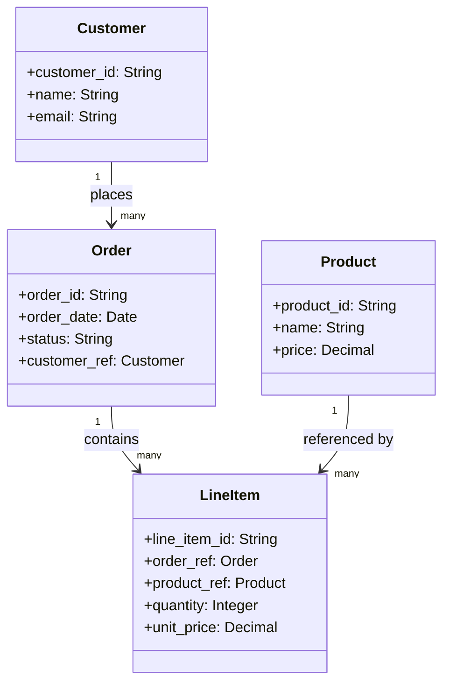

# Toy Domain Model — Order Management (Worked Example Fixture)

**Purpose**: Minimal domain-model fixture used solely to validate the UI Model schema in T03. Not a real project's domain model — do not treat this as authoritative for any actual EDPS project.

## Domain Entities

### Customer
- `customer_id` (identifier)
- `name` (string)
- `email` (string)

### Order
- `order_id` (identifier)
- `order_date` (date)
- `status` (enumeration: pending, shipped, delivered, cancelled)
- `customer_ref` (reference → Customer)

### LineItem
- `line_item_id` (identifier)
- `order_ref` (reference → Order)
- `product_ref` (reference → Product)
- `quantity` (integer)
- `unit_price` (decimal)

### Product
- `product_id` (identifier)
- `name` (string)
- `price` (decimal)

## Domain Class Diagram

