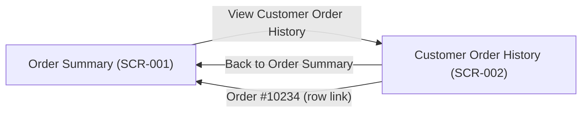

# Interaction Flows

**Project**: UI-PROTO-VALIDATION-001 *(T11 end-to-end validation run)*
**Generated**: 2026-10-27
**Source**: screen-inventory.json, SCR-001/mockup.html, SCR-002/mockup.html

## Primary Navigation Flow *(IF-001)*
**Screens Involved**: SCR-001 (Order Summary), SCR-002 (Customer Order History)
**Verified Against**: SCR-001/mockup.html, SCR-002/mockup.html *(see Verification Log below)*

## Verification Log

| Flow | Edge | Mockup Source | Status |
|---|---|---|---|
| IF-001 | SCR-001 → SCR-002 | SCR-001/mockup.html: `<a href="../SCR-002/mockup.html" class="screen__nav-link" data-transition-target="SCR-002">View Customer Order History</a>` | ✅ Verified |
| IF-001 | SCR-002 → SCR-001 (nav link) | SCR-002/mockup.html: `<a href="../SCR-001/mockup.html" class="screen__nav-link" data-transition-target="SCR-001">Back to Order Summary</a>` | ✅ Verified |
| IF-001 | SCR-002 → SCR-001 (row link) | SCR-002/mockup.html: `<a href="../SCR-001/mockup.html" class="order-link" data-transition-target="SCR-001">Order #10234</a>` (also present for "Order #10198") | ✅ Verified |

**Manual verification note**: all three edges above were confirmed by direct inspection of both mockup.html files' actual `<a href>` attributes (not assumed from the layout specs' intent) — grep-based cross-check performed against both files, confirming every edge in the diagram above has a corresponding real link, and no real link in either mockup is missing from the diagram.

---
**Traceability**: Diagram edges verified against actual mockup navigation per FR-07.1 (manual in MVP; see screen-generateflow's own Quality Checks)
**Generated**: 2026-10-27T00:00:00Z
