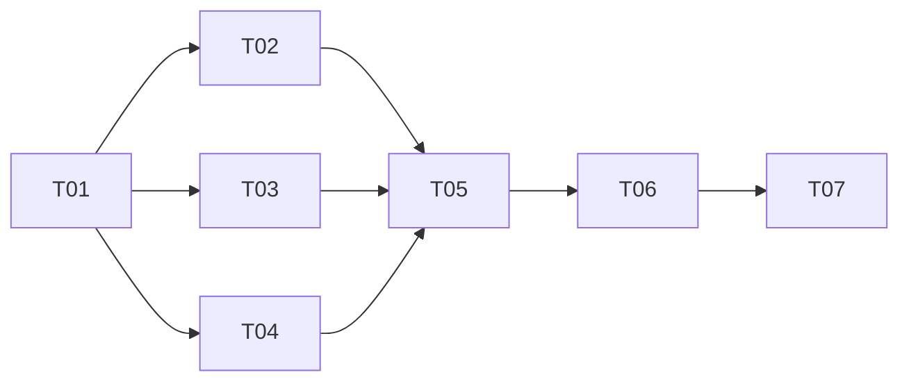

# Task Breakdown

**Project**: PRJ-07  
**Date**: 2026-11-07  
**Status**: Planned - All implementation tasks not started  
**Inputs**: [Requirements](requirements.md), [goals](goals.md), [W5H](w5h-analysis.md), [implementation analysis](implementation-analysis.md)  
**Structured counterpart**: [task-breakdown.json](task-breakdown.json)

| Task | Phase | Deliverable | Prerequisites | Expected person-days |
|------|-------|-------------|---------------|----------------------|
| [T01](../../tasks/T01-define-modeling-contract.md) | Foundation | Shared entity/boundary/round contract | None | 2.00 |
| [T02](../../tasks/T02-build-use-case-skill.md) | Modeling | Use-case skill, model, detailed scripts | T01 | 3.17 |
| [T03](../../tasks/T03-build-ui-model-skill.md) | Modeling | Software-boundary UI-model producer | T01 | 2.00 |
| [T04](../../tasks/T04-build-alignment-validator.md) | Validation | Shared validator, evidence, clarification | T01 | 3.33 |
| [T05](../../tasks/T05-integrate-existing-modeling-skills.md) | Integration | Existing modeling/UI/change handoffs | T02, T03, T04 | 2.17 |
| [T06](../../tasks/T06-integrate-s5-workflow-rounds.md) | Integration | S5 categories, routing, round state/gates | T05 | 3.33 |
| [T07](../../tasks/T07-verify-and-document-release.md) | Verification | Passing evidence, worked example, guide | T06 | 3.17 |

Each linked task defines testable acceptance criteria, validation scenarios, and deliverables. All are release-essential; no optional features are hidden in the critical scope.

## Requirement Coverage

| Requirement | Implementation owners | Release evidence |
|-------------|-----------------------|------------------|
| R-001 | T05, T06 | T07 |
| R-002 | T01, T03, T05, T06 | T07 |
| R-003 | T02 | T07 |
| R-004 | T02 | T07 |
| R-005 | T01, T03, T04, T05 | T07 |
| R-006 | T06 | T07 |
| R-007 | T01, T02, T05 | T07 |
| R-008 | T01, T02, T03, T04, T05 | T07 |
| R-009 | T01, T04, T05, T06 | T07 |
| R-010 | T01, T04, T05, T06 | T07 |
| R-011 | T01, T03, T04, T05, T06 | T07 |

Coverage: 11/11 requirements (100%). This is planned coverage, not a claim of passing implementation.

## Dependency Analysis

Unlimited-resource critical path: T01 -> T04 -> T05 -> T06 -> T07, approximately 14.00 working days. T02/T03/T04 can be implemented independently from shared fixtures; integration waits for all three. With one implementer, total effort sets the baseline: 19.17 working days, plus 3 contingency days (approximately 23 days when rounded up).

## Risks

See [implementation analysis](implementation-analysis.md). Highest risks are source-backed validation, cross-level identity, legacy state compatibility, and accidental alignment bypass. Estimates and [schedule](project-schedule.md) are provisional; staffing/start date are not committed.
