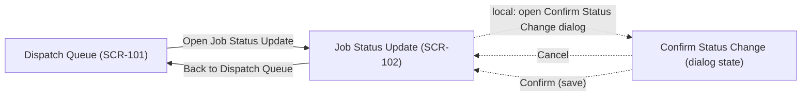

# Interaction Flows

**Project**: PRJ-07 — T07 Worked Example
**Boundary**: BND-CHILD-SW
**Generated**: 2026-11-08
**Source**: screen-inventory.json, SCR-101/mockup.html, SCR-102/mockup.html

## Primary Navigation Flow *(IF-101)*
**Screens Involved**: SCR-101 (Dispatch Queue), SCR-102 (Job Status Update)

## Verification Log

| Edge | Type | Mockup Source | Status |
|---|---|---|---|
| SCR-101 → SCR-102 | page navigation | `<a href="../SCR-102/mockup.html" ...>Open Job Status Update →</a>` | ✅ Verified (static href present) + ✅ Browser-confirmed (see Browser Verification below) |
| SCR-102 → SCR-101 | page navigation | `<a href="../SCR-101/mockup.html" ...>← Back to Dispatch Queue</a>` | ✅ Verified (static href present) + ✅ Browser-confirmed |
| SCR-102 → dialog (open) | local state | `updateBtn.addEventListener('click', ...)` sets `dialog.hidden = false` | ✅ Browser-confirmed |
| dialog → SCR-102 (cancel) | local state | `cancelBtn.addEventListener('click', ...)` sets `dialog.hidden = true`, no change to `currentStatus` | ✅ Browser-confirmed |
| dialog → SCR-102 (save) | local state | `saveBtn.addEventListener('click', ...)` updates `currentStatus.textContent`, closes dialog | ✅ Browser-confirmed |

## Browser Verification

See [browser-verification-report.md](browser-verification-report.md) for screenshots and step-by-step observed behavior — actual browser interaction was performed for this worked example (not merely static source inspection), per T07's explicit instruction to report unavailable checks rather than claim static tests prove runtime behavior.

---
**Traceability**: Diagram edges verified against actual mockup navigation (hrefs) and actual observed browser interaction (dialog open/cancel/save)
**Generated**: 2026-11-08
